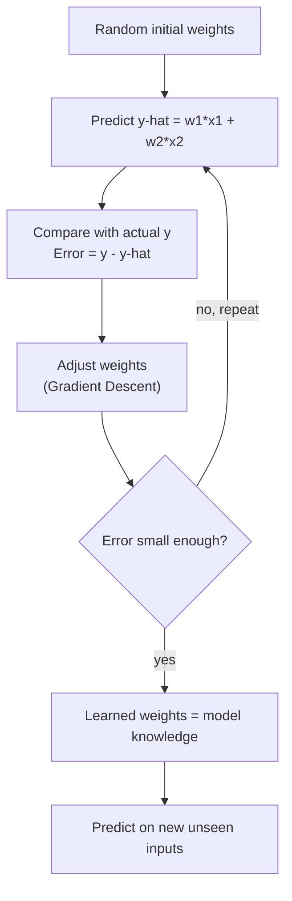
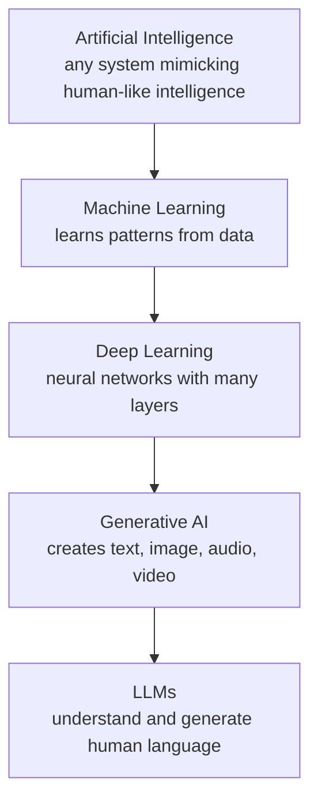

# What is Machine Learning?

> **Step 1: Machine Learning Foundations** · ⏱️ 12 min read · [Read original](https://outcomeschool.com/blog/machine-learning)

## TL;DR
Machine Learning gives computers the ability to learn from data without being explicitly programmed. A generic algorithm is fed data and finds the hidden pattern, which is stored as learned **weights**. Training = start with random weights, predict, measure error, adjust weights (gradient descent), repeat thousands of times. No magic, just math.

## Key Concepts
- **Machine Learning** — field of CS where generic algorithms find patterns in data instead of problem-specific code.
- **Generic algorithm** — same algorithm, different training data, different learned rules (e.g. a classifier that recognizes handwritten digits can also classify spam vs not-spam).
- **Pattern** — the relationship tying inputs to output (e.g. `y = x1 + 2 × x2`).
- **Model** — the assumed form of the relationship; here a **linear model** (straight-line relationship between inputs and output).
- **Weights** (`w1`, `w2`) — constants linking inputs to output; they are the "knowledge" of the model.
- **Actual y** — ground truth from the dataset. **Predicted ŷ** — value computed with current weights.
- **Error** — `y - ŷ`.
- **Training** — the full loop of predict, compare, adjust, repeat.
- **Gradient Descent** — algorithm that moves weights step by step so error decreases (not explained in depth in this post).

## How It Works

### Finding a pattern by hand
Dataset (rows of x1, x2, y): (4,2,8), (1,2,5), (0,5,10), (2,1,4). The hidden pattern:

$$y = w_1 x_1 + w_2 x_2,\quad w_1 = 1,\ w_2 = 2$$

- Built a linear model, then learned the weights by observing the data.
- Predict for new input: x1=3, x2=4 gives y = 3 + 8 = 11.
- By hand this works for 4 rows and 2 inputs; with millions of rows and hundreds/thousands of inputs it is impossible, which is where ML shines.
- Model's whole job: **data → find pattern → learn weights**. "Learning" = keep adjusting weights until predicted y matches actual y as closely as possible.

### The training loop
1. Start with random weights (model knows nothing).
2. Predict: $\hat{y} = w_1 x_1 + w_2 x_2$.
3. Compare with actual: $\text{Error} = y - \hat{y}$.
4. Adjust w1, w2 slightly so the next prediction is better.
5. Repeat thousands of times; each iteration moves closer to the true pattern.

### Worked example (start w1=w2=0)
| Step | w1 | w2 | Errors (rows 1-4) |
|---|---|---|---|
| 1 | 0 | 0 | 8, 5, 10, 4 |
| 2 | 0.225 | 0.400 | 6.30, 3.975, 8.0, 3.15 |
| 3 | 0.402375 | 0.7185 | 4.95, 3.16, 6.41, 2.48 |
| ... | | | |
| 1000 | 1 | 2 | 0, 0, 0, 0 |

Errors shrink and weights converge to the exact values (w1=1, w2=2). Gradient Descent drives these adjustments.

### Code (essence)
```python
w = np.array([0.0, 0.0]); learning_rate = 0.01; steps = 1000
for step in range(steps):
    y_pred = np.dot(X, w)
    error = y - y_pred
    gradient = -(2/n) * np.dot(X.T, error)   # direction to adjust weights
    w = w - learning_rate * gradient          # learning_rate = size of each update
```
After 1000 steps it learns w1≈1, w2≈2 and predicts 11 for (3, 4).

### ML engineer workflow
1. Understand the data.
2. Choose the model: linear if relationship is simple, tree-based if boundaries are complex, deep learning if highly nonlinear or data is large.
3. Train (learn weights).
4. Evaluate.
5. Deploy for predictions on new data.

(Related: Bias-Variance Tradeoff helps pick a model neither too simple nor too complex.)

## Diagram(s)

### Training loop


### Where ML sits in AI


## Key Takeaways
- ML = learning the best weights from data; weights are the model's knowledge.
- Generic algorithms + different data = different learned rules; no custom code per problem.
- Training loop: random weights, predict, error, adjust, repeat.
- Gradient Descent is the mechanism that reduces error step by step.
- Once weights are learned, the model predicts for inputs it has never seen.
- AI ⊃ ML ⊃ Deep Learning ⊃ Generative AI ⊃ LLMs; ML is not the same as AI.
