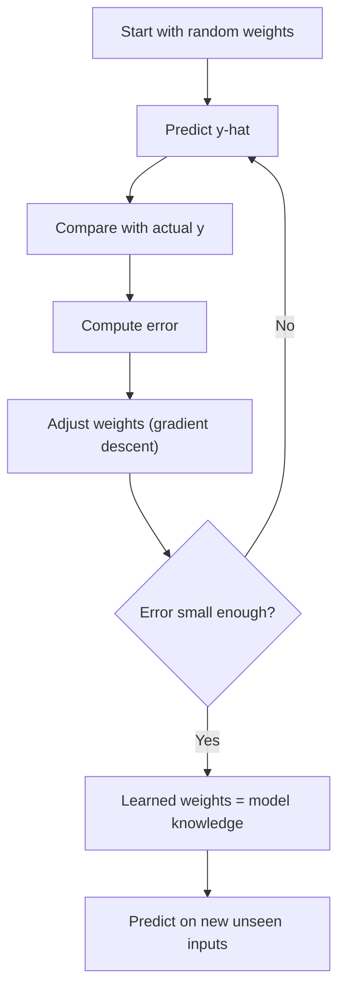

# What is Machine Learning?

> **Step 1: Machine Learning Foundations** · ⏱️ 12 min read · [Read original](https://outcomeschool.com/blog/machine-learning)

## TL;DR
Machine Learning lets computers learn patterns from data instead of being explicitly programmed for each problem. In practice, "learning" means adjusting a model's weights until its predictions match the actual values as closely as possible.

## Key Concepts
- **Generic algorithm** — one algorithm (e.g. classification) works on many problems; only the training data changes (digits vs spam emails).
- **Model** — a function linking inputs to output, e.g. the linear model $y = w_1 x_1 + w_2 x_2$.
- **Weights** — the constants in the model; they are the model's "knowledge".
- **Actual y vs predicted ŷ** — ground truth from the dataset vs what the model computes with current weights.
- **Error** — $y - \hat{y}$, how wrong a prediction is.
- **Training** — the loop of predict, measure error, adjust weights, repeat.
- **Gradient Descent** — the mechanism that moves weights step by step so error shrinks over time.

## How It Works
**Finding the pattern by hand.** Given rows (x1, x2, y) = (4,2,8), (1,2,5), (0,5,10), (2,1,4), we can spot $y = x_1 + 2x_2$, i.e. $w_1 = 1, w_2 = 2$. With these weights we predict for new input: x1=3, x2=4 gives y=11. With millions of rows and thousands of inputs this is impossible by hand, which is where ML helps.

**The learning loop (training):**
1. Start with random (or zero) weights.
2. Predict: $\hat{y} = w_1 x_1 + w_2 x_2$.
3. Compare with actual: error $= y - \hat{y}$.
4. Adjust the weights slightly (via gradient descent).
5. Repeat thousands of times.

In the blog's example, starting at w1=0, w2=0 gives errors 8, 5, 10, 4; after the first update w1=0.225, w2=0.4; by step 1000 the weights reach 1 and 2 and the error is 0. A short NumPy script (learning rate 0.01, 1000 steps) reproduces this.

**ML engineer workflow:** understand the data, choose a model (linear for simple relationships, tree-based for complex boundaries, deep learning for highly nonlinear or large data), train, evaluate, deploy.

**Where ML sits in AI:**

| Term | Meaning |
|---|---|
| AI | Any system mimicking human-like intelligence |
| ML | Subset of AI that learns patterns from data |
| Deep Learning | Subset of ML using many-layer neural networks |
| Generative AI | Deep models that create text, image, audio, video |
| LLMs | Generative AI specialised in human language |

## Diagram

## Key Takeaways
- Machine Learning = learning the best weights from data.
- Learning is just pattern finding; no magic, only math.
- Training = predict, measure error, adjust weights, repeat.
- Gradient Descent is what drives the weight updates.
- AI contains ML, which contains Deep Learning, which underlies Generative AI and LLMs.
