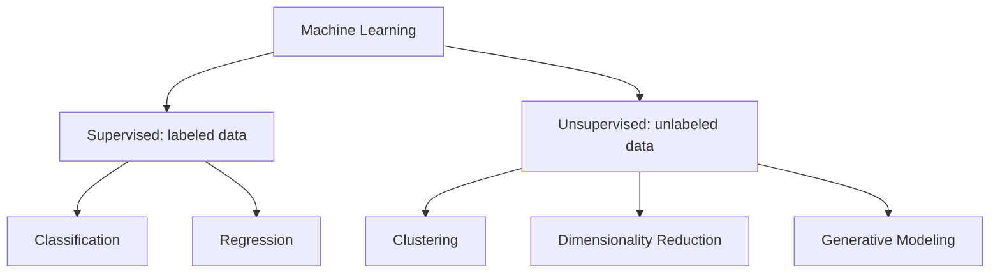

# Supervised vs Unsupervised Learning

> **Step 1: Machine Learning Foundations** · ⏱️ 7 min read · [Read original](https://outcomeschool.com/blog/supervised-vs-unsupervised-learning)

## TL;DR
Supervised learning learns from labeled data (like learning with a teacher), while unsupervised learning finds structure in unlabeled data (like exploring without a map). Supervised helps you predict; unsupervised helps you discover.

## Key Concepts
- **Supervised learning** — model gets inputs plus correct output labels and learns the mapping to predict on unseen data.
- **Unsupervised learning** — only inputs, no labels; the goal is to uncover hidden patterns, structures, or groupings.
- **Classification** — predicting predefined classes (spam detection, image recognition).
- **Regression** — predicting continuous values (house or stock prices, temperature).
- **Clustering** — grouping similar points (K-Means).
- **Dimensionality reduction** — compressing data while keeping important information (PCA).
- **Generative modeling** — learning data structure to generate new samples (Variational Autoencoders).

## How It Works
**Supervised:**
1. Feed data plus correct labels.
2. Model makes predictions.
3. Compare predictions with labels.
4. Adjust weights with an optimization algorithm.
5. Repeat until error is minimized.

Example: house prices. Features are Area, Bedrooms, Location Score; the label is Price. Given new area, bedrooms and location score, the model predicts the price.

**Unsupervised:** feed only raw data; the model analyzes structure and groups, compresses, or relates points without guidance. Example: a fitness app with unlabeled user data (steps, active minutes, workouts, heart rate, sleep, water, engagement). K-Means finds segments such as Active Lifestyle Enthusiasts, Moderate Fitness Users, and Low Activity Busy Users, with no labels given.

### Comparison

| Aspect | Supervised | Unsupervised |
|---|---|---|
| Data | Labeled | Unlabeled |
| Goal | Predict output label | Discover patterns, group, reduce dimensions |
| Types | Classification, Regression | Clustering, Dimensionality Reduction |
| Examples | Spam detection, price prediction | Customer segmentation, anomaly detection |
| Algorithms | Linear/Logistic Regression, Decision Trees, Random Forests | K-Means, Hierarchical Clustering, PCA |
| Use when | You know the target and have labels | You want to explore and labels are unavailable |

## Diagram

## Key Takeaways
- Labels are the dividing line: with answers it is supervised, without it is unsupervised.
- Classification predicts categories; regression predicts continuous numbers.
- K-Means is unsupervised; generative modeling also counts as unsupervised.
- Choose supervised when you know the target and have labels; choose unsupervised to explore structure.
