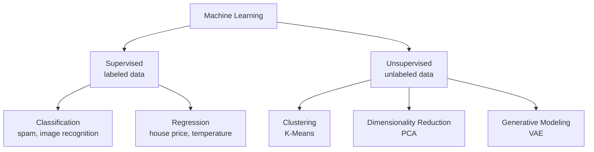
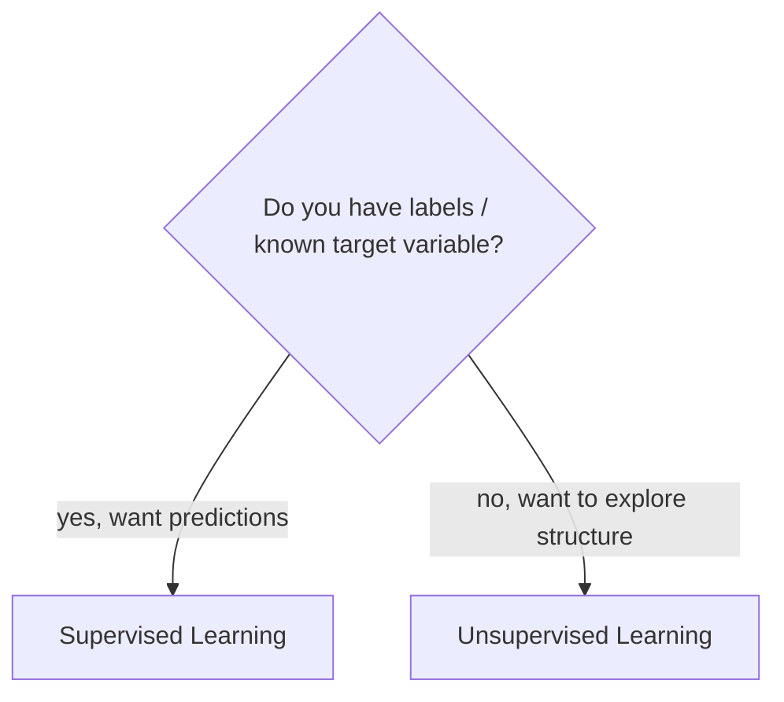

# Supervised vs Unsupervised Learning

> **Step 1: Machine Learning Foundations** · ⏱️ 7 min read · [Read original](https://outcomeschool.com/blog/supervised-vs-unsupervised-learning)

## TL;DR
Supervised learning learns from labeled data (like learning with a teacher / answer key) to predict outputs for new inputs. Unsupervised learning gets only raw inputs (no teacher) and discovers groupings, structure, or compressed representations. Supervised helps you predict; unsupervised helps you discover.

## Key Concepts
- **Label** — the correct answer/output attached to an input.
- **Supervised learning** — input data + correct output labels; learn the input-to-output mapping to predict on unseen data.
- **Unsupervised learning** — only inputs, no labels or predefined outputs; uncover hidden patterns, structures, groupings.
- **Classification** — categorize into predefined classes (spam detection, image recognition).
- **Regression** — predict continuous numerical values (house prices, stock prices, temperature).
- **Clustering** — group similar points (K-Means).
- **Dimensionality reduction** — compress data while keeping important information (PCA).
- **Generative modeling** — learn data structure to generate brand-new samples (Variational Autoencoders).

## How It Works

### Supervised learning
Analogy: solving math problems with the answer key beside you.
1. Feed data + correct labels.
2. Model makes predictions.
3. Compare predictions with labels.
4. Adjust weights using an optimization algorithm.
5. Repeat until error is minimized.

Examples: house prices, spam vs not spam, digit recognition, customer churn.
(Predictions are checked on unseen data via train/validation/test split.)

Example dataset: features Area, Bedrooms, Location Score; label Price (INR Lakhs).
| Area (sq ft) | Bedrooms | Location Score | Price (Lakhs) |
|---|---|---|---|
| 1200 | 2 | 7.5 | 85 |
| 1500 | 3 | 8.0 | 110 |
| 900 | 2 | 6.8 | 70 |
| 1800 | 3 | 8.5 | 130 |
| 1100 | 2 | 7.0 | 78 |

Price is the label; for new (area, bedrooms, location score) the model predicts price.

### Unsupervised learning
Analogy: exploring a new city without a map, noticing busy vs quiet areas nobody labeled.
1. Feed only raw data.
2. Model analyzes the structure.
3. Groups, compresses, or finds relationships without external guidance.

Examples: customer segments, website user behavior patterns, anomaly detection (fraud), dimensionality reduction (PCA).

Example: fitness app with 8 unlabeled users (daily steps, active minutes, weekly workouts, avg heart rate, sleep hours, water intake, engagement score). K-Means finds three natural personas:
| Segment | Users | Traits |
|---|---|---|
| Active Lifestyle Enthusiasts | 1, 4, 6 | 12.5k-15k steps, 75-92 active min, 4-6 workouts, HR 68-74 |
| Moderate Fitness Users | 2, 5, 8 | 8k-10.5k steps, 40-60 min, 2-3 workouts |
| Low Activity Busy Users | 3, 7 | 4.8k-5.6k steps, 18-25 min, 1 workout, HR 82-85 |

No labels existed, yet meaningful clusters emerged.

## Diagram(s)

### Supervised vs unsupervised taxonomy

### Choosing between them

## Comparison
| Supervised | Unsupervised |
|---|---|
| Labeled data | Unlabeled data |
| Predicts output label | Discovers hidden patterns, groups similar data, reduces dimensionality |
| Types: Classification, Regression | Types: Clustering, Dimensionality Reduction |
| Examples: spam detection, price prediction | Examples: customer segmentation, anomaly detection |
| Algorithms: Linear Regression, Logistic Regression, Decision Trees, Random Forests | Algorithms: K-Means, Hierarchical Clustering, PCA |
| Use when target is known, predictions wanted, labels available or can be generated | Use when exploring, labels unavailable, need natural groupings/structure |

## FAQ
- K-Means supervised or unsupervised? → Unsupervised; clustering without labels.
- Classification vs regression? → Both supervised; classes vs continuous values.
- Is generative modeling unsupervised? → Yes, alongside clustering and dimensionality reduction.
- When pick unsupervised? → Exploring data, no labels, need natural structure; otherwise supervised.

## Key Takeaways
- Supervised = inputs + labels; unsupervised = inputs only.
- Supervised splits into classification (categories) and regression (continuous values).
- Unsupervised covers clustering, dimensionality reduction, generative modeling.
- K-Means and PCA are unsupervised; Linear/Logistic Regression, Decision Trees, Random Forests are supervised.
- Supervised predicts; unsupervised discovers.
