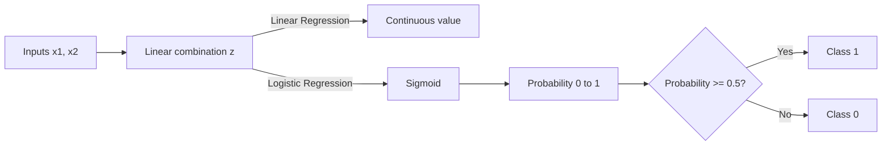

# Linear Regression vs Logistic Regression

> **Step 1: Machine Learning Foundations** · ⏱️ 7 min read · [Read original](https://outcomeschool.com/blog/linear-regression-vs-logistic-regression)

## TL;DR
Linear Regression predicts a continuous value (e.g. house price); Logistic Regression predicts a class by outputting a probability (e.g. spam or not). Both start from a linear combination of inputs, but logistic adds a sigmoid on top.

## Key Concepts
- **Regression** — predicts a continuous, measurable numeric value (temperature, price).
- **Classification** — predicts a categorical value (yes/no, spam/not-spam).
- **Linear Regression** — fits a line (hyperplane in higher dimensions) by minimizing Mean Squared Error.
- **Logistic Regression** — a classifier that predicts the probability an input belongs to a class.
- **Sigmoid** — squashes any real number into the range 0 to 1.
- **Cross-Entropy** — the loss mainly used for classification problems.

## How It Works
**Linear Regression**

$$y = w_1 x_1 + w_2 x_2$$

Output has no limits; it can go below 0 or above 1. Loss: Mean Squared Error.

**Logistic Regression**

$$z = w_1 x_1 + w_2 x_2, \qquad y = \sigma(z) = \frac{1}{1 + e^{-z}}$$

The sigmoid gives a probability in [0, 1]. Threshold: probability >= 0.5 gives Class 1; below 0.5 gives Class 0. Loss: Cross-Entropy.

**Why "Regression" in the name?** The name comes from how the model is built, not its task. It begins with a regression-style linear equation, then applies the logistic function to get probabilities for classification.

### Comparison

| | Linear Regression | Logistic Regression |
|---|---|---|
| Task | Regression (continuous) | Classification (probability to class) |
| Equation | y = w1x1 + w2x2 | z = w1x1 + w2x2, then y = sigmoid(z) |
| Loss | Mean Squared Error | Cross-Entropy |
| Examples | House price, temperature | Spam, disease prediction |
| Use when | Target is continuous | Target is categorical |

## Diagram

## Key Takeaways
- Linear = continuous output, MSE loss; Logistic = probability then class, Cross-Entropy loss.
- Logistic Regression is a classifier despite its name.
- Linear output is unbounded; sigmoid bounds logistic output to [0, 1].
- Default decision threshold is 0.5.
