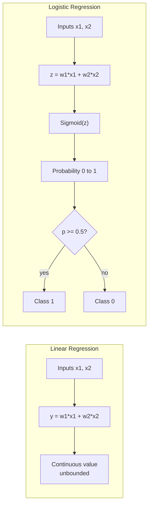

# Linear Regression vs Logistic Regression

> **Step 1: Machine Learning Foundations** · ⏱️ 7 min read · [Read original](https://outcomeschool.com/blog/linear-regression-vs-logistic-regression)

## TL;DR
Linear Regression predicts a continuous value (e.g. house price) with a straight line. Logistic Regression predicts a category: it computes the same linear combination, passes it through a sigmoid to get a probability in [0, 1], then thresholds at 0.5 to pick a class. Despite its name, Logistic Regression is a classifier.

## Key Concepts
- **Regression** — predicts a continuous value (numeric, measurable, any value): temperature, height, weight, house price, stock price.
- **Classification** — predicts a categorical value (discrete groups, usually non-numeric): yes/no, red/blue/green, spam/not-spam, disease or not.
- **Linear Regression** — supervised algorithm; linear relationship between inputs and a continuous output.
- **Logistic Regression** — supervised classification algorithm; outputs probability of belonging to a class.
- **Sigmoid (logistic) function** — S-shaped curve squashing any z into (0, 1).
- **MSE** — Mean Squared Error, loss for Linear Regression.
- **Cross-Entropy** — loss mainly used for classification; trains Logistic Regression.

## How It Works

### Linear Regression
$$y = w_1 x_1 + w_2 x_2$$
x = input features, w = weights, y = predicted continuous value.
- Finds the line (hyperplane in higher dimensions) that best fits the data by minimizing MSE between predicted and actual.
- Output unbounded: can go below 0 or above 1.
- Example: house price from size and location.

### Logistic Regression
1. Linear combination (note: z, not y): $z = w_1 x_1 + w_2 x_2$
2. Sigmoid: $y = \sigma(z) = \dfrac{1}{1 + e^{-z}}$ gives a probability in [0, 1].
3. Threshold: probability >= 0.5 gives Class 1; < 0.5 gives Class 0.
4. Trained with Cross-Entropy loss.

Output is always restricted to [0, 1].

### Why is it called "Regression"?
The name reflects how the model is built, not the task. Internally: regression-like linear equation, then logistic (sigmoid) transformation, producing probabilities for classification. Since the core computation is regression-based, the name stuck.

## Diagram(s)

### Pipelines side by side

## Differences
| Linear Regression | Logistic Regression |
|---|---|
| Regression: continuous value | Classification: probability (0-1) then class |
| y = w1x1 + w2x2 | z = w1x1 + w2x2, y = sigmoid(z) |
| Loss: Mean Squared Error | Loss: Cross-Entropy |
| Examples: house price, temperature | Examples: spam detection, disease prediction |
| Use when target is continuous | Use when target is categorical |

## FAQ
- Regression or classification? → Logistic Regression is classification; the name comes from its linear-equation start.
- Can Linear Regression output <0 or >1? → Yes; Logistic cannot because of sigmoid.
- Which loss? → Linear: MSE; Logistic: Cross-Entropy.
- Probability to class? → Threshold 0.5.
- Classifier quality is measured with Precision and Recall (separate blog).

## Key Takeaways
- Continuous target means Linear Regression; categorical target means Logistic Regression.
- Both start with the same weighted sum; Logistic adds a sigmoid.
- Sigmoid bounds outputs to [0, 1], giving probabilities.
- Default decision threshold is 0.5.
- MSE for linear, Cross-Entropy for logistic.
- "Regression" in Logistic Regression refers to its internals, not its task.
