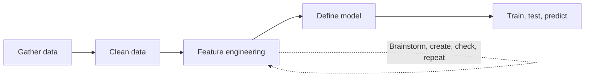

# What is Feature Engineering in Machine Learning?

> **Step 1: Machine Learning Foundations** · ⏱️ 6 min read · [Read original](https://outcomeschool.com/blog/feature-engineering)

## TL;DR
Feature engineering uses domain knowledge to turn raw data into features that help ML algorithms learn better. It often makes the biggest difference between a good model and a bad one.

## Key Concepts
- **Feature engineering** — creating (or removing) features from raw data so they better represent the problem.
- **Derived feature** — e.g. Hour_Of_Day extracted from a date-time.
- **Crossed column** — combining two features (latitude and longitude) into one useful feature.
- **Bucketized column** — grouping a numeric value into ranges (age buckets) encoded as 1, 2, 3.
- **Automated feature engineering** — a hot topic, but resource-hungry.

## How It Works
**Place in the ML workflow:** gather data, clean data, feature engineering, define model, train/test and predict.

**Examples from the blog:**
1. *Flight status.* Raw Date_Time_Combined is less useful; status depends on the hour of day, so create Hour_Of_Day.
2. *House price.* Latitude and longitude alone are of little use; cross them into one feature.
3. *Age classification.* Output depends on age range (11-20 gives X, 21-40 gives Y, 41-70 gives Z), so create a bucketized Age_Range feature with values 1, 2, 3.
4. *Removal.* Dropping an unrelated feature is also feature engineering because irrelevant features degrade performance.

**Process:** brainstorm features, create them, check how they work with the model, repeat until they work well.

## Diagram

## Key Takeaways
- Feature engineering is the step that most separates good models from bad ones.
- It sits after cleaning and before defining the model.
- Creating, combining, bucketing and removing features all count.
- The success of ML algorithms depends heavily on how the data is presented.
