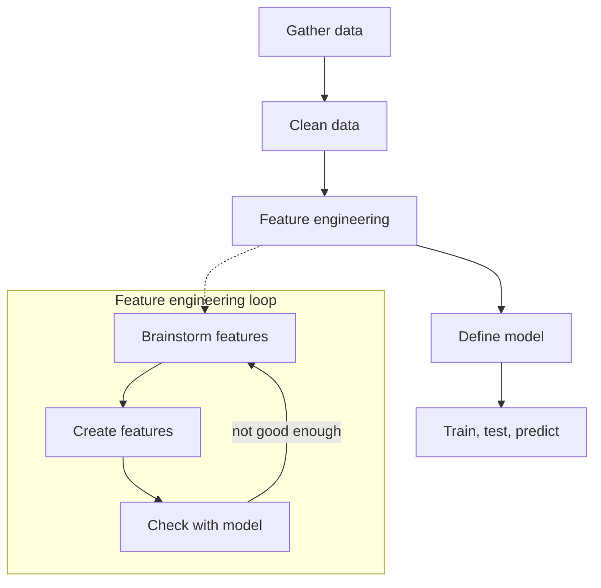
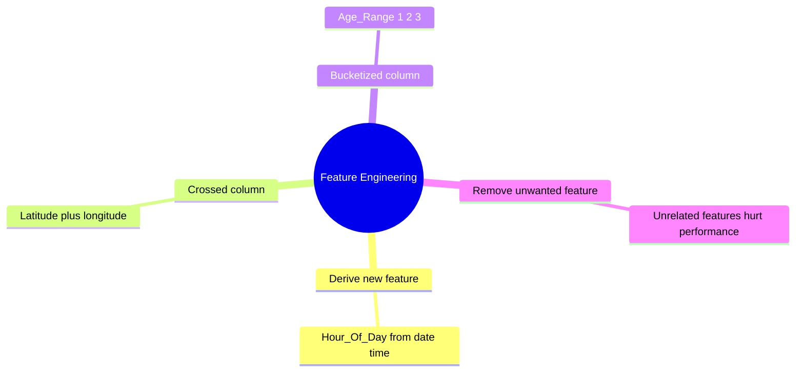

# What is Feature Engineering in Machine Learning?

> **Step 1: Machine Learning Foundations** · ⏱️ 6 min read · [Read original](https://outcomeschool.com/blog/feature-engineering)

## TL;DR
Feature engineering is using domain knowledge to turn raw data into features that make ML algorithms work, increasing predictive power. It sits between data cleaning and model definition and often separates a good model from a bad one. It is iterative: brainstorm, create, test, repeat.

## Key Concepts
- **Feature engineering** — transforming raw data into features that better represent the underlying problem, improving accuracy on unseen data; "turns your inputs into things the algorithm can understand."
- **Crossed column** — combine two features into one useful feature.
- **Bucketized column** — group a numeric range into buckets with numeric codes.
- **Automated Feature Engineering** — hot topic, but resource-hungry; a few companies have started.

## How It Works

### Where it fits in an ML project
1. Gather data
2. Clean data
3. **Feature engineering**
4. Define model
5. Train, test, predict

### Examples
- **Derived feature (flight status):** given Date_Time_Combined (e.g. 2018-02-14 20:40) and Status, status depends on the hour not the full date-time. Create **Hour_Of_Day** (20 Delayed, 10 On Time, 7 On Time, 18 Delayed, 10 On Time). The model learns better as the feature is directly related to the label.
- **Crossed column (house price):** latitude and longitude are useless alone; combine them into one feature so the model learns better.
- **Bucketized column (age):** output X/Y/Z depends on age range: 11-20 gives X, 21-40 gives Y, 41-70 gives Z. Create 3 buckets and a feature **Age_Range** with values 1, 2, 3.
- **Removing features:** dropping an unrelated feature is also feature engineering since irrelevant features degrade performance.
- Related: One-hot Encoding turns categories into numbers without fake order.

### Process
1. Brainstorm features.
2. Create features.
3. Check how they work with the model.
4. Repeat until features work well.

### Expert views
- Vital to ML success though rarely covered in books; much of ML success is engineering features a learner can understand.
- Success of all ML algorithms depends on how you present the data.
- Kagglers use standard algorithms and spend most effort on feature engineering.

## Diagram(s)

### ML pipeline and feature-engineering loop

### Technique types

## Trade-offs & Pitfalls
- Irrelevant features degrade model performance, so drop them.
- Automated feature engineering needs a lot of resources.
- Raw features (e.g. lat/long alone, full timestamp) can be useless to the model.

## FAQ
- Is removing features feature engineering? → Yes.
- Where does it fit? → After gather/clean, before defining model.
- Crossed column? → Combines two features (lat + long) into one.
- Can it be automated? → Yes, but resource-heavy.

## Key Takeaways
- Feature engineering creates the big gap between good and bad models.
- Use domain knowledge to build features directly tied to the target.
- Techniques: derived features, crossed columns, bucketing, removing useless features.
- It is iterative: brainstorm, create, evaluate, repeat.
- How you present data matters more than which algorithm you pick.
