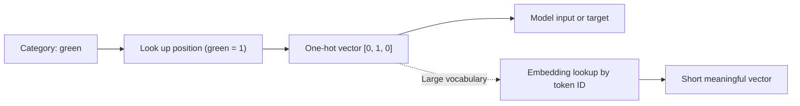

# What is One-hot Encoding in Machine Learning?

> **Step 1: Machine Learning Foundations** · ⏱️ 15 min read · [Read original](https://outcomeschool.com/blog/one-hot-encoding)

## TL;DR
One-hot Encoding turns a category into a vector where exactly one position is 1 and the rest are 0, so models get numbers without a fake order. It is used for inputs and for classification targets; for huge vocabularies like LLM tokens, embeddings replace it.

## Key Concepts
- **Label encoding** — assigning each category an integer (red=1, green=2, blue=3); injects a fake order.
- **One-hot vector** — length equals number of categories; the "hot" position is 1.
- **Target (correct answer)** — can also be one-hot, e.g. cat = [1, 0, 0].
- **Cross-entropy loss** — compares one-hot target with predicted probabilities.
- **Embedding** — a short learned vector (e.g. 768 numbers) representing a token.
- **Embedding matrix / lookup** — one row per token; token ID picks the row directly.
- **Sparse data** — data where most values are 0.

## How It Works
**Why not label encoding?** The model treats 1, 2, 3 as real numbers, so it "believes" blue > red and red + green = blue. Fine only when categories truly have order (small, medium, large).

**Steps:**
1. Find the unique categories.
2. Give each a fixed position.
3. For each row create a vector of zeros and put 1 at the category's position.
4. Replace the single column with the new columns.

Every pair of categories then differs in exactly two positions, so none is "closer" or "bigger". Libraries: `pd.get_dummies`, scikit-learn `OneHotEncoder`.

**Classification target.** With softmax outputs cat 0.7, dog 0.2, horse 0.1 and target [1, 0, 0]:

$$\text{loss} = -\sum_i t_i \log p_i = -\log p_{\text{correct}}$$

So the loss is $-\log 0.7 = 0.36$; if the model gave 0.2 it would be $1.61$. Low probability on the right class means high loss.

**Tokens in LLMs.** Each token in the vocabulary can be a one-hot vector; the next-token target is one-hot over the vocabulary with the same cross-entropy.

**Why embeddings replace it.** With 50,000+ tokens, one-hot vectors are huge and carry no meaning ("cat" is as far from "kitten" as from "car"). Multiplying a one-hot vector by the embedding matrix just selects one row, so LLMs skip the multiplication and do an embedding lookup by token ID.

### Disadvantages of one-hot
| Issue | Why |
|---|---|
| Very wide | One column per category (10,000 cities = 10,000 columns) |
| Sparse | Mostly zeros waste memory and time |
| Hard to learn | Many categories seen only a few times |
| No similarity | Mumbai is no closer to Pune than to London |
| New categories | No column for unseen values |

## Diagram

## Key Takeaways
- Models need numbers; label encoding on unordered categories creates a fake order.
- One-hot gives each category its own column and equal distance from every other.
- With a one-hot target, cross-entropy reduces to $-\log$ of the correct class probability.
- One-hot times embedding matrix equals picking a row, which is the LLM embedding lookup.
- Use one-hot for few unordered categories; use embeddings for very many.
