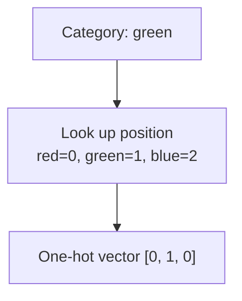
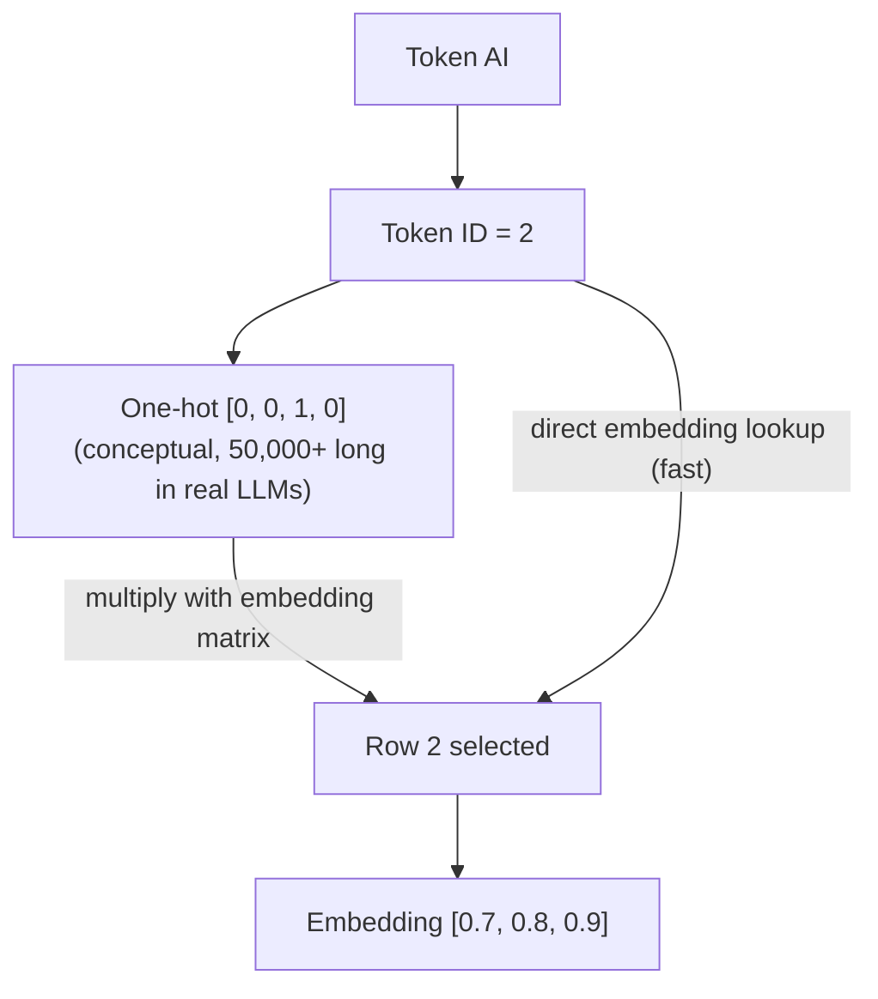
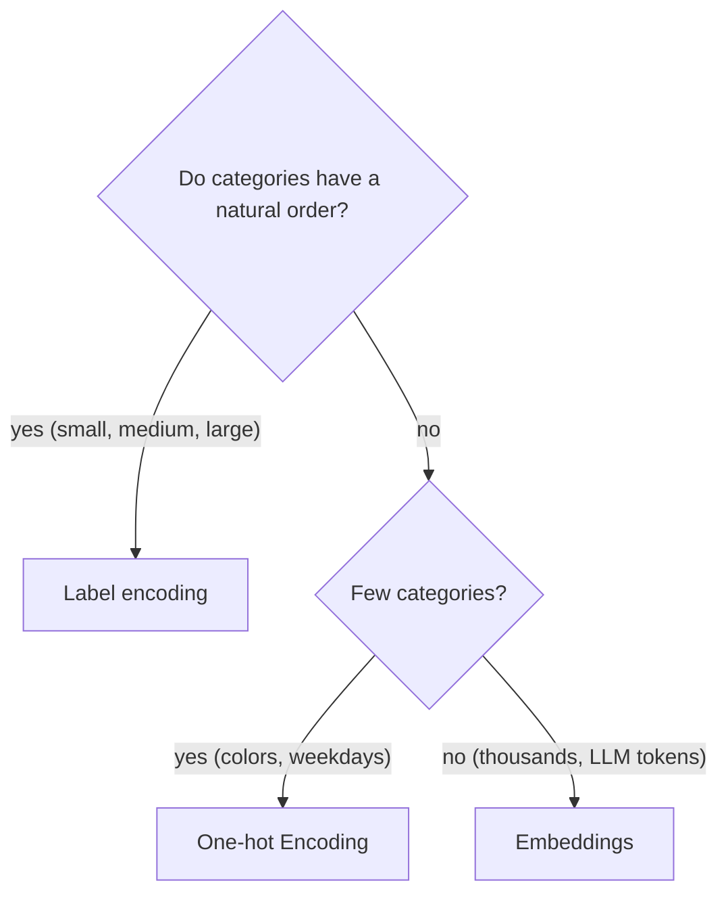

# What is One-hot Encoding in Machine Learning?

> **Step 1: Machine Learning Foundations** · ⏱️ 15 min read · [Read original](https://outcomeschool.com/blog/one-hot-encoding)

## TL;DR
One-hot Encoding turns a category into a vector of 0s with a single 1 whose position identifies the category, avoiding the fake order that label encoding introduces. It is used for inputs and for classification targets (making cross-entropy simple), and conceptually for LLM tokens, where embeddings replace the huge sparse vectors in practice.

## Key Concepts
- **Why numbers** — models only multiply, add, and compare numbers; categories (color, city, animal, next word) must be converted.
- **Label encoding** — assign each category an integer (red=1, green=2, blue=3). Model treats them as real numbers.
- **One-hot vector** — length = number of categories; exactly one "hot" (1) position, all others "cold" (0).
- **Target** — the correct answer; also one-hot encoded in classification.
- **Softmax** — final model function producing class probabilities summing to 1.
- **Cross-entropy loss** — how wrong the model is; lower is better.
- **Token / vocabulary** — token = word or piece of a word; vocabulary = fixed list of all known tokens (often 50,000 to 100,000+).
- **Embedding** — short learned numeric vector (e.g. 768 numbers) for a token; similar meanings give similar embeddings.
- **Embedding matrix** — one row per vocabulary token. **Token ID** — a token's position. **Embedding lookup** — pick the row directly by token ID.
- **Sparse data** — most values are 0.

## How It Works

### Problem with label encoding
red=1, green=2, blue=3 makes the model believe blue > red, green is exactly between red and blue, and red + green = blue. All false: colors have no order. The model learns wrong patterns from this fake order. Label encoding is fine when order is real (small, medium, large).

### One-hot encoding step by step
Cars A green, B red, C blue, D green:
1. Find unique categories (red, green, blue).
2. Fix positions: red=0, green=1, blue=2.
3. For each row create a vector of zeros and set 1 at its category's position.
4. Replace the single Color column with the 3 new columns.

| Car | red | green | blue |
|---|---|---|---|
| A | 0 | 1 | 0 |
| B | 1 | 0 | 0 |
| C | 0 | 0 | 1 |
| D | 0 | 1 | 0 |

Each row has exactly one 1; A and D share a vector. Any two different colors' vectors differ in exactly two positions, so every category is equally different from every other.

### Python
```python
colors = ["red", "green", "blue"]
def one_hot(color):
    vector = [0] * len(colors)
    vector[colors.index(color)] = 1
    return vector
```
Libraries do this in practice: `pd.get_dummies` (pandas), `OneHotEncoder` (scikit-learn).

### One-hot for the correct answer (classification)
Photo of cat/dog/horse; model outputs probabilities (softmax) e.g. cat 0.7, dog 0.2, horse 0.1. Target for a cat photo is [1, 0, 0] (not 1,2,3, which adds fake order). Both vectors have same length so compare position by position:

$$L = -\sum_i t_i \log(p_i)$$

$t_i$ = target at position i, $p_i$ = predicted probability, log = natural log. With one-hot target all terms vanish except the correct class: $L = -\log(p_{\text{correct}})$.
- cat = 0.7: loss = -log(0.7) = 0.36
- cat = 0.2: loss = -log(0.2) = 1.61

Low probability on the correct class gives high loss; training pushes the model to raise it.

### One-hot of tokens in LLMs
Toy vocabulary: I=0, love=1, AI=2, books=3, so "I" = [1,0,0,0], "love" = [0,1,0,0], "AI" = [0,0,1,0], "books" = [0,0,0,1]. Output side: the correct next token is a one-hot target over the whole vocabulary with the same cross-entropy loss.

### Why embeddings replace one-hot vectors
With 50,000 tokens each vector has 49,999 zeros:
- **Too big** — huge waste of memory and computation.
- **No meaning** — "cat" is as different from "kitten" as from "car".

Embedding: short learned vector. Multiplying a one-hot vector by the embedding matrix selects exactly one row (the 1 picks its row, 0s remove others). Example (4 tokens x 3 numbers): one-hot for "AI" [0,0,1,0] times the matrix gives row 2 = [0.7, 0.8, 0.9]. `one_hot @ embedding_matrix` equals `embedding_matrix[2]`, but the direct lookup is much faster (no multiplying thousands of zeros). LLMs never build the giant one-hot; they use the token ID for an embedding lookup. The one-hot idea stays in the background.

## Diagram(s)

### Encoding a category


### One-hot to embedding lookup


### Choosing an encoding


## Trade-offs & Pitfalls
One-hot works well for few unordered categories (colors, days of week, product types) but:
- **Very wide** — one column per category (10,000 cities = 10,000 columns).
- **Sparse** — mostly zeros, wasting memory and time.
- **Hard to learn with many categories** — columns have few 1s, so the model sees each category rarely and needs much more data.
- **No similarity** — cannot show Mumbai is closer to Pune than to London.
- **New categories** — a new value after training (e.g. "yellow") has no column.

## FAQ
- Label vs one-hot? → Label encoding when real order exists; one-hot when no natural order.
- In pandas/sklearn? → `pd.get_dummies`, `OneHotEncoder`.
- Do LLMs build one-hot vectors? → No, embedding lookup by token ID gives the same result faster.
- Why bad for many categories? → Wide, sparse, rare 1s; use embeddings.

## Key Takeaways
- Models need numbers, but naive integer labels create a fake order.
- One-hot: vector length = number of categories, a single 1 at the category's position, all categories equidistant.
- One-hot targets reduce cross-entropy to -log(probability of the correct class).
- Real vocabularies make one-hot too large, sparse, and meaningless, so embeddings replace them.
- One-hot times embedding matrix equals a row lookup; LLMs just look up by token ID.
- Not suitable for huge cardinality or unseen categories.
