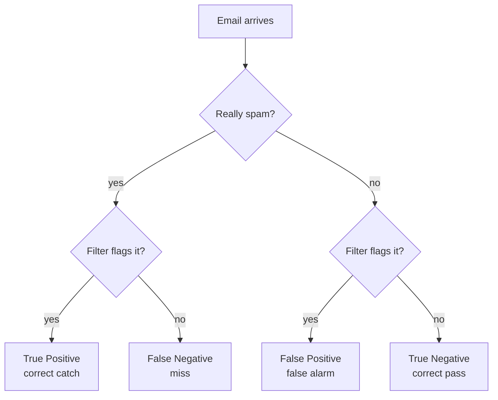
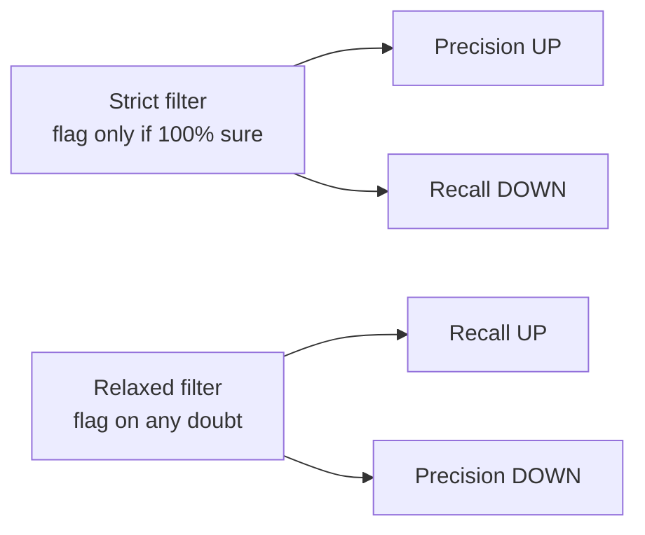
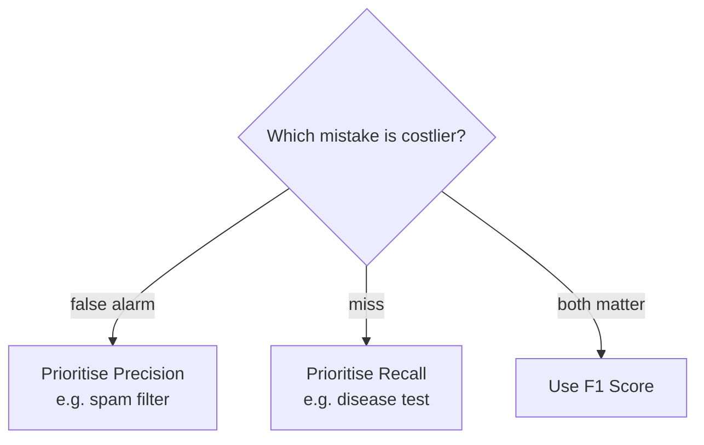

# Precision vs Recall

> **Step 1: Machine Learning Foundations** · ⏱️ 11 min read · [Read original](https://outcomeschool.com/blog/precision-vs-recall)

## TL;DR
Precision = of the items we flagged, how many were correct. Recall = of all the real items, how many did we catch. They usually pull against each other (tug of war), so which to prioritise depends on the cost of a false alarm vs a miss. Both are built from the four outcomes TP, FP, FN, TN, and neither uses TN.

## Key Concepts
- **Setup** — a yes/no classification model (supervised learning), illustrated by a spam filter.
- **True Positive (TP)** — really spam, flagged: correct catch.
- **False Positive (FP)** — not spam, flagged: false alarm (real email in spam folder).
- **False Negative (FN)** — really spam, not flagged: a miss.
- **True Negative (TN)** — not spam, not flagged: correct pass.
- **F1 Score** — single combined score mixing Precision and Recall (for a balance; covered separately).

## How It Works

### Four outcomes (confusion matrix)
| | Really Spam | Really Not Spam |
|---|---|---|
| Flagged as spam | True Positive (correct catch) | False Positive (false alarm) |
| Not flagged | False Negative (missed spam) | True Negative (correct pass) |

TP and TN are correct decisions; FP and FN are mistakes.

### Precision
Question: out of all emails flagged as spam, how many were spam?
$$\text{Precision} = \frac{TP}{TP + FP}$$
Example: flagged 10, 8 truly spam, 2 good: 8/10 = 80%.
- High: when the filter says spam we can trust it; few good emails wrongly flagged.
- Low: too many good emails flagged; important mail can get lost.

### Recall
Question: out of all real spam, how many did we catch?
$$\text{Recall} = \frac{TP}{TP + FN}$$
Example: 20 real spam, caught 8, missed 12: 8/20 = 40%.
- High: catches most spam.
- Low: lots of spam slips into inbox.

Both formulas share TP on top; only the denominator differs (Precision adds FP, Recall adds FN).

### The tug of war
- Very strict filter (flag only when 100% sure): Precision up, Recall down (misses unsure spam).
- Very relaxed filter (flag on small doubt): Recall up, Precision down (flags good emails).
- Usually cannot have both very high, so decide which matters more.

| Point | Precision | Recall |
|---|---|---|
| Main question | Of flagged, how many correct? | Of all real, how many caught? |
| Focus | Correct when raising alarm | Not missing real ones |
| Formula bottom | TP + FP | TP + FN |
| Low value means | Too many false alarms | Too many misses |
| Care about | Avoiding false alarms | Avoiding misses |

### When to use which
- **Precision matters more** when a false alarm is costly: spam filter (boss or bank email lost). A false alarm is worse than a small miss.
- **Recall matters more** when a miss is costly: serious disease test (telling a sick person they are healthy means no treatment). Catch every case even with some false alarms.
- Same metrics evaluate modern AI: a RAG pipeline is scored on Context Precision and Context Recall.
- Need balance: F1 Score.

## Diagram(s)

### Decision outcomes

### Strictness trade-off

### Which metric to prioritise

## FAQ
- Both high at once? → Usually not; tug of war.
- Balance? → F1 Score.
- Do they use True Negatives? → No.
- Why Recall for medical tests? → Missing a sick patient is dangerous.
- Used for RAG? → Yes, Context Precision and Context Recall.

## Key Takeaways
- Every yes/no decision lands in TP, FP, FN, or TN.
- Precision = TP / (TP + FP); Recall = TP / (TP + FN).
- Tightening a threshold trades Recall for Precision and vice versa.
- Costly false alarms: favour Precision. Costly misses: favour Recall.
- Neither metric uses True Negatives.
- F1 combines both when balance is needed.
