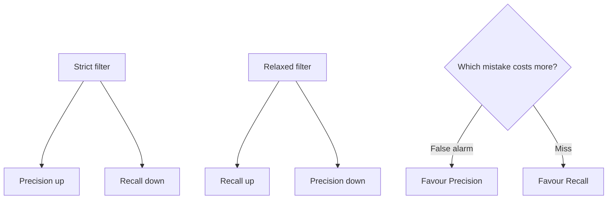

# Precision vs Recall

> **Step 1: Machine Learning Foundations** · ⏱️ 11 min read · [Read original](https://outcomeschool.com/blog/precision-vs-recall)

## TL;DR
Precision measures how many flagged items were actually correct; Recall measures how many of the real items we caught. They pull against each other, and the cost of a mistake decides which matters more.

## Key Concepts
- **True Positive (TP)** — really spam, flagged as spam (correct catch).
- **False Positive (FP)** — not spam, flagged as spam (false alarm).
- **False Negative (FN)** — really spam, missed (a miss).
- **True Negative (TN)** — not spam, passed (correct pass).
- **Precision** — of everything flagged, the fraction that was correct.
- **Recall** — of all real positives, the fraction we caught.
- **F1 Score** — single combined score balancing both.

## How It Works
Running example: a spam filter.

| | Really spam | Really not spam |
|---|---|---|
| Flagged | TP | FP |
| Not flagged | FN | TN |

$$\text{Precision} = \frac{TP}{TP + FP} \qquad \text{Recall} = \frac{TP}{TP + FN}$$

- Precision: filter flagged 10, 8 were spam, so 8/10 = 80%. Low precision means too many good emails land in spam.
- Recall: 20 real spam, caught 8, so 8/20 = 40%. Low recall means lots of spam reaches the inbox.
- Both share TP on top; they differ only in the bottom. Neither uses TN.

**Tug of war.** A very strict filter (flags only when 100% sure) raises Precision, lowers Recall. A very relaxed filter (flags on small doubt) raises Recall, lowers Precision.

| Point | Precision | Recall |
|---|---|---|
| Question | Of flagged, how many correct? | Of all real, how many caught? |
| Focus | Being right when alarming | Not missing real ones |
| Low means | Too many false alarms | Too many misses |

**Which to favour?**
- False alarm costly (spam filter losing a bank email): favour Precision.
- Miss costly (medical test for serious disease): favour Recall.

The same idea scores RAG pipelines via Context Precision and Context Recall.

## Diagram

## Key Takeaways
- Precision = TP / (TP + FP); Recall = TP / (TP + FN).
- You usually cannot maximise both; it is a trade-off.
- Costly false alarms: optimise Precision. Costly misses: optimise Recall.
- F1 Score combines the two when you need balance.
- The same metrics apply to modern systems such as RAG retrieval.
