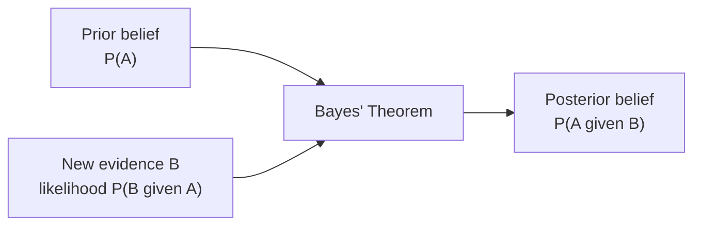
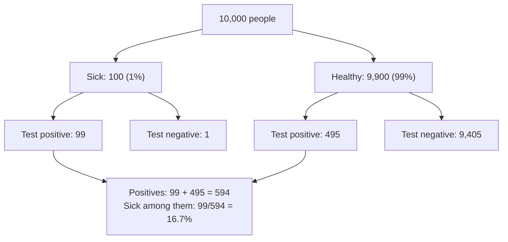

# What is Bayes' Theorem?

> **Step 1: Machine Learning Foundations** · ⏱️ 8 min read · [Read original](https://outcomeschool.com/blog/bayes-theorem)

## TL;DR
Bayes' Theorem is the exact rule for updating a belief when new evidence arrives: prior belief plus evidence gives a posterior belief. It shows that the prior matters a lot, so even a "99% accurate" test on a rare disease gives only about a 16.7% chance of being sick after a positive result. It powers spam filters, medical testing, and Naive Bayes models.

## Key Concepts
- **Prior, P(A)** — belief before seeing evidence.
- **Posterior, P(A | B)** — updated belief after the evidence ("probability of A given B").
- **Likelihood, P(B | A)** — how likely the evidence is when A is true.
- **Evidence, P(B)** — how likely the evidence is overall.
- **A and B** — A is the thing we want to know (person has disease); B is the evidence seen (test positive).
- **False positive** — test says positive for a person who does not have the disease.

## How It Works

### The simple idea
Prior belief + new evidence = updated belief (before, then after). Real-life example: we expect no rain, see dark clouds, and now expect rain. Bayes' Theorem is the exact math for this.

### The formula

$$
P(A \mid B) = \frac{P(B \mid A)\, P(A)}{P(B)}
$$

In words: Posterior = (Likelihood × Prior) / Evidence.

### Worked example (disease test)
- Prior: 1 in 100 people has the disease (1%).
- Test positive for a sick person: 99%.
- Test positive for a healthy person (false alarm): 5%.
- Question: a person tests positive, so what is the chance they are sick? Most say 99%, which is wrong.

Counting with 10,000 people:
1. 1% sick = 100 people; test catches 99 (true positives), misses 1.
2. 9,900 healthy; 5% flagged = 495 (false positives); 9,405 test negative.
3. Total positives = 99 + 495 = 594.
4. Real chance = 99 / 594 = 0.1667, about 16.7%.

Check with the formula:
- P(A) = 0.01, P(B | A) = 0.99.
- P(B) = (0.01 × 0.99) + (0.99 × 0.05) = 0.0099 + 0.0495 = 0.0594.
- P(A | B) = 0.0099 / 0.0594 = 0.1667. It matches the counting.

### Why the answer surprises us
The disease is rare, so there are very few truly sick people. A small error rate on the huge healthy group still creates many false positives, which outnumber the true positives. Lesson: combine evidence with the prior; never look at the evidence alone.

### Where it is used
- **Spam filters** — start with a belief about spam, treat words in the email as evidence, update the belief.
- **Medical testing** — real chance of disease after a test.
- **Machine learning** — Naive Bayes models classify text and reviews.
- **Everyday reasoning** — any guess updated by new information.

## Diagram(s)

### Belief update flow

### Disease test with 10,000 people

## Trade-offs & Pitfalls
- Confusing P(A | B) with P(B | A): likelihood is 99%, but posterior is only about 16.7%.
- Ignoring the prior (base rate): for rare events, even good tests give many false alarms.
- Computing P(B) wrongly: it must add the evidence chance when A is true and when A is not true.

## FAQ
- Difference between P(A | B) and P(B | A)? → They differ. P(A | B) is the posterior (belief after evidence); P(B | A) is the likelihood (evidence when A is true).
- How to calculate P(B)? → Sum the chance of evidence when A is true and when A is false: 0.0099 + 0.0495 = 0.0594.
- Solve without the formula? → Yes, imagine 10,000 people and count (99 of 594 positives); it is a good check.
- Use in ML? → Naive Bayes classifiers for text and reviews; spam filters use the same idea.

## Key Takeaways
- Bayes' Theorem: Posterior = (Likelihood × Prior) / Evidence.
- It converts a prior belief into a posterior using new evidence.
- P(A | B) is not P(B | A).
- A "99% accurate" test on a rare disease gave only about 16.7% chance of disease after a positive.
- Rare event plus small error rate on a large healthy group means false positives outnumber true positives.
- Counting 10,000 people is a simple sanity check for the formula.
- Used in spam filtering, medical testing, and Naive Bayes.
