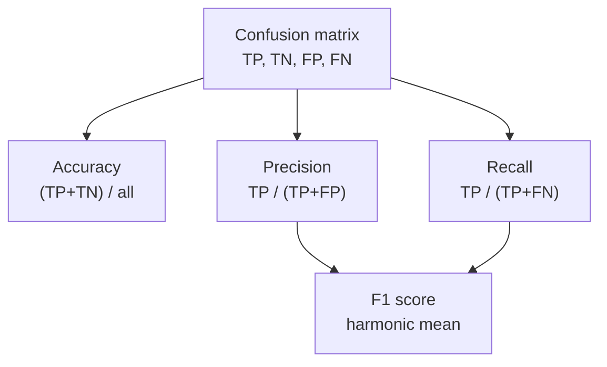

# How does a confusion matrix work?

> **Step 1: Machine Learning Foundations** · ⏱️ 16 min read · [Read original](https://outcomeschool.com/blog/confusion-matrix)

## TL;DR
A confusion matrix is a small table comparing a classifier's predictions with the real answers. It splits predictions into four boxes (TP, TN, FP, FN), showing not just how often the model is wrong but how it is wrong. Accuracy, precision, recall and F1 all come from these four counts, and it extends to many classes.

## Key Concepts
- **Confusion matrix** — table of model predictions vs real answers for a categorical model (spam/not spam, cat/dog, sick/healthy); shows where the model gets confused.
- **Positive class** — the thing we want to detect (e.g. "spam").
- **TP** — said yes, truly yes (correct). **TN** — said no, truly no (correct).
- **FP (Type I error)** — said yes, truly no: a false alarm.
- **FN (Type II error)** — said no, truly yes: a missed catch.
- **Memory trick** — first word = was the model right or wrong; second word = what it predicted. "False Positive" = predicted positive, wrongly.
- **Imbalanced data** — one class far more common than the other; makes accuracy misleading.
- **Harmonic mean** — average that stays low if either input is low.

## How It Works

### Why we need it
- Counting correct predictions gives one number that hides a lot; a model can be mostly correct and still useless.
- The matrix groups every prediction so we see the kind of mistakes.

### The four boxes
| | Real: Yes | Real: No |
|---|---|---|
| **Model: Yes** | TP (correct) | FP (mistake) |
| **Model: No** | FN (mistake) | TN (correct) |

### Spam filter example (100 emails: 40 spam, 60 normal)
| | Real: Spam | Real: Not spam |
|---|---|---|
| **Model: Spam** | TP = 35 | FP = 5 |
| **Model: Not spam** | FN = 5 | TN = 55 |

- Real spam = 35 + 5 = 40; real normal = 5 + 55 = 60; total 100.

### How to read it
- Axes: real answer (truth) and model prediction (guess).
- Main diagonal (top-left to bottom-right) = correct (TP = 35, TN = 55); off-diagonal = mistakes (FP = 5, FN = 5).
- Good model: big diagonal, tiny elsewhere. Works for any number of classes.

### Metrics
- **Accuracy** = (TP + TN) / (TP + TN + FP + FN) = 90 / 100 = 0.90.
  - Can fool us: with 1 spam in 100 emails, a lazy model that always says "not spam" gets 99% accuracy yet catches nothing. Problem arises with imbalanced data.
- **Precision** = TP / (TP + FP) = 35 / 40 = 0.875. Of all "yes" answers, how many were right? Matters when false alarms are costly (important email sent to spam). Reads the row where model said Yes.
- **Recall** = TP / (TP + FN) = 35 / 40 = 0.875. Of all real "yes" cases, how many did we catch? Matters when misses are costly (e.g. disease detection: accept more false alarms for high recall). Reads the column where real answer is Yes.
- Both share TP but pair it with different mistake boxes. (Blog points to a separate Precision vs Recall post.)
- **F1** = 2 · (P · R) / (P + R) = 2 · (0.875 · 0.875) / 1.75 = 0.875.
  - Precision and recall trade off: easy "yes" raises recall but lowers precision; strict model does the reverse.
  - Harmonic mean stays low if either is low; F1 sits closer to the smaller value. Useful for imbalanced data.

### More than two classes
- Grid with one row/column per class. Cat/Dog/Bird example (rows = model said, columns = real):

| | Real Cat | Real Dog | Real Bird |
|---|---|---|---|
| **Said Cat** | 40 | 3 | 2 |
| **Said Dog** | 4 | 35 | 1 |
| **Said Bird** | 2 | 2 | 38 |

- Diagonal (40, 35, 38) = correct; the 3 means model said Cat when it was a Dog.
- Precision/recall can be computed per class, applying the four-box idea to one class at a time.
- Shows exactly which classes get mixed up, so we know where to improve.

### In code (scikit-learn)
```python
from sklearn.metrics import confusion_matrix, ConfusionMatrixDisplay
real = ["spam","spam","not spam","spam","not spam"]
pred = ["spam","not spam","not spam","spam","not spam"]
print(confusion_matrix(real, pred))   # [[2 0] [1 2]]
ConfusionMatrixDisplay.from_predictions(real, pred)  # draws it
```
- In scikit-learn rows = real answers, columns = predictions; classes sorted alphabetically ("not spam" first). Works for 2 or many classes.

### Where it is used
- Spam filters (catch spam vs block real mail), medical tests (don't miss sick patients), bank fraud detection, image recognition (which objects get confused), text classification (positive/negative reviews).
- Helps pick the right measure: precision, recall, or balance.

## Diagram(s)

### Matrix to metrics


## Trade-offs & Pitfalls
- Accuracy misleads on imbalanced data.
- Precision up usually means recall down, and vice versa; choose by cost of false alarms vs misses.
- F1 balances both but hides which side is weak.

## Key Takeaways
- A confusion matrix shows how a classifier is wrong, not just how often.
- Diagonal = correct, off-diagonal = mistakes.
- FP = Type I (false alarm); FN = Type II (missed catch).
- Accuracy can be 99% for a useless model on imbalanced data.
- Precision = trust in "yes"; recall = coverage of real positives.
- F1 is the harmonic mean, low if either precision or recall is low.
- Same idea scales to many classes and reveals which classes are confused.
