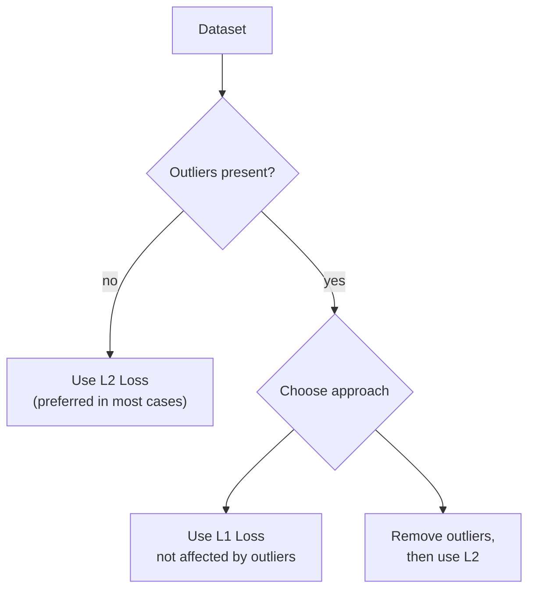

# What are L1 and L2 Loss Functions?

> **Step 1: Machine Learning Foundations** · ⏱️ 3 min read · [Read original](https://outcomeschool.com/blog/l1-and-l2-loss-functions)

## TL;DR
L1 and L2 are loss functions used to minimize error. L1 sums absolute differences between true and predicted values; L2 sums squared differences. L2 is usually preferred, but with outliers L1 is better because squaring makes outlier errors huge.

## Key Concepts
- **L1 Loss** — Least Absolute Deviations (LAD): sum of all absolute differences between true and predicted values.
- **L2 Loss** — Least Square Errors (LS): sum of all squared differences between true and predicted values.
- **Outlier** — data point far from the rest; heavily distorts squared error.

## How It Works

$$
L1 = \sum_i |y_i - \hat{y}_i| \qquad L2 = \sum_i (y_i - \hat{y}_i)^2
$$

$y_i$ = true value, $\hat{y}_i$ = predicted value.

### Choosing between them
- L2 is generally preferred in most cases.
- With outliers, L2 performs badly: squared differences lead to a much larger error.
- Options: use L1 (not affected by outliers) or remove outliers and then use L2.

## Diagram(s)

## Comparison
| | L1 | L2 |
|---|---|---|
| Name | Least Absolute Deviations (LAD) | Least Square Errors (LS) |
| Error term | Absolute difference | Squared difference |
| Outliers | Not affected | Much larger error, performs poorly |
| Default? | When outliers exist | Preferred in most cases |

## Key Takeaways
- L1 = absolute differences (LAD); L2 = squared differences (LS).
- L2 is the default choice.
- Squaring amplifies outliers, hurting L2.
- With outliers: pick L1 or clean outliers and use L2.
