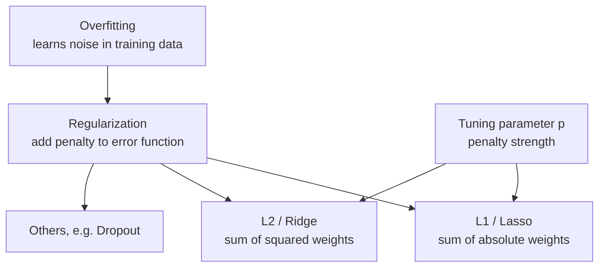

# What is Regularization in Machine Learning? L1 vs L2 Explained

> **Step 1: Machine Learning Foundations** · ⏱️ 3 min read · [Read original](https://outcomeschool.com/blog/regularization-in-machine-learning)

## TL;DR
Regularization reduces overfitting by adding a penalty on the weights to the error function. L1 (Lasso) penalizes the sum of absolute weights; L2 (Ridge) penalizes the sum of squared weights. A tuning parameter controls penalty strength.

## Key Concepts
- **Overfitting** — model learns detail and noise in training data so much that it hurts performance on new data.
- **Regularization** — technique to solve overfitting; encourages evenly distributed weights (a good model does not give excess weight to a particular feature).
- **L1 / Lasso** — penalty = sum of absolute values of weights.
- **L2 / Ridge** — penalty = sum of squared values of weights.
- **Tuning parameter p** — decides how much we penalize the model (same role in L1 and L2).

## How It Works

$$
\text{Loss}_{reg} = \text{Loss} + p \sum_j |w_j| \quad (L1) \qquad \text{Loss}_{reg} = \text{Loss} + p \sum_j w_j^2 \quad (L2)
$$

$w_j$ = weights, $p$ = penalty strength (blog shows these as images; written here in the standard form).

1. Training minimizes the error function.
2. Regularization adds a penalty on weights to it.
3. Large weights become costly, so weights stay evenly distributed and the model generalizes better.

Other regularization techniques exist, e.g. Dropout (randomly switching off neurons in deep neural networks).

## Diagram(s)

## FAQ
- L1 vs L2? → Same idea, different penalty: absolute vs squared weights.
- Role of p? → Controls how strongly the model is penalized.
- Why helps overfitting? → Keeps weights evenly distributed instead of over-weighting a feature.
- Only L1 and L2? → No; Dropout is another.

## Key Takeaways
- Regularization = penalty added to the error function to fight overfitting.
- L1 (Lasso) uses absolute weights; L2 (Ridge) uses squared weights.
- Tuning parameter p sets penalty strength.
- Good models spread weight evenly across features.
- Dropout is a non-L1/L2 regularizer for neural networks.
