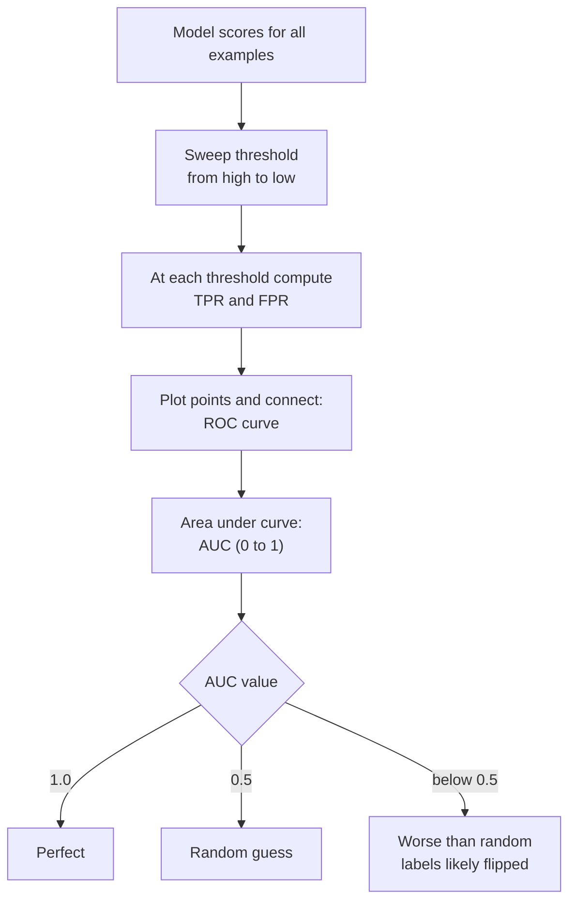

# How does the ROC curve and AUC work?

> **Step 1: Machine Learning Foundations** · ⏱️ 17 min read · [Read original](https://outcomeschool.com/blog/roc-curve-and-auc)

## TL;DR
The ROC curve plots True Positive Rate against False Positive Rate across every possible threshold, showing how well a binary classifier separates two classes. AUC is the area under that curve, a single 0 to 1 score for comparing models without picking a threshold. It fixes accuracy's blind spot on imbalanced data, but has its own limits on very rare classes and mistake costs.

## Key Concepts
- **ROC (Receiver Operating Characteristic)** — name from WWII radar (real plane vs noise); graph of how well a model tells two things apart.
- **AUC (Area Under the Curve)** — area under the ROC curve; ROC is the picture, AUC the score; higher is better.
- **Score** — model's confidence, usually 0 to 1 (near 1 = sure spam, near 0 = sure not spam, 0.5 = unsure).
- **Threshold** — cut-off score above which something is called positive (spam). E.g. 0.5.
- **Positive class** — what we want to catch (spam); negative class = not spam.
- **TP / TN / FP / FN** — caught spam / correctly passed normal / normal wrongly flagged / spam wrongly passed. Together = confusion matrix.
- **TPR (sensitivity, recall)** — caught spam / all real spam.
- **FPR** — normal wrongly flagged / all real normal.

## How It Works

### Why accuracy is not enough
- 100 emails, 10 spam, 90 normal. A lazy model that always says "not spam" gets 90% accuracy while doing nothing useful.
- Accuracy fools us when one group is much larger. We need a better measure of how well the model separates the groups.

### Score, threshold, four outcomes
- Model outputs a score; threshold turns it into a decision (score above threshold = spam). Moving the threshold changes results.

| | Actual spam | Actual not spam |
|---|---|---|
| **Model: spam** | TP (correct) | FP (mistake) |
| **Model: not spam** | FN (mistake) | TN (correct) |

### TPR and FPR
- TPR = spam caught / all real spam (rewards catching spam; 1 = caught all).
- FPR = normal wrongly marked spam / all real normal (punishes false alarms; 0 = no false alarms).
- Example: 10 spam, 90 normal; model catches 8 spam and flags 9 normal: TPR = 8/10 = 0.8, FPR = 9/90 = 0.1. That pair is one point on the graph.
- Goal: high TPR and low FPR.

### How the threshold changes them
| Threshold | TPR | FPR |
|---|---|---|
| Very low (near 0) | High (almost everything called spam) | High |
| Medium | Medium | Medium |
| Very high (near 1) | Low (miss most spam) | Low |

- No single threshold usually gives perfect TPR and FPR together; each threshold yields one (FPR, TPR) pair. ROC tries all thresholds at once.

### Drawing the ROC curve
- X axis = FPR, Y axis = TPR.
1. Pick a threshold (e.g. 0.9).
2. Compute TPR and FPR: one point.
3. Lower threshold (0.8), compute again.
4. Repeat from high to low.
5. Connect the points: the ROC curve.
- Dotted diagonal (bottom-left to top-right) = random guesser, "no skill" baseline.
- Good model bows toward the top-left corner (high TPR, low FPR together); closer to the corner = better.

### AUC
- Whole graph is a 1x1 square, so area is 1 and AUC is between 0 and 1.
- Curve higher toward top-left = more area = bigger AUC; curve near diagonal covers about half = AUC near 0.5.

### Reading AUC
- 1.0 = perfect (almost never in real world). 0.5 = coin flip, matches the diagonal. Below 0.5 = worse than random, usually flipped labels (model learning the opposite).

| AUC | Meaning |
|---|---|
| 0.9 to 1.0 | Great |
| 0.8 to 0.9 | Good |
| 0.7 to 0.8 | Fair |
| 0.6 to 0.7 | Weak |
| 0.5 to 0.6 | Almost useless |
| around 0.5 | Random guessing |

- Only guidelines; depends on the problem (e.g. 0.75 can be very valuable for a hard medical task).

### AUC as a probability
- AUC = probability that the model scores a random positive (spam) higher than a random negative (normal). AUC 0.9 means 9 times out of 10 the pair is ranked correctly; 0.5 = guessing.
- Example pair: spam scores 0.82, normal 0.31, correctly ranked.
- So AUC measures ranking quality and ignores any specific threshold.

### Where used
- Medicine (sick vs healthy tests), banks (fraud), email spam filters, ML teams comparing models without picking a threshold.

## Diagram(s)

### From scores to AUC

## Trade-offs & Pitfalls
- **Rare positives** (e.g. fraud 1 in 10,000): ROC can look strong while the model raises too many false alarms; a Precision-Recall curve is more honest.
- **No threshold advice**: AUC shows ranking quality across all thresholds but you must still pick one cut-off.
- **Equal mistake costs**: AUC ignores that missing cancer is far worse than a false alarm.

## FAQ
- What does ROC stand for? → Receiver Operating Characteristic, from WWII radar.
- Is TPR the same as recall? → Yes (also sensitivity): of all real positives, how many were caught.
- Does AUC pick the threshold? → No; it measures ranking across all thresholds, you weigh costs and choose.
- When use Precision-Recall instead? → When one class is very rare (e.g. 1 in 10,000 fraud).

## Key Takeaways
- Accuracy misleads on imbalanced data; ROC/AUC measure separation instead.
- ROC plots TPR (y) vs FPR (x) across all thresholds.
- Each threshold gives one point; lowering it raises both TPR and FPR.
- Diagonal = random; curve hugging top-left = good.
- AUC 1.0 perfect, 0.5 random, below 0.5 worse than random (flipped labels).
- AUC = probability a random positive outranks a random negative.
- AUC is threshold-free but ignores mistake costs and can flatter models on very rare classes; use Precision-Recall there.
