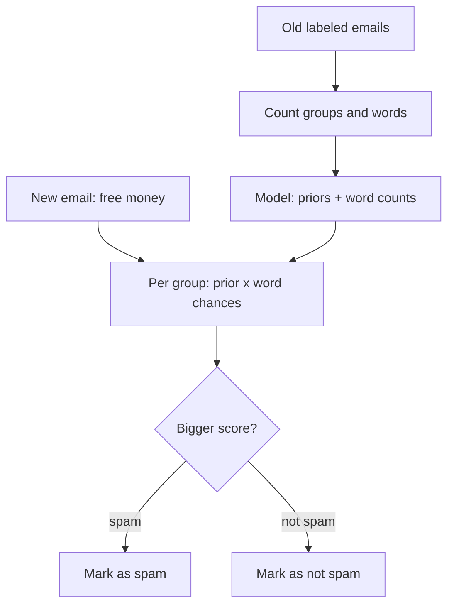
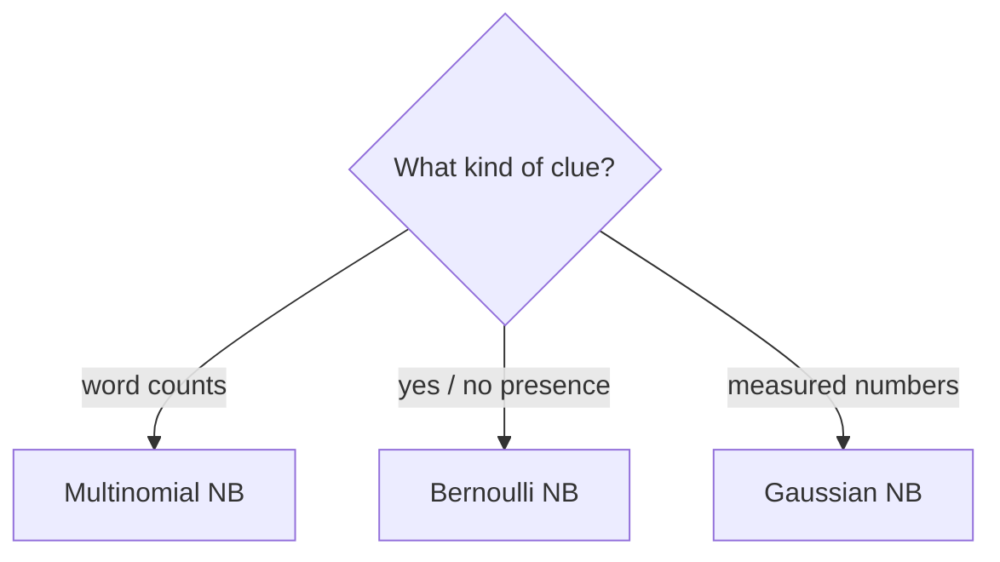

# How does Naive Bayes work?

> **Step 1: Machine Learning Foundations** · ⏱️ 14 min read · [Read original](https://outcomeschool.com/blog/naive-bayes)

## TL;DR
Naive Bayes is a classifier that uses Bayes' theorem while naively assuming every clue (word) is independent. Training is just counting; prediction multiplies the prior with each word's chance per group and picks the bigger score. It is fast, simple and needs little data, but misses relationships between clues.

## Key Concepts
- **Classification** — sorting things into groups (spam or not spam, happy or angry).
- **Bayes' theorem** — rule to update a belief using a new clue: start with prior belief, adjust with evidence.
- **Naive assumption** — each clue acts on its own, independent of the others (not fully true for real words).
- **Prior** — starting belief about each group before reading any words, from counting labeled examples (e.g. 2/4 spam).
- **Training** — counting group sizes and per-group word frequencies; the stored count table is the model.
- **Prediction** — scoring a new item for each group and picking the best.
- **Laplace smoothing** — add a small number (usually 1) to every word count so no probability is exactly 0.

## How It Works

### Bayes' theorem in plain words
Example: hearing a cough slightly raises belief in a cold (not certainty). Same idea, with numbers.

$$
P(\text{spam} \mid \text{clue}) = \frac{P(\text{clue} \mid \text{spam})\, P(\text{spam})}{P(\text{clue})}
$$

- Left: probability of spam given we saw the clue (`|` means "given").
- $P(\text{clue} \mid \text{spam})$: how often the clue appears inside spam. $P(\text{spam})$: how common spam is overall.
- $P(\text{clue})$: overall chance of the clue; only scales the result. It is the same for every group, so just compare the top parts; the biggest wins.

### Why "Naive"
- Words are linked (e.g. "free" and "money" often co-occur in spam); tracking all links is hard and slow.
- Naive Bayes pretends each word is independent, so it multiplies each word's chance one by one.
- Knowingly untrue, but makes the math very simple and fast, and still works well in practice.

### Training (spam filter)
1. Take old emails labeled spam / not spam.
2. Count emails per group, which gives the prior (e.g. 2 of 4 spam: prior 2/4 each).
3. For every word, count its appearances in spam and in normal emails (e.g. "free" in spam 2, in not spam 0; "meeting" in spam 0).
4. Store the counts; this table is the trained model.

### Prediction
For new email "free money", per group:
1. Start with the prior.
2. Look up each word's likelihood in that group.
3. Multiply them (allowed by the naive assumption).
4. Compare both scores; the bigger wins.

- SPAM score = P(spam) × P("free"|spam) × P("money"|spam)
- NOT SPAM score = P(not spam) × P("free"|not spam) × P("money"|not spam)
- Check how often the filter is right with a confusion matrix.

### The zero problem and Laplace smoothing
- An unseen word has count 0, so probability 0; multiplying by 0 kills the whole score even if all other clues say spam.
- Fix: add 1 to every count (0 becomes 1, 5 becomes 6) and adjust the total so probabilities still sum to 1.
- Example: "free" 2→3, "money" 1→2, "lunch" 0→1. An unseen word makes the score small, not dead.

### Three types
| Type | Clue it cares about | Typical use |
|---|---|---|
| Multinomial | counts (how many times a word appears) | most common for text: spam filters, news sorting |
| Bernoulli | presence only (yes/no) | short texts |
| Gaussian | smooth numbers (height, weight, temperature), assumed bell-shaped | numeric features |

scikit-learn provides all three.

### Why it is popular
- Very fast: training is counting, prediction is a few multiplications.
- Needs little data.
- Simple to build and understand; a great first method.
- Handles thousands of clues well, since each is treated alone.

### Where it is used
- Spam filtering (famous early use).
- Sentiment analysis (positive/negative).
- News and document sorting by topic.
- Quick first-pass filters where a fast cheap guess is enough.
- Still a low-cost baseline that newer methods are measured against.

## Diagram(s)

### Training and prediction flow

### Picking a type

## Trade-offs & Pitfalls
- The naive assumption is its biggest weakness: it cannot learn that "free money" together is more spam-like than "free" and "money" apart.
- Final probability values are often imprecise; the ranking is usually good (right group), but confidence may be off.
- Weak where deep meaning and word order matter; Transformers such as BERT do much better.
- Trade: gives up deep understanding for speed, simplicity and low cost.

## FAQ
- Why does it work if the assumption is wrong? → It only needs to pick the right group, not exact probabilities; the ranking is usually good.
- What is the prior? → Starting belief per group, from counting labeled examples (2 of 4 spam: 2/4).
- Which type for text? → Multinomial; Bernoulli for presence on short texts; Gaussian is for numbers.
- Better than BERT-like Transformers? → No; it trades deep understanding for speed and low cost, and serves as a baseline.

## Key Takeaways
- Naive Bayes = Bayes' theorem + independence assumption between clues.
- Training is counting; the count table is the model.
- Prediction: prior × each word's likelihood per group; the bigger score wins.
- The denominator P(clue) is the same for all groups, so it can be ignored when comparing.
- Laplace smoothing (add 1) stops a single unseen word from zeroing the score.
- Multinomial for counts, Bernoulli for presence, Gaussian for continuous numbers.
- Fast, light, data-efficient, but blind to relationships between words.
