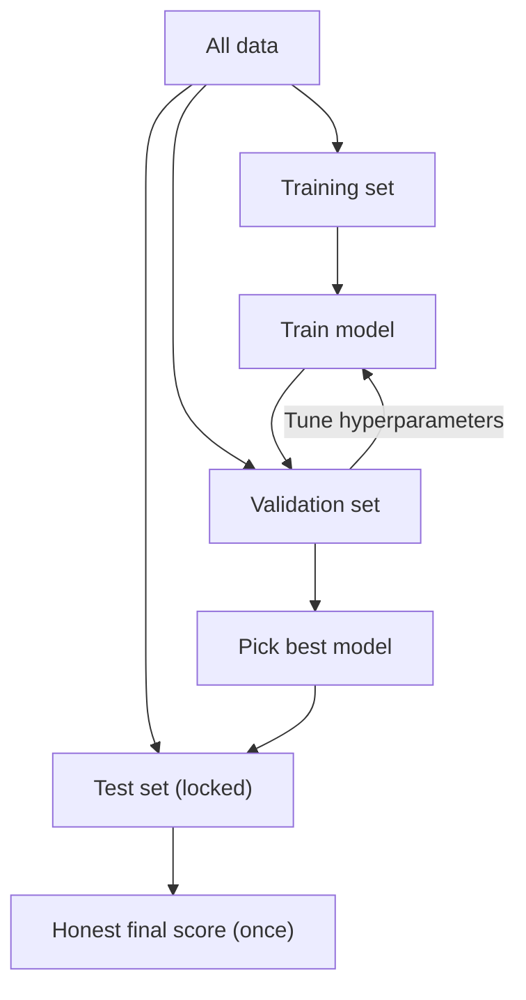

# Why do we split data into train, validation, and test sets?

> **Step 1: Machine Learning Foundations** · ⏱️ 14 min read · [Read original](https://outcomeschool.com/blog/train-validation-test-split)

## TL;DR
We split data so the model learns from one part, gets tuned on a second, and is judged fairly on a third it has never seen. Testing on seen data hides overfitting, and tuning on the test set makes its score optimistic.

## Key Concepts
- **Overfitting** — the model memorises training examples (even accidents) and fails on new ones.
- **Training set** — the "practice book"; the model learns from it; usually the largest part.
- **Validation set** — the "mock exam"; used many times to compare models and tune hyperparameters.
- **Test set** — the "final exam"; locked away, used once at the end for an honest score.
- **Hyperparameters** — settings chosen by us (model size, training length, learning speed), not learned.
- **Data leakage** — information from validation/test sneaking into training so scores look too good.
- **Cross-validation / stratified split** — tools for small data and rare classes.

## How It Works
**Why not test on seen data?** Like a class tested on the exact practice questions: memorising and understanding both score 100.

**Why a validation set?** If we pick the best model size using the test set, we have used it to make a decision, so its score is no longer fair.

**Workflow:**
1. Train on the training set.
2. Score on the validation set.
3. Change a hyperparameter, retrain, rescore.
4. Repeat; pick the best validation score.
5. Check the chosen model on the test set exactly once.

**Split sizes:**

| Amount of data | Train | Val | Test |
|---|---|---|---|
| Few thousand | 70% | 15% | 15% |
| Tens of thousands | 80% | 10% | 10% |
| Millions | 98% | 1% | 1% |

Val and test must be just big enough for a trustworthy score. In scikit-learn, call `train_test_split` twice (first take test, then split the rest); `random_state` makes it repeatable.

**Leakage mistakes:**
1. Duplicates across sets (dedupe before splitting).
2. Preparing data (e.g. averages for scaling) on full data before splitting; split first, compute from train only.
3. Random shuffle on time data; train on the past, test on the later period.
4. Same person (e.g. patient photos) in two sets.
5. Peeking at the test set repeatedly.

**When simple split is not enough:** with little data (say 500 rows), use cross-validation: split non-test data into e.g. 5 parts, train 5 times with a different validation part each time, average the scores. Keep a separate test set anyway. For rare classes (2% spam), use `stratify=y`.

## Diagram

## Key Takeaways
- Train learns, validation tunes, test judges once.
- Never use the test set for decisions; it stops being a fair exam.
- Split first, then compute any scaling statistics from training data only.
- Time-based data must be split by time, not shuffled.
- Small data: cross-validation; imbalanced labels: stratified split.
