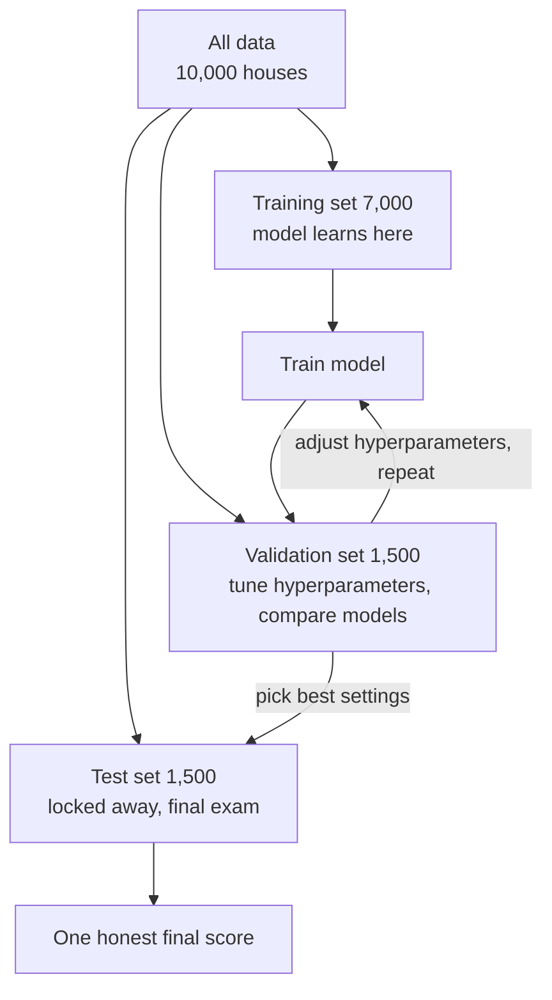
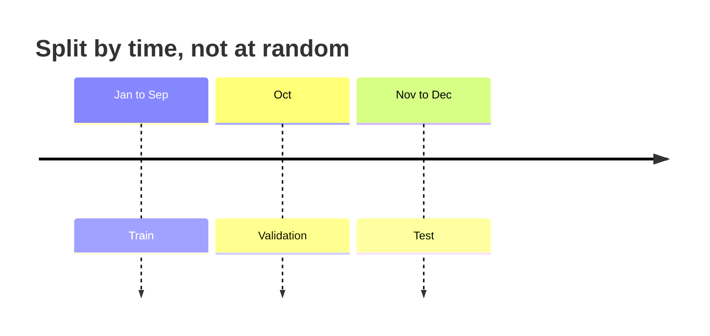

# Why do we split data into train, validation, and test sets?

> **Step 1: Machine Learning Foundations** · ⏱️ 14 min read · [Read original](https://outcomeschool.com/blog/train-validation-test-split)

## TL;DR
We split data so the model learns on one part (train), gets tuned on another (validation), and is judged fairly once on a third part it has never seen (test). Scoring on seen data hides overfitting; using the test set for tuning quietly turns it into a second validation set. Leakage between sets makes scores look better than reality.

## Key Concepts
- **Overfitting** — model learns training examples (even accidents/noise) so closely it fails on new ones; remembering instead of learning.
- **Training set** — data the model learns from (the practice book); usually the biggest part.
- **Test set** — locked away, used only once at the end for an honest score (final exam).
- **Hyperparameters** — settings chosen by us before training (model size, training duration, learning speed), not learned by the model.
- **Validation set** — separate data for comparing models and tuning hyperparameters (mock exam) so the test set stays clean.
- **Data leakage** — information from validation/test sneaks into training, inflating scores (like seeing exam questions).
- **Cross-validation**, **stratified split** — see below.

## How It Works

### The problem: testing on seen data
Analogy: teacher gives 100 practice questions, then the same 100 on the exam; everyone scores 100 and we cannot tell memorizing from understanding. Example: a house sold cheaply because the owner was in a hurry is an accident; an overfitted model memorizes it and mispredicts similar houses later. So the score on seen data tells nothing useful.

### Why two sets are not enough
Picking the best of small/medium/large models by test score means the winner was chosen by looking at the test set, so the test score becomes slightly too good. Hence the validation set.

### Workflow (10,000 houses: 7,000 train / 1,500 val / 1,500 test)
1. Train on the training set.
2. Check on the validation set, note the score.
3. Change a hyperparameter, retrain, re-check on validation.
4. Repeat; pick settings with the best validation score.
5. Check the chosen model on the test set exactly once: the honest real-world estimate.

| Set | Used for | How often we look |
|---|---|---|
| Training | Learning the pattern | All the time |
| Validation | Comparing models, tuning | Many times |
| Test | Honest final score | Once, at the end |

### Code
```python
X_temp, X_test, y_temp, y_test = train_test_split(X, y, test_size=0.15, random_state=42)
X_train, X_val, y_train, y_val = train_test_split(X_temp, y_temp, test_size=0.176, random_state=42)
```
First call takes 15% as test; second takes 17.6% of the remaining 85% (about 15% of whole) giving roughly 70/15/15. `random_state=42` makes the shuffle repeatable.

### How much data per set
| Data amount | Train | Val | Test |
|---|---|---|---|
| A few thousand | 70% | 15% | 15% |
| Tens of thousands | 80% | 10% | 10% |
| Millions | 98% | 1% | 1% |

For 10 million examples, 1% = 100,000, enough for a reliable score. Val and test only need to be big enough to be trustworthy; the rest goes to training (more training data generally gives a better model).

### Data leakage mistakes
1. **Duplicates** — same house in train and test; remove duplicates before splitting.
2. **Preparing data before splitting** — e.g. computing the mean size on full data gives training a hint about test. Split first, compute such values from the training set only.
3. **Ignoring time** — random shuffle lets the model train on the future. Split by time: train Jan-Sep, validation Oct, test Nov-Dec.
4. **Same person in two sets** — multiple photos of a patient across sets lets the model recognise the patient, not the disease. Keep all of one person's data in one set.
5. **Peeking at the test set repeatedly** — it becomes a second validation set. Look once.

### When the simple split is not enough
- **Small data (e.g. 500 examples):** 15% validation = 75 examples, so the score swings with luck. Use **cross-validation**: split non-test data into e.g. 5 parts, train 5 times with a different validation part each time, average the 5 scores. Still keep a separate test set.
- **Rare classes (e.g. 2% spam):** random split may put almost no spam in test. Use a **stratified split** (each set keeps the same mix of answers); `stratify=y` in `train_test_split`.

## Diagram(s)

### Data split and roles


### Time-based split


## Trade-offs & Pitfalls
- Looking at test more than once ruins it.
- Small validation sets give noisy scores; use cross-validation.
- Imbalanced classes need stratification.
- Leakage in any form inflates results.

## FAQ
- Validation vs test? → Validation used many times for tuning (mock exam); test once at the end.
- Check test more than once? → No.
- Shuffle time data? → No, train on past, test on later.
- Stratified split? → Preserves answer mix in every set; for rare classes.

## Key Takeaways
- Never evaluate on data the model trained on; it hides overfitting.
- Train learns, validation tunes, test judges once.
- Typical splits: 70/15/15, 80/10/10, 98/1/1 for huge data.
- Split first, then compute scaling statistics from training only.
- Remove duplicates, group by person, split time data chronologically.
- Use cross-validation for small data and stratify for rare classes.
