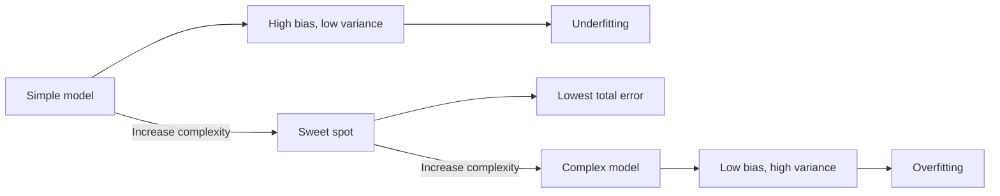

# How does the Bias-Variance Tradeoff work?

> **Step 1: Machine Learning Foundations** · ⏱️ 17 min read · [Read original](https://outcomeschool.com/blog/bias-variance-tradeoff)

## TL;DR
The tradeoff is the balance between a model too simple to learn the real pattern (high bias, underfitting) and one so sensitive it learns noise (high variance, overfitting). The best model sits where total error on new data is lowest.

## Key Concepts
- **Error** — difference between the model's guess and the correct answer; what matters is error on unseen data.
- **Bias** — error from wrong or too-simple assumptions (a straight line fitted to a curve); more data does not fix it.
- **Variance** — error from being too sensitive to the exact training data; retraining on different data gives very different models.
- **Noise** — random effects not part of the true pattern.
- **Irreducible error** — noise-driven error no model can remove; a floor.
- **Complexity** — a model's flexibility.

## How It Works
**Dartboard view** (centre = correct answer): bias = how far the average guess is from the centre; variance = how spread out the guesses are.

| Bias | Variance | Picture |
|---|---|---|
| Low | Low | Tight cluster on centre (ideal) |
| Low | High | Spread, right on average |
| High | Low | Tight but off-centre (consistently wrong) |
| High | High | Spread and off-centre (worst) |

**Why a tradeoff?** Making a model more flexible lowers bias but makes it chase noise (variance up); simplifying lowers variance but loses the real pattern (bias up).

$$\text{Total Error} = \text{Bias}^2 + \text{Variance} + \text{Irreducible Error}$$

This exact form holds for squared error; the idea holds generally.

**Code demo** (sine data plus noise, polynomial degrees 1, 4, 12): degree 1 had train 0.217 / val 0.181 (high bias); degree 4 had 0.019 / 0.036 (balanced); degree 12 had 0.010 / 9.616 (high variance).

**Detect it** by comparing training and validation error:

| Train | Validation | Diagnosis |
|---|---|---|
| High | High, close | High bias (underfit) |
| Low | Much higher | High variance (overfit) |
| Low | Low, close | Good balance |
| High | Much higher | Both high |

**Fix it:**
- High bias: more complex model, more useful features, less regularization, train longer. More data does not help.
- High variance: more data, simpler model or fewer features, more regularization, ensembles (Random Forests), dropout and early stopping.

Note: double descent in very large networks, but the core idea still guides us.

## Diagram

## Key Takeaways
- High bias = underfitting; high variance = overfitting.
- Gap between train and validation error signals variance; high training error signals bias.
- Total error = Bias^2 + Variance + Irreducible Error; the last is a floor.
- A training error of zero is often a red flag for memorisation.
- Most fixes trade one for the other; more data helps variance only.
