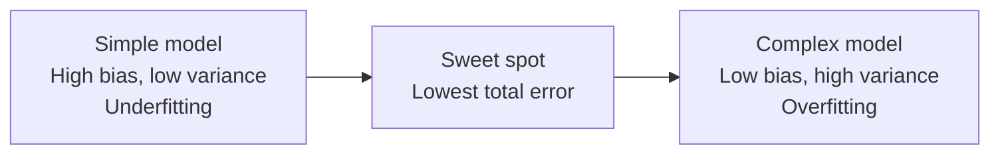
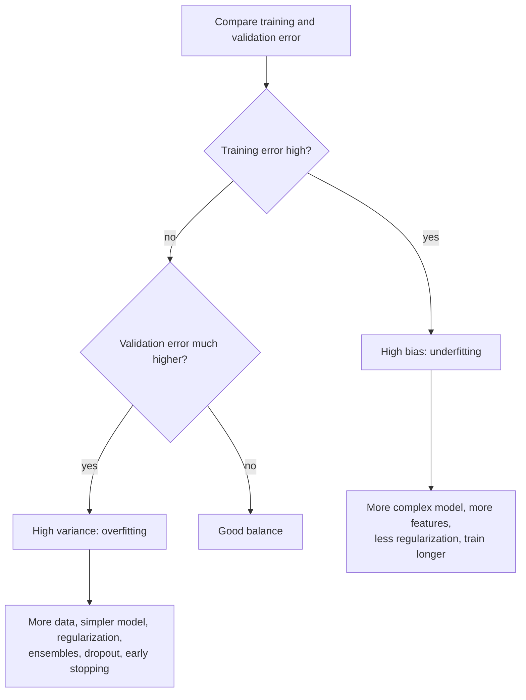

# How does the Bias-Variance Tradeoff work?

> **Step 1: Machine Learning Foundations** · ⏱️ 17 min read · [Read original](https://outcomeschool.com/blog/bias-variance-tradeoff)

## TL;DR
The Bias-Variance Tradeoff is the balance between a model too simple to learn the real pattern (high bias, underfitting) and one so sensitive it learns noise (high variance, overfitting). Reducing one usually increases the other; the goal is the sweet spot of lowest total error on new data. Compare training and validation errors to diagnose which problem you have.

## Key Concepts
- **Error** — difference between the model's guess and the correct answer (real price 50 lakh, guess 45 lakh, error 5 lakh). What matters is error on new/unseen data, not training data.
- **Bias** — error from wrong/too simple assumptions; high bias misses the real pattern regardless of data (a straight line fitting a curve).
- **Variance** — error from being too sensitive to the exact training data; model changes a lot with a different training set.
- **Noise** — random effects not part of the real pattern (owner in a hurry, buyer loves the garden).
- **Underfitting** — too simple; bad on training and new data; comes from high bias.
- **Overfitting** — learns training data incl. noise; great on training, bad on new data; comes from high variance.
- **Complexity** — flexibility of the model (straight line low, very wiggly curve high).
- **Irreducible error** — noise in the data itself; no model can remove it.

## How It Works

### Bias vs variance intuition
- High bias: straight line on curved data is wrong at small, middle, and big houses; 1 million houses won't help.
- High variance: wiggly line passes through every training point (zero training error) but goes up and down between points; a different 100 houses gives a completely different line.

### Dartboard (center = correct answer, darts = guesses from different training sets)
| Case | Picture | Meaning |
|---|---|---|
| Low bias, low variance | Tight cluster at center | Ideal |
| Low bias, high variance | Spread around center | Right on average, each guess shaky |
| High bias, low variance | Tight cluster away from center | Consistently wrong |
| High bias, high variance | Spread and off-center | Worst |

Bias = how far the average guess is from center; variance = how spread out the guesses are.

### Why a tradeoff
Making a model more flexible lowers bias but makes it sensitive to noise (variance up); simplifying lowers variance but reduces ability to learn the pattern (bias up).
| Complexity | Bias | Variance | Total error |
|---|---|---|---|
| Very simple | High | Low | High |
| Just right | Medium | Medium | Lowest (sweet spot) |
| Very complex | Low | High | High |

### Decomposition
$$\text{Total Error} = \text{Bias}^2 + \text{Variance} + \text{Irreducible Error}$$
Bias squared because errors are measured as squared differences (so positive and negative do not cancel). Exact formula holds for squared-error (typical numeric prediction); the idea stays for other problems. Irreducible error is a floor, so we minimise Bias^2 + Variance.

### Code experiment
30 noisy points on a sine wave, 70/30 train/validation, polynomial degrees 1, 4, 12 (`PolynomialFeatures` + `LinearRegression` via `make_pipeline`, MSE metric):
| Degree | Train MSE | Val MSE | Verdict |
|---|---|---|---|
| 1 | 0.217 | 0.181 | High bias (cannot follow wave) |
| 4 | 0.019 | 0.036 | Good balance |
| 12 | 0.010 | 9.616 | High variance (fits noise, explodes between points) |

Exact numbers vary with random data; pattern stays.

### Detecting the problem
Always compare training error and validation error (low training error alone says nothing).
| Train err | Val err | Meaning | Problem |
|---|---|---|---|
| High | High (close to train) | Can't learn training data | High bias (underfit) |
| Low | High (much higher) | Memorized training data | High variance (overfit) |
| Low | Low (close) | Learned real pattern | Good |
| High | Much higher | Too simple and unstable | Both |

Level of training error indicates bias; the gap indicates variance.

### Fixing
**High bias:** more complex model (line to curve, bigger network); add useful features (rooms, location); reduce regularization; train longer. More data does NOT fix it.
**High variance:** more training data; simpler model or fewer features; more regularization; ensembles (average many models, e.g. Random Forests); dropout and early stopping (stop when validation error rises) in neural nets; Data Augmentation.

| Fix | Reduces bias? | Reduces variance? |
|---|---|---|
| More complex model | Yes | No, increases |
| Simpler model | No, increases | Yes |
| More training data | No | Yes |
| More useful features | Yes | No, can increase |
| Stronger regularization | No, increases | Yes |
| Averaging models (Random Forests) | Little | Yes |

Most fixes trade one for the other; more data helps variance without hurting bias.

Caveat: **double descent** - very large networks on huge data may keep improving after they can memorize training data; still watch both errors.

## Diagram(s)

### Error vs model complexity

### Diagnosis and fix

## FAQ
- More data fixes underfitting? → No; fixes variance not bias.
- Both high bias and variance? → Yes: high train error, much higher validation error.
- Zero error on new data? → No, irreducible error is a floor.
- Zero training error bad? → Often memorization (high variance); compare with validation.

## Key Takeaways
- Bias = too-simple assumptions (underfit); variance = oversensitivity to training data (overfit).
- Total error = Bias^2 + Variance + Irreducible error.
- Complexity lowers bias but raises variance; seek the sweet spot.
- Training error level shows bias; train/validation gap shows variance.
- More data helps variance, not bias; regularization and ensembles reduce variance.
- Never judge by training error alone.
