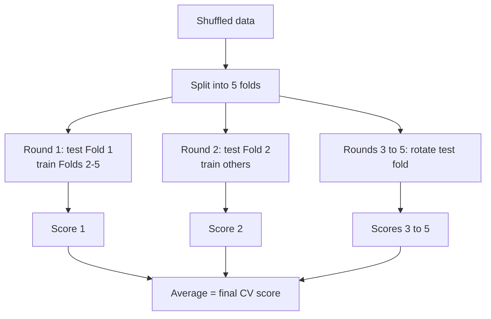
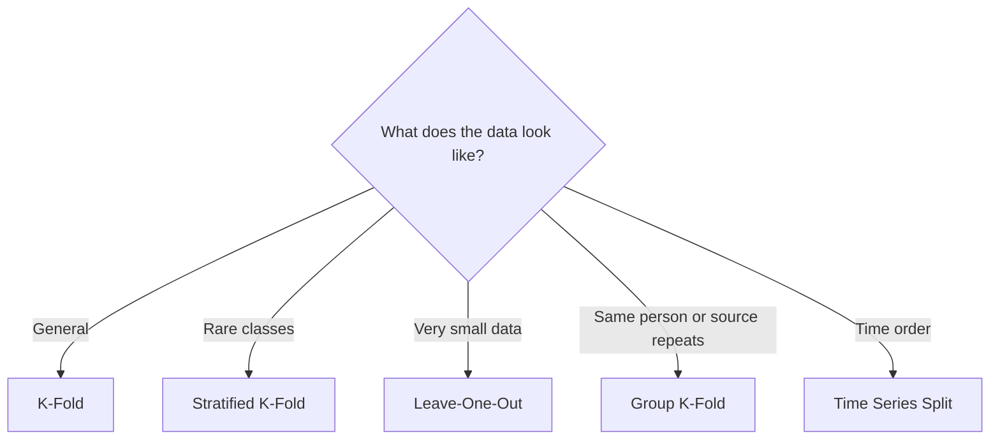

# How does Cross-Validation work?

> **Step 1: Machine Learning Foundations** · ⏱️ 17 min read · [Read original](https://outcomeschool.com/blog/cross-validation)

## TL;DR
Cross-Validation measures how well a model works on unseen data by splitting the data into parts, training and testing several times so every part gets a turn as the test part, and averaging the scores. It is more reliable than one split, uses all the data for both training and testing, and the spread of scores shows how stable the model is.

## Key Concepts
- **Accuracy** — fraction of examples the model answers correctly.
- **Cross-Validation** — train/test many times on different splits of the same data, then average; "cross" means roles rotate (test part in one round is training part in others).
- **Fold** — one part of the data; **K** — number of folds.
- **Hyperparameter** — setting chosen before training (e.g. tree depth).
- **Overfitting** — model memorizes training data and fails on new data.
- **Data leakage** — information from the test fold slips into training.
- **Standard deviation (spread)** — how spread out the fold scores are; smaller means more stable.

## How It Works

### The problem with one single split
- 100 emails, 80 train / 20 test, 18 correct = 90%. But with luck the test set may be easy or hard: reshuffle and get 80%, again 95%. Which is real?
- Score depends on which examples landed in test, worse with small data.
- The 20 test emails are never used for learning, which hurts with only 100.
- Cross-Validation fixes both. Analogy: judge a student by five tests on five chapters and average, not one test on a bad day.

### K-Fold Cross-Validation
1. Shuffle the data so each part gets a fair mix.
2. Split into K equal folds (e.g. K = 5).
3. Run K rounds: one fold is test, the other K - 1 are training; train a fresh model and note the score.
4. Rotate so each fold is the test part exactly once.
5. Average the K scores = final CV score.

- Every example is tested exactly once and trained on K - 1 times: luck averages out, no data wasted.
- Train a brand-new model from scratch each round; carrying a model over means it already saw the test fold and the score is dishonest.

### Worked example (100 emails, K = 5, 20 per fold)
| Round | Test on | Correct / 20 | Accuracy |
|---|---|---|---|
| 1 | Fold 1 | 18 | 90% |
| 2 | Fold 2 | 16 | 80% |
| 3 | Fold 3 | 19 | 95% |
| 4 | Fold 4 | 17 | 85% |
| 5 | Fold 5 | 18 | 90% |

Average = 440 / 5 = 88%. A single split could have reported anything from 80% to 95%.

Spread matters: scores 88, 87, 89, 88, 88 mean a trustworthy model; 60, 95, 70, 99, 100 also average 84.8% but the model is unstable and cannot be trusted on new data.

### In code (scikit-learn)
Breast cancer dataset (569 patients, 30 measurements), Decision Tree with `max_depth=3`:
```python
folds = KFold(n_splits=5, shuffle=True, random_state=0)
scores = cross_val_score(model, X, y, cv=folds)
```
`random_state=0` fixes the shuffle; `cross_val_score` trains a fresh model per round. Output: fold scores `[0.965 0.93 0.912 0.939 0.938]`, average 0.937, std 0.017, so about 93.7% accurate and fairly stable.

### Using CV to pick the best model
Try several depths with the same folds (fair comparison):

| max_depth | Average |
|---|---|
| 1 | 0.884 (too simple) |
| 3 | 0.937 (best) |
| 10 | 0.924 (starts to overfit) |

- Pick depth 3, then train one final model on all the training data with that setting.
- `GridSearchCV` tries many setting combinations with CV automatically.
- The best CV score is slightly optimistic because the winner was chosen by those scores. Keep a separate test set untouched during CV and check the final model on it once at the end.

### Choosing K
| K | Models trained | Training data per round | Speed |
|---|---|---|---|
| 3 | 3 | 67% | Fast |
| 5 | 5 | 80% | Good balance |
| 10 | 10 | 90% | Good balance, slower |
| N (examples) | N | All but one | Very slow |

- Small K: less training data per round, so the score is a bit lower than truth, but fast.
- Large K: closer to truth but many models to train.
- K = 5 or 10 is the usual choice.

### Types of Cross-Validation
| Type | How it splits | When to use |
|---|---|---|
| K-Fold | Random, equal folds | General use, numbers to predict |
| Stratified K-Fold | Each fold keeps the same mix of answers | Categories, especially rare ones |
| Leave-One-Out (LOOCV) | One example tests, all others train | Very small data |
| Group K-Fold | One group stays in one fold | Many examples from same person/source |
| Time Series Split | Train on past, test on future | Time-ordered data |

- **Stratified:** if only 10% of emails are spam, a random fold may get almost none. Stratified keeps ~10% in every fold. Safer default for classification; `cv=5` with a classifier in scikit-learn already uses it.
- **LOOCV:** K = number of examples (50 examples = 50 models). Maximum data use, very slow on large data.
- **Group K-Fold:** e.g. 10 X-rays per patient; if one patient is in train and test, the model recognizes the patient, not the disease, inflating the score.
- **Time Series:** training part grows each round, test part is always later (`TimeSeriesSplit`); never train on the future.

### Common mistakes
1. **Preparing data before splitting** (e.g. scaling with the full-data average) leaks test info. Fix: put scaling and model in a `Pipeline` (`make_pipeline(StandardScaler(), LogisticRegression())`) so preparation is learned only from training folds each round.
2. **Shuffling time-based data** mixes future into training; use Time Series CV.
3. **Same person/source in two folds**; use Group K-Fold.
4. **Reporting the best CV score as the final score** after tuning; keep a separate test set.

## Diagram(s)

### 5-Fold rotation


### Which type to use


## Trade-offs & Pitfalls
- Works well: small or medium data, fair model/setting comparison, and measuring stability (not just average).
- Poor fit: very slow models (deep learning trained 5-10 times can take days or weeks; use one fixed validation split) and huge data (one split is already large, luck matters little).
- Leakage via preprocessing, time shuffling, shared groups, or reusing the tuned CV score as the final score.

## FAQ
- CV vs single split? → Single split trains and tests once, so luck dominates; CV rotates the test part and averages, using every example for both.
- Still need a test set? → Yes; the best CV score is optimistic, so test once at the end.
- Why a new model each round? → So it has never seen that round's test fold.
- Large spread? → Model is unstable even if the average looks fine; do not trust it.

## Key Takeaways
- One split's score depends on luck; CV averages it out and uses all the data.
- K-Fold: shuffle, split into K, rotate the test fold, average K scores.
- Train a fresh model every round.
- K = 5 or 10 balances reliability and cost.
- Use Stratified for rare classes, Group for repeated people, Time Series for ordered data.
- Fit preprocessing inside a Pipeline to avoid leakage.
- Keep a separate test set and use it once after tuning.
- Skip CV for very slow models or huge data.
