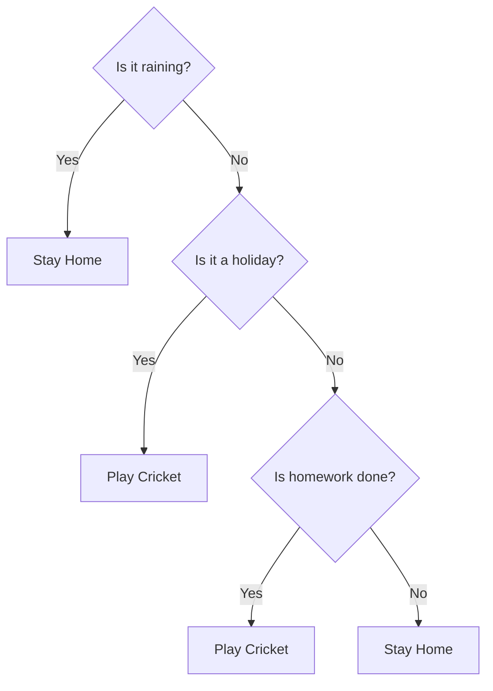
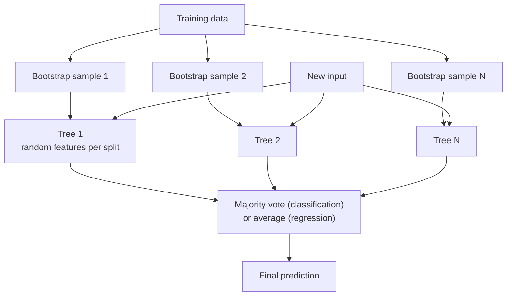

# How do Decision Trees and Random Forests work?

> **Step 1: Machine Learning Foundations** · ⏱️ 18 min read · [Read original](https://outcomeschool.com/blog/decision-trees-and-random-forests)

## TL;DR
A Decision Tree predicts by asking a chain of yes/no questions, choosing at each node the question that makes the resulting groups purest (lowest weighted Gini). A single deep tree overfits and is unstable (high variance). A Random Forest builds many trees on bootstrap samples with random feature subsets and combines them by majority vote (classification) or average (regression).

## Key Concepts
- **Decision Tree** — model that predicts by walking yes/no questions from the top to an answer; human-readable (like 20 questions).
- **Root node** — first question. **Internal (decision) node** — a question in the middle. **Branch** — arrow per answer. **Leaf node** — end of path holding the final answer. **Depth** — questions from root to deepest leaf (example tree: 3).
- **Classification tree** vs **regression tree** — leaf is a category vs a number (usually average of training examples in that leaf).
- **Pure group** — all examples have the same answer.
- **Gini Impurity** — mixedness measure; 0 = pure. (Entropy is an alternative with the same idea.)
- **Recursive splitting** — repeating the best-question search inside each group.
- **Random Forest** — many randomised trees combined by voting/averaging.
- **Bootstrap sampling** — pick N items with replacement for each tree. **Bagging** = Bootstrap Aggregating. **Feature randomness** — each split sees only a random subset of features.
- **Wisdom of the crowd** — independent errors cancel when averaged (sweets in a jar); fails if everyone copies the same person.

## How It Works

### Predicting
Walk root to leaf. Example (cricket): not raining, not holiday, homework done: raining? No, holiday? No, homework? Yes, leaf Play Cricket.

### Learning the best question: Gini

$$
\text{Gini} = 1 - p_{yes}^2 - p_{no}^2
$$

$p$ = share of each answer in the group. 4 Yes/0 No gives 0 (pure); 2/2 gives 0.5 (max for two answers). Choose the split with the lowest weighted average Gini (bigger groups weigh more).

Training data: 10 days, 6 Yes and 4 No; Gini before split = 1 - 0.36 - 0.16 = 0.48.
- Split on Raining: Yes group (days 3,5,7,10) 1Y/3N, Gini 0.375; No group (1,2,4,6,8,9) 5Y/1N, Gini 0.278. Weighted = 0.4x0.375 + 0.6x0.278 = 0.317.
- Split on Holiday: Yes (1,4,5,9,10) 4Y/1N, Gini 0.32; No (2,3,6,7,8) 2Y/3N, Gini 0.48. Weighted = 0.40.

| Question | Weighted Gini | Drop from 0.48 |
|---|---|---|
| Raining? | 0.317 | 0.163 |
| Holiday? | 0.40 | 0.08 |

Raining wins as root. Inside "Raining = No" (5Y/1N) split on Holiday: Holiday Yes (days 1,4,9) is 3Y/0N pure leaf Play; Holiday No (2,6,8) is 2Y/1N mostly Play. Numeric features (temperature): try many cut points ("temperature < 30?") and pick the best.

### When to stop growing
Without limits, stops only when every leaf is pure. Early-stop rules: max depth (e.g. 5), min samples per leaf (e.g. 10), min improvement in purity.

### Problem with a single tree
Unrestricted, it memorizes accidents (e.g. "3rd Tuesday of month", "neighbor's dog barked") for each training example: overfitting (perfect train, bad new). Also very sensitive: changing a few examples can change the root and the whole tree below: high variance. Solution: ask many and vote.

### Random Forest: two sources of randomness
1. **Bootstrap sampling:** each tree gets N items drawn with replacement (e.g. Tree 1: [2,2,5,7,1,9,9,3,10,6]); some duplicated, some missing; for large data each tree sees about 63% of distinct examples.
2. **Feature randomness:** at each split only a random few features are considered, so a dominant feature like "Raining" doesn't sit at every root and trees stay different. Default for classification: about sqrt(number of features) (25 features means about 5).

### Prediction
Send the new input to every tree. Classification: majority vote (e.g. 4 Play vs 1 Stay Home gives Play). Regression: average of tree outputs. Reduces variance without simplifying each tree.

### Code result (sklearn, breast cancer dataset, 569 patients, 30 features, 70/30 split)
`DecisionTreeClassifier` vs `RandomForestClassifier(n_estimators=100)`:
- Tree: train 1.0, test 0.942
- Forest: train 1.0, test 0.971 (about half as many mistakes on new data). Numbers vary with the split.

## Diagram(s)

### Decision tree for cricket

### Random Forest pipeline

## Decision Tree vs Random Forest
| Point | Decision Tree | Random Forest |
|---|---|---|
| What | One flowchart | Many voting trees |
| Explainable | Yes, readable | No, hundreds of trees |
| Accuracy on new data | Good, can overfit | Usually better |
| Overfitting | Easily if not stopped | Much less |
| Training speed | Very fast | Slower |
| Prediction speed | Very fast | Slower |
| Sensitivity to data changes | High | Low |

Use a tree when each decision must be explained (e.g. rejected loan) or as a quick first model; use a forest for best accuracy, a strong default for tabular data (customers, sales, patients).

## FAQ
- Trees predict numbers? → Yes, regression trees (leaf average); forest averages trees.
- Gini vs Entropy? → Both mixedness measures; same idea.
- Stop overfitting? → Max depth, min leaf samples, min improvement, or use a forest.
- Features per split? → About sqrt(total features) for classification.

## Key Takeaways
- Tree picks the question giving the lowest weighted Gini after the split, recursively.
- Unconstrained trees overfit and have high variance.
- Random Forest = bagging (bootstrap + aggregate) + feature randomness.
- Diversity among trees is what makes the vote useful.
- Classification votes; regression averages.
- Trees are interpretable; forests are more accurate but opaque and slower.
