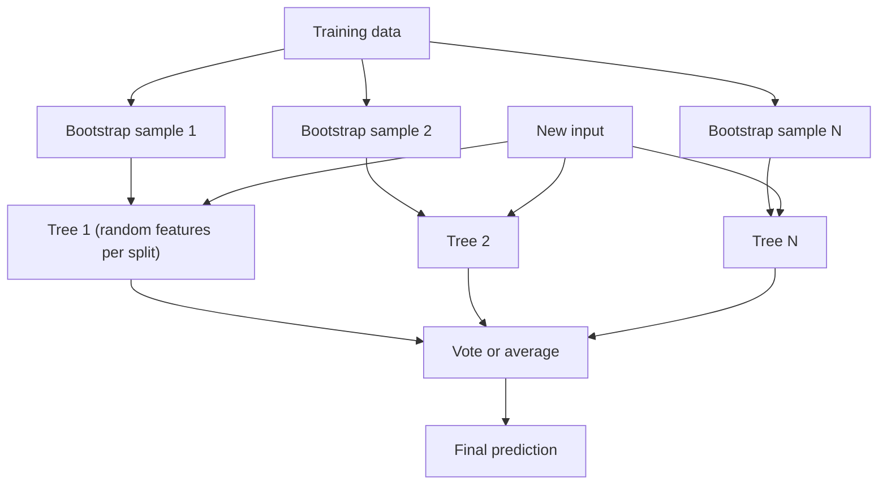

# How do Decision Trees and Random Forests work?

> **Step 1: Machine Learning Foundations** · ⏱️ 18 min read · [Read original](https://outcomeschool.com/blog/decision-trees-and-random-forests)

## TL;DR
A Decision Tree predicts by asking a chain of yes/no questions; it is readable but overfits easily. A Random Forest builds many deliberately different trees on random samples and lets them vote, giving more reliable predictions.

## Key Concepts
- **Root / internal / leaf node** — first question / later questions / final answer; **depth** = questions from root to deepest leaf.
- **Classification vs regression tree** — leaf holds a category vs a number (average of training items in that leaf).
- **Gini Impurity** — measures how mixed a group is; 0 means pure.
- **Recursive splitting** — repeat the best-split search inside each group.
- **Bootstrap sampling** — pick N rows with replacement for each tree (about 63% distinct rows on large data).
- **Bagging** — Bootstrap Aggregating: train on random samples, combine results.
- **Feature randomness** — each split sees only a random few features (about sqrt of total for classification).

## How It Works
**Choosing a question.** Try every question, pick the one giving the purest groups. For two answers:

$$\text{Gini} = 1 - p_{yes}^2 - p_{no}^2$$

Example with 10 days (6 Yes, 4 No): before split Gini = 0.48. Splitting on "Raining?" gives weighted Gini 0.317; on "Holiday?" gives 0.40. Raining wins and becomes the root; repeat inside each branch.

**When to stop:** max depth, min samples per leaf, min improvement. Otherwise the tree memorises accidents (overfitting) and is highly sensitive to small data changes (high variance).

**Random Forest fix.** Wisdom of the crowd works only if voters think differently, so make trees differ:
1. Bootstrap sample of data per tree.
2. Random feature subset at each split (stops every tree putting "Raining" at the root).
3. Predict: classification takes a majority vote; regression averages.

**Code result** (breast cancer data, 569 patients): both score 1.0 on train; test accuracy tree 0.942 vs forest 0.971.

| Point | Decision Tree | Random Forest |
|---|---|---|
| Nature | One flowchart | Many voting trees |
| Explainable | Yes | Hard |
| New-data accuracy | Good, can overfit | Usually better |
| Overfitting | Easy | Much less |
| Speed | Very fast | Slower |
| Sensitivity to data changes | High | Low |

Use a tree when explanations matter (e.g. loan rejection) or for a quick first model; use a forest for accuracy on tabular data.

## Diagram

## Key Takeaways
- Trees split on the question that yields the purest groups (lowest weighted Gini).
- Unrestricted trees overfit and are unstable (high variance).
- Random Forest = bagging plus feature randomness plus voting.
- Diversity among trees is what makes the vote useful.
- Trade-off: forests gain accuracy but lose interpretability and speed.
