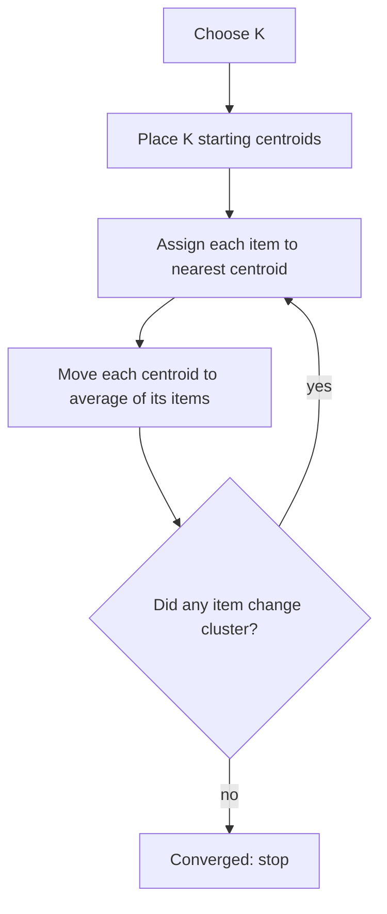
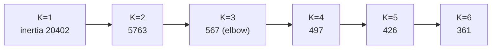

# How does K-Means Clustering work?

> **Step 1: Machine Learning Foundations** · ⏱️ 16 min read · [Read original](https://outcomeschool.com/blog/k-means-clustering)

## TL;DR
K-Means is an unsupervised method that splits data into K clusters, each represented by a centroid (the mean of its items). It repeats two steps - assign every item to the nearest centroid, then move each centroid to the average of its items - until no item changes cluster. Pick K with the elbow method, scale features, and use K-Means++.

## Key Concepts
- **Clustering** — group similar items together, different ones apart; unsupervised (no correct answers). Use: customer segmentation.
- **K-Means** — K (number of clusters, chosen up front) + Means (each center is the average of its items).
- **Centroid** — average position of all items in a cluster. Items (2, 4, 9 km) give (2+4+9)/3 = 5. For 2D: average each coordinate, e.g. (1,2) and (3,6) give (2,4).
- **Euclidean distance** — straight-line distance: $d = \sqrt{(x_2-x_1)^2 + (y_2-y_1)^2}$. Example (1,1) to (4,5) = sqrt(9+16) = 5.
- **Converged** — assignments stop changing, centroids stop moving.
- **Inertia** — sum of squared distances of items to their own centroid; smaller = tighter clusters.
- **Local minimum** — result that looks best nearby but not overall.
- **K-Means++**, **Silhouette Score**, **DBSCAN** — see below.

## How It Works

### Four steps
1. Choose K.
2. Place K starting centroids (simplest: K random data items).
3. Assign each item to the nearest centroid (cluster).
4. Move each centroid to the average of its cluster.
Repeat 3 and 4 until no item changes cluster. Analogy: guests walk to nearest snack table, tables move to the middle of their crowd, repeat.

### Worked example (K=2)
Points A(1,1), B(2,1), C(1,2), D(8,8), E(9,8), F(8,9). Deliberately bad start: centroids at A and B.
- **Round 1 assign:** A, C go to Cluster 1 (centroid (1,1)); B, D, E, F go to Cluster 2 (centroid (2,1)). B is misplaced.
- **Round 1 move:** C1 = (1, 1.5); C2 = (6.75, 6.5).
- **Round 2 assign:** distances to C1/C2: A 0.50/7.96, B 1.12/7.27, C 0.50/7.30 (cluster 1); D 9.55/1.95, E 10.31/2.70, F 10.26/2.80 (cluster 2). B fixed.
- **Round 2 move:** C1 = (1.33, 1.33), C2 = (8.33, 8.33).
- **Round 3:** no changes, stop. Clusters {A,B,C} and {D,E,F}.

### Code (sklearn)
`KMeans(n_clusters=2, n_init=10, random_state=0).fit(points)`; `n_init=10` runs 10 starts and keeps the best; `labels_` gives clusters ([1 1 1 0 0 0]), `cluster_centers_` ([8.33, 8.33], [1.33, 1.33]), `predict([[2,2]])` gives group 1. Cluster numbers are just names.

### Choosing K: Elbow Method
Inertia always falls as K grows (K = number of items gives 0, useless), so run K = 1, 2, 3... and look for the bend. `make_blobs` (300 points, 3 centers):
| K | 1 | 2 | 3 | 4 | 5 | 6 |
|---|---|---|---|---|---|---|
| Inertia | 20402 | 5763 | 567 | 497 | 426 | 361 |

Big drops until K=3, then little: elbow at K=3. Real data may be unclear: use **Silhouette Score** (closeness to own cluster vs nearest other; higher = better separated), or let business need decide K (e.g. 4 offers means 4 groups).

### Common problems and fixes
| Problem | Why | Fix |
|---|---|---|
| Bad starting centroids | Settles but can get stuck in a local minimum | K-Means++ (first centroid random, each next far from chosen ones; sklearn default); run many times (`n_init`), keep lowest inertia |
| Features on different scales | Large-scale feature (income 2,00,000-50,00,000 vs age 18-70) dominates distance | Scale features, e.g. StandardScaler (mean 0, similar spread) |
| Outliers | Centroids are averages; one extreme point pulls a centroid | Remove clear outliers or use a less sensitive method |

### Works well vs fails
- **Works well:** roughly round (blob) clusters, similar sizes, a rough idea of K, large data needing speed (simple and fast).
- **Fails:** odd shapes (two moons, rings), since boundaries are straight between centroids; very different sizes/spreads; many outliers. Alternative: DBSCAN (density-based).
- **Uses:** customer grouping, grouping news/documents, color reduction in images (replace colors with centroid colors), finding unusual items (far from all centroids). Related: vector search clusters vectors for ANN.

## Diagram(s)

### K-Means loop

### Elbow method

## FAQ
- K-Means++? → Spread-out starting centroids; lowers chance of poor results.
- Always the best clusters? → No; may hit a local minimum.
- Inertia? → Sum of squared distances to own centroid; always falls with K so pair with elbow.
- Why scale? → Distance is dominated by large-scale features.

## Key Takeaways
- K-Means = unsupervised, K clusters, centroids as means, Euclidean distance.
- Loop: assign to nearest centroid, recompute centroids, until stable.
- Choose K via elbow (and silhouette), or business need.
- Use K-Means++ and multiple inits; scale features; handle outliers.
- Best for round, similar-sized clusters; use DBSCAN for odd shapes.
