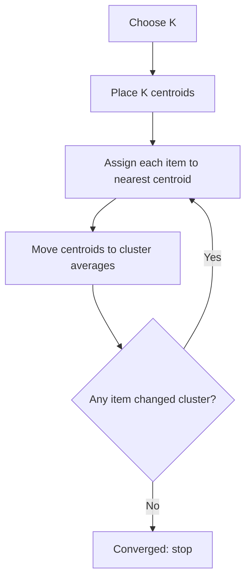

# How does K-Means Clustering work?

> **Step 1: Machine Learning Foundations** · ⏱️ 16 min read · [Read original](https://outcomeschool.com/blog/k-means-clustering)

## TL;DR
K-Means is an unsupervised method that splits data into K clusters, assigning each item to the nearest cluster centre (centroid) and recomputing centres until nothing changes. It is simple and fast but sensitive to starting points, scale, outliers and non-round shapes.

## Key Concepts
- **Clustering** — grouping similar items without labels (e.g. customer segmentation).
- **K** — number of clusters, chosen up front.
- **Centroid** — the mean position of the items in a cluster.
- **Euclidean distance** — straight-line distance, $\sqrt{(x_2-x_1)^2 + (y_2-y_1)^2}$.
- **Convergence** — no item changes cluster, so centroids stop moving.
- **Inertia** — sum of squared distances of items to their own centroid.
- **Elbow method / Silhouette score** — ways to choose K.
- **K-Means++** — smarter initialisation spreading starting centroids apart.

## How It Works
**Four steps:**
1. Choose K.
2. Place K starting centroids (e.g. random data points).
3. Assign each item to the nearest centroid.
4. Move each centroid to the average of its items; repeat 3 and 4 until stable.

**Worked example** (K=2): points A(1,1), B(2,1), C(1,2), D(8,8), E(9,8), F(8,9). Starting badly with A and B as centroids puts B in cluster 2 with D, E, F. After moving centroids (1,1.5) and (6.75,6.5), B joins A and C. Final centroids (1.33,1.33) and (8.33,8.33); round 3 changes nothing, so it stops.

**Choosing K:** inertia always falls as K rises (zero when K equals item count), so plot it and look for the elbow. On 300 points with 3 true groups, inertia was 20402, 5763, 567, 497... for K=1..4, bending at K=3. Silhouette score or business need can also set K.

**Problems and fixes:**

| Problem | Fix |
|---|---|
| Bad starting centroids (local minimum) | K-Means++ and multiple runs (`n_init`), keep lowest inertia |
| Features on different scales (age vs income) | Scale first, e.g. StandardScaler |
| Outliers pull centroids | Remove them or use a less sensitive method |

**Works well:** round, similar-sized blobs, large data, roughly known K. **Fails:** odd shapes (moons, rings), very different sizes or spreads, many outliers; DBSCAN suits those better. Uses: customer segmentation, document grouping, colour reduction, spotting items far from every centroid.

## Diagram

## Key Takeaways
- K-Means = K groups, each represented by the mean (centroid) of its members.
- Alternate assign and update until assignments stop changing.
- It converges but not always to the best result; use K-Means++ and several restarts.
- Scale features and handle outliers before clustering.
- Pick K with the elbow method (inertia alone always favours bigger K).
