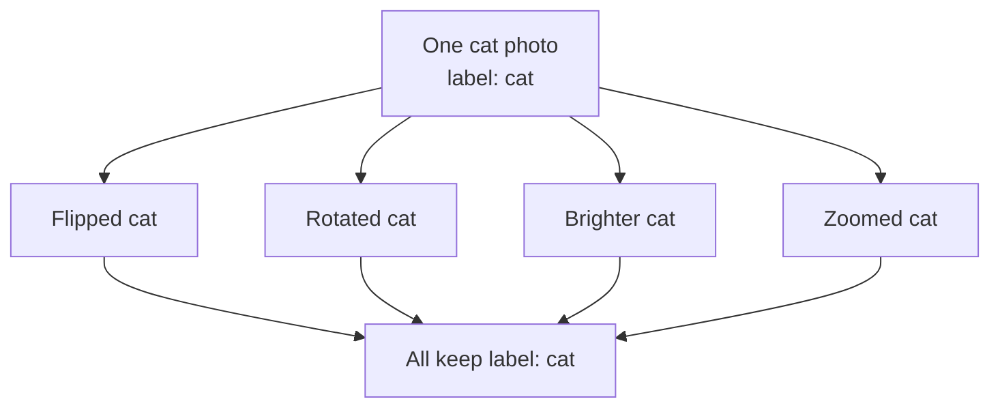
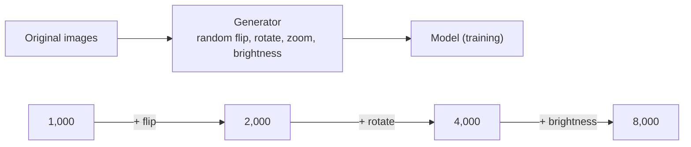

# How does Data Augmentation work?

> **Step 1: Machine Learning Foundations** · ⏱️ 14 min read · [Read original](https://outcomeschool.com/blog/data-augmentation)

## TL;DR
Data Augmentation creates new training examples from existing ones by applying small, meaning-preserving changes (flip, rotate, reword). The label stays the same but the data looks new, so the model learns the general idea instead of memorizing, reducing overfitting when data is scarce. Apply only to training data and only with transformations that keep the meaning.

## Key Concepts
- **Data Augmentation** — increase the amount of training data without collecting new data, by transforming existing examples.
- **Transformation** — small change that keeps meaning but looks different to the model.
- **Label** — correct answer attached to an example; unchanged by augmentation (flipped cat is still "cat").
- **Overfitting** — good on training data, poor on unseen data (student who memorized 10 specific questions).
- **On-the-fly augmentation** — changes applied during training, never saved to disk.

## How It Works

### Why needed
A model learns from examples, but thousands of labeled photos are costly. With only 500 cats and 500 dogs it memorizes exact photos (overfitting). More varied examples help it understand; augmentation provides variety from existing data. (Dropout is another way to reduce overfitting.)

### Core idea
One cat photo gives flipped, rotated, brighter, zoomed versions, all labeled cat. Each imitates a real-world condition (different angle, lighting, position), teaching the model a cat is a cat however it appears.

### Image transformations and what they imitate
| Transformation | Real-world situation |
|---|---|
| Flipping (horizontal/vertical) | Cat facing the other way |
| Rotation (e.g. 10-20 degrees) | Tilted camera |
| Cropping | Only part of cat in frame |
| Zooming | Cat closer or farther |
| Brightness change | Bright sun or dim light |
| Adding noise | Low-quality camera or dark |
| Shifting | Cat not centered |

Augmentation also underpins self-supervised learning (Contrastive Learning uses two augmented versions of the same image).
Caution: don't break meaning, e.g. never flip digit 6 upside down (looks like 9).

### Code (Keras)
```python
data_generator = ImageDataGenerator(
    rotation_range=20, horizontal_flip=True,
    brightness_range=[0.8, 1.2], zoom_range=0.2, width_shift_range=0.1)
```
Each parameter sets a random range for that change. Generator sits between stored images and the model, producing a fresh variation each time, never saved, so almost no image is seen twice and storage is saved. `ImageDataGenerator` is legacy/deprecated; modern Keras uses layers like `RandomFlip("horizontal")`, `RandomRotation(0.1)`, `RandomZoom(0.2)`, `RandomBrightness(0.2)`.

### Text augmentation
Example: "The movie was very good and I really enjoyed it." (positive).
- **Synonym replacement:** good to nice.
- **Word shuffling:** slightly reorder words, keep meaning clear.
- **Back translation:** translate to another language and back ("The film was really good and I enjoyed it a lot.").
- **Random insertion:** add a harmless extra word.
Care: one key word change can flip meaning (good to bad turns positive into negative).

### Numeric walkthrough
1,000 images, then add flipped version: 2,000; add rotated version: 4,000; add brightness version: 8,000. Doubles each step, with no new photos collected.

## Diagram(s)

### One example, many variations


### On-the-fly pipeline and growth


## When to use
| Situation | Use it? |
|---|---|
| Small training data | Yes, helps a lot |
| Model overfitting | Yes |
| Real-world data has many variations | Yes |
| Already huge and varied dataset | Still helps, smaller benefit |
| Transformation changes meaning | No, avoid |

## Trade-offs & Pitfalls
- Transformations must preserve meaning (digit 6 vs 9; good vs bad).
- Apply augmentation only to training data, not test data - test on real unchanged examples.

## FAQ
- Label change? → No.
- Augment test data? → No.
- Save augmented images? → No, on the fly.
- Can it hurt? → Yes if meaning changes.

## Key Takeaways
- Small meaning-preserving changes make new examples with the same label.
- Combats overfitting from scarce data.
- Choose transformations that mimic real-world variation for your use case.
- Text needs extra care since one word can flip meaning.
- Augment training only, on the fly.
