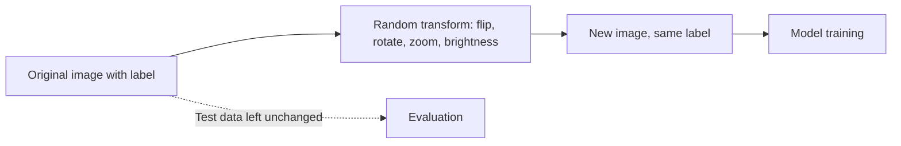

# How does Data Augmentation work?

> **Step 1: Machine Learning Foundations** · ⏱️ 14 min read · [Read original](https://outcomeschool.com/blog/data-augmentation)

## TL;DR
Data Augmentation creates new training examples from existing ones through small, meaning-preserving changes (flip an image, reword a sentence). It fights overfitting when data is scarce, without collecting new data.

## Key Concepts
- **Augmentation** — increasing training data by transforming existing examples.
- **Transformation** — a small change that keeps the meaning, so the label stays the same.
- **Overfitting** — memorising training examples instead of learning the general idea.
- **On-the-fly augmentation** — random changes applied during training; nothing saved to disk.

## How It Works
Core idea: label unchanged, data looks new. One cat photo becomes flipped, rotated, brighter and zoomed cats, all still "cat". This teaches that a cat is a cat in any orientation or light.

**Image transforms and what they imitate:**

| Transformation | Real-world situation |
|---|---|
| Flipping | Cat facing other way |
| Rotation | Tilted camera |
| Cropping | Part of cat in frame |
| Zooming | Closer or farther |
| Brightness | Sun or dim light |
| Noise | Low-quality camera or darkness |
| Shifting | Cat off-centre |

**Code.** Keras `ImageDataGenerator` (legacy; modern way uses layers like `RandomFlip`, `RandomRotation`, `RandomZoom`, `RandomBrightness`) sits between stored images and the model, handing a fresh random variation each time.

**Text transforms** (example "The movie was very good and I really enjoyed it", label positive): synonym replacement, word shuffling, back translation, random insertion.

**Numeric walkthrough:** 1,000 images, add flip (2,000), rotate (4,000), brightness (8,000); doubling each step with no new photos.

**Cautions:** the change must not break meaning (a flipped 6 looks like 9; "good" to "bad" flips sentiment). Augment training data only, not test data.

| Situation | Use it? |
|---|---|
| Little data | Yes, helps a lot |
| Overfitting | Yes |
| Real data varies | Yes |
| Huge varied dataset | Smaller benefit |
| Transformation changes meaning | No |

## Diagram

## Key Takeaways
- Augmentation adds variety, not new collected data, to reduce overfitting.
- Labels must survive the transformation.
- Pick transformations that mimic real-world variation for your use case.
- Applied on the fly during training, to training data only.
