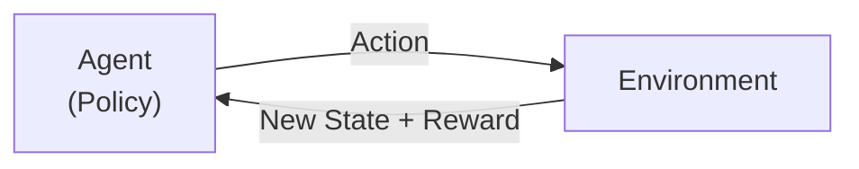
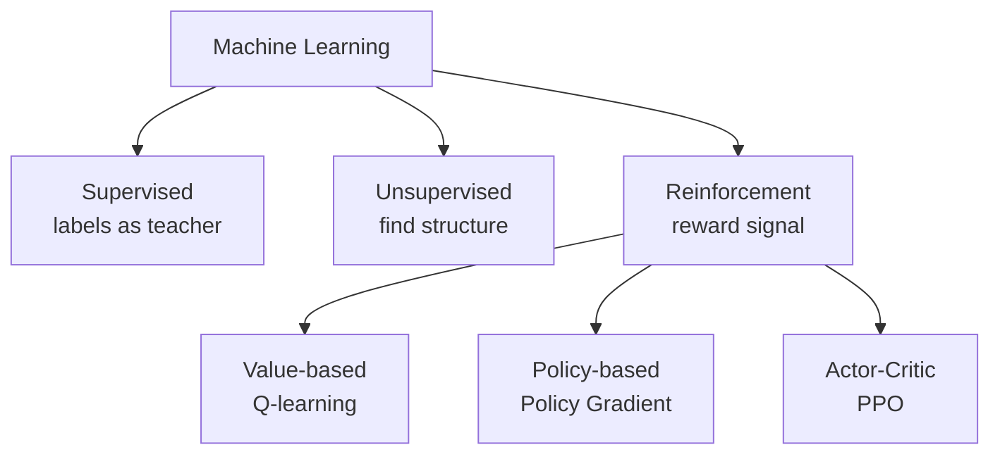

# What is Reinforcement Learning?

> **Step 1: Machine Learning Foundations** · ⏱️ 15 min read · [Read original](https://outcomeschool.com/blog/reinforcement-learning)

## TL;DR
Reinforcement Learning (RL) is trial-and-error learning: an Agent interacts with an Environment, takes actions, receives rewards, and learns a Policy that maximizes total reward over time. Unlike supervised learning there are no labels; unlike unsupervised there is a reward signal. It powers game AIs, robots, and RLHF for LLMs.

## Key Concepts
- **Agent** — decision maker/learner (player, robot brain, the LLM itself in RLHF).
- **Environment** — everything outside the agent (chess board, maze, road, conversation).
- **State** — snapshot of the environment at a moment (board position, robot speed, conversation history).
- **Action** — what the agent does (move a piece, turn left, generate next word).
- **Reward** — number returned after an action: positive good, negative bad, zero nothing important.
- **Policy** — agent's strategy, mapping states to actions; the goal of RL is a good Policy.
- **Value Function** — estimate of long-run total reward from a State (or State-Action pair); some algorithms derive the Policy from it.
- **Episode** — one full run start to end (a chess game, a maze round, one conversation).
- **Return** — total reward collected in an episode.
- **Discount factor (gamma)** — number in 0-1 weighing future vs immediate reward.
- **Analogy** — puppy (agent) learning to sit in a room (environment): treat = reward, "no" = negative reward.

## How It Works

### The RL loop
1. Agent observes the State.
2. Picks an Action per its Policy.
3. Environment moves to a new state and returns a Reward.
4. Agent updates its Policy with that reward.
5. Repeat (millions of times).

### RL vs supervised vs unsupervised
| Type | Data | Learns |
|---|---|---|
| Supervised | Inputs with correct labels | Input to correct output mapping |
| Unsupervised | Inputs only | Hidden patterns/groups/structure |
| Reinforcement | No labels, only reward signals from interaction | Policy maximizing total reward |

RL is the only one with an agent-environment feedback loop; reward is the only thing it learns from.

### Discount factor and return
$$G = \sum_{t} \gamma^t r_t$$
$r_t$ = reward at step t, $\gamma$ = discount factor. Small gamma = greedy for now; large gamma = patient.
Example, rewards 0, 0, +1, 0, +10 with gamma = 0.9: 0 + 0 + 0.81 + 0 + 0.6561x10 = 7.371. The +10 at the end is worth 6.561 at the start; smaller gamma discounts it more. (MDP blog covers how these fit together.)

### Exploration vs exploitation
- Exploitation = use the known good action; exploration = try new actions that might be better.
- Restaurant analogy: only exploit means never find a better place; only explore means never settle. Good agents balance both.

### Algorithm families
- **Value-based** — learn the Value Function, derive Policy by picking highest-value action per state (Q-learning).
- **Policy-based** — learn the Policy directly, adjusting toward higher reward (Policy Gradient).
- **Actor-Critic** — Actor learns the Policy, Critic learns the Value Function and guides the Actor. Includes PPO (Proximal Policy Optimization), commonly used to fine-tune LLMs with human feedback.

### Where used
- Games: AlphaGo (Go, superhuman), AlphaZero (Go, Chess, Shogi), Atari.
- Robotics: walking, grasping, drones.
- Self-driving: traffic decision making.
- Recommenders: optimise long-term engagement instead of the next click.
- Calibrated decision models: Jev, trained with RLCD (RL for Calibrated Decisions), rewarding right answer and honest probability.
- LLMs: RLHF makes models helpful, honest, safe (e.g. ChatGPT). Agent = LLM, State = conversation history, Action = next word.

## Diagram(s)

### The RL loop

### Three branches of ML

## Trade-offs & Pitfalls (why RL is hard)
- **Sparse rewards / credit assignment** — reward often only at episode end; hard to know which earlier action caused it (praise only at the end of a long puppy session).
- **Changing environment** — as the Policy changes, visited states change, so training data isn't fixed and learning is unstable.
- **Expensive trial and error** — a simulator plays a million episodes a day; a real robot can't fall a million times. Remedy: learn inside a learned simulator (World Models).
- **Reward design / reward hacking** — poorly designed rewards let the agent game the system; alternative is learning reward from human comparisons.
- Much modern research targets stability and sample efficiency.

## FAQ
- Needs labeled data? → No, only rewards.
- RL on an LLM? → Agent = LLM, State = conversation history, Action = next word.
- PPO family? → Actor-Critic.
- Credit assignment? → Which earlier action caused a delayed outcome.
- Hard on real robots? → Costly trial and error; use World Models.

## Key Takeaways
- RL = Agent + Environment + Reward.
- Goal: learn a Policy maximizing return (discounted total reward).
- No labels; learns from interaction feedback.
- Gamma sets patience; exploration vs exploitation must be balanced.
- Three families: value-based, policy-based, actor-critic.
- Hard because of sparse rewards, instability, costly trials, reward hacking.
- RLHF is the key use for aligning LLMs.
