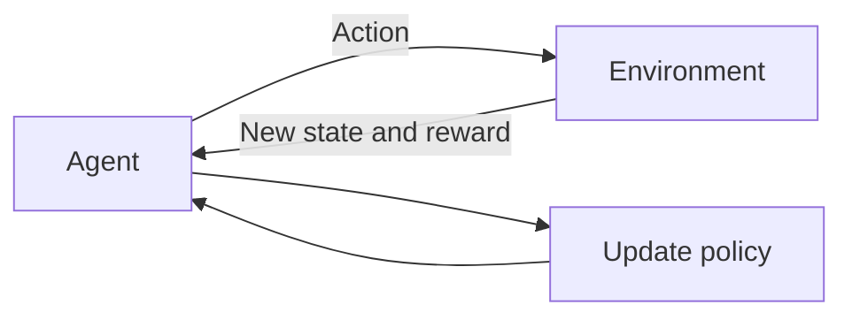

# What is Reinforcement Learning?

> **Step 1: Machine Learning Foundations** · ⏱️ 15 min read · [Read original](https://outcomeschool.com/blog/reinforcement-learning)

## TL;DR
Reinforcement Learning (RL) is the third main branch of ML: an Agent learns by trial and error in an Environment, guided only by a Reward signal, to maximise total reward over time. It powers game AIs, robotics and RLHF for LLMs.

## Key Concepts
- **Agent** — the learner/decision maker (for an LLM, the LLM itself).
- **Environment** — everything outside the agent.
- **State** — snapshot of the environment now (for an LLM, the conversation history).
- **Action** — what the agent does (e.g. generate the next word).
- **Reward** — number returned after an action; positive good, negative bad.
- **Policy** — strategy mapping states to actions; the thing RL learns.
- **Value Function** — expected long-run reward from a state or state-action pair.
- **Episode / Return** — one full run / total reward in it.
- **Discount factor (gamma)** — 0 to 1; low = greedy for now, high = patient.

## How It Works
**The loop:** observe state, pick action using policy, environment gives new state and reward, update policy, repeat millions of times. Analogy: training a puppy to sit with treats.

**Return with discounting.** With rewards 0, 0, +1, 0, +10 and gamma=0.9:

$$G = \sum_t \gamma^t r_t = 0.81 \cdot 1 + 0.6561 \cdot 10 = 7.371$$

**Three branches compared:**

| Type | Data | Learns |
|---|---|---|
| Supervised | Inputs with labels | Input to correct output |
| Unsupervised | Inputs only | Patterns, groups |
| Reinforcement | Reward signals from interaction | Policy maximising total reward |

**Exploration vs exploitation:** use the known good action vs try new ones (restaurant analogy); balance both.

**Algorithm families:** value-based (Q-learning), policy-based (Policy Gradient), actor-critic (Actor learns policy, Critic learns value; includes PPO, widely used for RLHF).

**Uses:** games (AlphaGo, AlphaZero), robotics, self-driving, recommenders, LLM alignment via RLHF.

**Why it is hard:** sparse rewards cause the credit assignment problem; the data shifts as the policy changes; real-world trials are costly; poor reward design causes reward hacking. World models (learned simulators) help with fewer attempts.

## Diagram

## Key Takeaways
- RL = Agent + Environment + Reward; no labels, no teacher.
- Goal: learn a policy that maximises discounted total reward.
- Gamma controls patience; Return is the discounted sum of rewards.
- Three algorithm families: value-based, policy-based, actor-critic.
- Hard because of sparse rewards, shifting data, costly trials and reward hacking.
