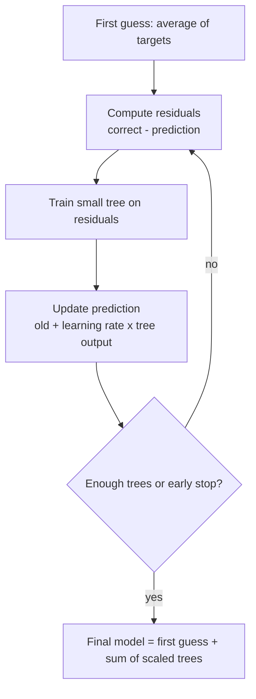
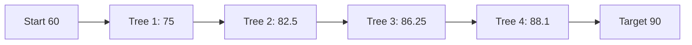

# How does Gradient Boosting work?

> **Step 1: Machine Learning Foundations** · ⏱️ 17 min read · [Read original](https://outcomeschool.com/blog/gradient-boosting)

## TL;DR
Gradient Boosting builds many small, weak models (shallow trees) one after another, each learning to fix the residual mistakes left by all earlier ones. Adding the small corrections (scaled by a learning rate) gives one strong model. It is often the most accurate method on table-like data, but needs careful tuning to avoid overfitting.

## Key Concepts
- **Overfitting** — a big tree memorizes training data, including random accidents, and fails on new data. A tiny tree is too simple, so one model alone is too weak or too fragile.
- **Boosting** — train many simple models in sequence, each focusing on the mistakes of the ones before it.
- **Weak learner** — simple model only slightly better than random guessing; in Gradient Boosting a small Decision Tree (2-3 levels). A one-question tree is a **decision stump**. Small trees cannot memorize, so many safe pieces add up without easy overfitting.
- **Residual** — Correct Answer - Current Prediction. Example: sold 50, predicted 60, residual = -10 (prediction 10 lakh too high). Positive = too low, negative = too high, 0 = perfect.
- **Learning rate** — small number (usually 0.01-0.3) scaling how much of each tree's correction is applied.
- **Loss** — one number saying how bad predictions are (e.g. mean of squared residuals).
- **Gradient descent** — walk opposite the gradient (downhill on the loss).
- **Pseudo-residuals** — the downhill direction of a non-squared loss (used e.g. for classification).
- **Bagging** — train models independently on random samples, then vote or average (Random Forest).

## How It Works

### Boosting analogy (golfer)
Hole is 100 m away. Shot 1 goes 80 (20 short), shot 2 covers the remaining 20 by going 15 (5 short), shot 3 goes 4 (1 short), shot 4 is a tap in. Each shot fixes only what is left. Boosting: model 1 guesses roughly, model 2 fixes model 1's errors, model 3 fixes what is still wrong, and so on. Residual = remaining distance.

### Step-by-step example (3 houses, learning rate 0.5)
| House | Size | Correct price (lakh) |
|---|---|---|
| A | Small | 40 |
| B | Small | 50 |
| C | Big | 90 |

1. **First guess:** the average, (40+50+90)/3 = 60 for every house (no tree yet).
2. **Residuals:** A -20, B -10, C +30.
3. **Train a small tree on the residuals** (not prices). One question "Is the house small?": small houses output the average of -20 and -10 = -15, big house outputs +30.
4. **Update by a small step:** New Prediction = Old Prediction + Learning Rate * Tree's Output. A and B: 60 + 0.5 x -15 = 52.5. C: 60 + 0.5 x 30 = 75.
5. **New residuals and repeat:** A -12.5, B -2.5, C +15 (all smaller). Tree 2 outputs -7.5 (small) and +15 (big): A and B become 48.75, C becomes 82.5.

House C moves toward 90: 60, 75 (Tree 1), 82.5 (Tree 2), 86.25 (Tree 3), 88.1 (Tree 4), and keeps closing in.

Caveat: A and B share the same size, so the tiny trees cannot separate them and both settle near 45 (average of 40 and 50). More features (rooms, location) let trees split them.

Final model: Final Prediction = First Guess + LR * Tree 1 + LR * Tree 2 + LR * Tree 3 + ... Real use: hundreds or thousands of small trees.

### Learning rate
- Big: learns fast, but each tree over-corrects and the model can overfit (golfer hitting too hard and overshooting).
- Small: slow and careful, needs more trees, usually better on new data.
- Trade-off: smaller learning rate means more trees.

### Why "Gradient"?
- Goal: minimize the loss. Picture the loss as a hill, the gradient points uphill with its steepness, so walking the opposite way goes downhill (gradient descent).
- For squared error, the downhill direction for each prediction is exactly the residual (up to a constant that does not change direction). So a tree learning residuals learns the downhill direction, and adding it is one step down.
- Check with House C: prediction 60, correct 90, residual +30 says "move up", which reduces its loss. Bigger mistake = steeper hill = bigger residual, so the residual gives direction and strength.
- Each tree gives the direction, the learning rate gives the step size, adding trees is walking downhill step by step.
- Works for any loss, not only squared error. For yes/no problems (e.g. "Will this customer leave?") use a different loss, trees learn its pseudo-residuals, and the process is unchanged.

### Code (scikit-learn, 442 diabetes patients, 10 features)
`GradientBoostingRegressor(n_estimators=200, learning_rate=0.05, max_depth=2, random_state=42)` on a 70/30 train/test split. `staged_predict` shows predictions after each tree; metric is mean absolute error (lower is better).
| Trees | 1 | 10 | 50 | 100 | 200 |
|---|---|---|---|---|---|
| Test error | 63.0 | 53.7 | 43.2 | 41.9 | 42.1 |

Error falls fast, then rises slightly after 100 trees: extra trees learn random accidents (overfitting).

### Settings that control overfitting
- **n_estimators** — too few underfits, too many overfits.
- **learning_rate** — smaller is safer but needs more trees.
- **max_depth** — keep small, usually 2-8. Bigger trees learn faster but overfit faster.
- **subsample** — train each tree on a random part (e.g. 80%) of the data, adds randomness, generalizes better.
- **Early stopping** — hold out data, watch its error after each tree, stop when it stops improving. Simplest way to pick tree count (finds about 100 in the example).

### Gradient Boosting vs Random Forest
| Point | Random Forest | Gradient Boosting |
|---|---|---|
| How trees are built | All at once, independently | One after another |
| What each tree learns | Original answers | Mistakes of previous trees |
| Tree size | Big, deep | Small, shallow |
| Combining | Vote or average (bagging) | Sum of small corrections |
| Mainly reduces | Variance | Bias |
| Accuracy | Very good | Often best on table-like data |
| Tuning | Fine with defaults | Needs careful tuning |
| Overfitting risk | Low | Higher if too many trees |
| Training speed | Parallel | Sequential |

Quick strong model with little tuning: Random Forest. Highest accuracy on tabular data with time to tune: Gradient Boosting.

### Libraries and where it fits
- **XGBoost** — very popular, fast, extra controls against overfitting.
- **LightGBM** — by Microsoft, fast on large data, low memory.
- **CatBoost** — by Yandex, handles categorical columns like "City" or "Color" well without extra work.
- Same core idea in all. Used for fraud detection, churn prediction, search ranking on table-like data.

## Diagram(s)

### Boosting loop

### House C prediction path

## Trade-offs & Pitfalls
- Runs too long and it fixes random accidents in training data (overfitting). Control with trees, learning rate, depth, subsample, early stopping.
- Trees are sequential, so no parallel training like Random Forest.
- Not best for images, audio, long text (neural networks win).
- Struggles on very small, noisy data, chasing mistakes into noise. A simpler model or Random Forest is safer.

## FAQ
- Classification? → Yes, different loss, trees learn pseudo-residuals, same process.
- How many trees? → No fixed number. Smaller learning rate needs more. Use early stopping.
- Bagging vs boosting? → Bagging: independent models on random samples, vote or average (Random Forest). Boosting: sequential small models learning from earlier mistakes.
- Good for images and text? → No, it shines on table-like data.

## Key Takeaways
- Gradient Boosting = many weak trees in sequence, each fitting the residuals of the ensemble so far.
- Prediction = first guess + learning rate x sum of tree outputs.
- Residuals are the negative gradient of squared error, so each tree is a gradient descent step.
- Smaller learning rate needs more trees but generalizes better.
- Tune n_estimators, learning_rate, max_depth, subsample, and use early stopping.
- Random Forest = parallel deep trees (cuts variance), Gradient Boosting = sequential shallow trees (cuts bias).
- Best on tabular data (XGBoost, LightGBM, CatBoost), weak on images, audio, text.
