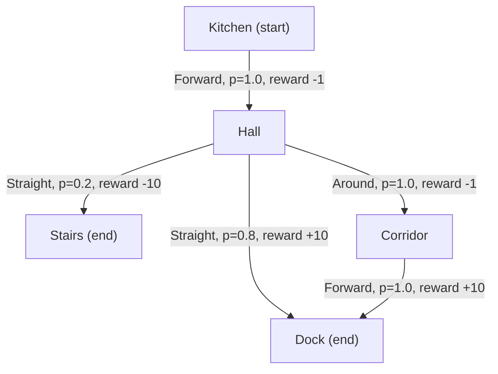
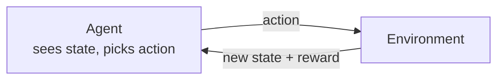
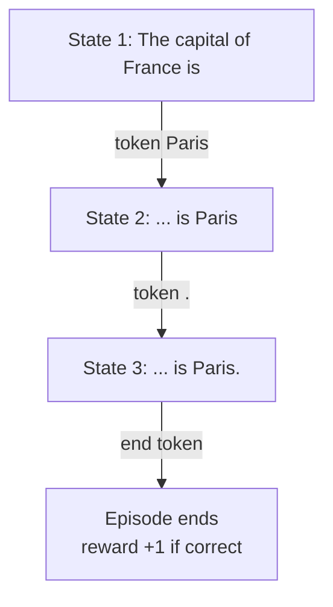

# What is a Markov Decision Process (MDP)?

> **Step 1: Machine Learning Foundations** · ⏱️ 17 min read · [Read original](https://outcomeschool.com/blog/markov-decision-process-mdp)

## TL;DR
An MDP is the standard formal way to describe a reinforcement learning problem: an agent picks actions step by step, each action changes the state, and each step gives a reward. It has five parts (states, actions, transition probabilities, rewards, discount factor), the Markov property (future depends only on the present state and action), and the goal is to find the policy with the highest expected return.

## Key Concepts
- **Agent / Environment / Action / Reward / State** — learner; world it acts in; its choice; number returned after an action (positive good, negative bad); current situation.
- **Markov property** — future depends only on the present state, not how we got there (chess board). A state has it when it holds all useful information about the past, so the agent needn't remember history.
- **MDP** — five parts: S, A, P, R, gamma.
- **Terminal state** — end state; run is over.
- **Policy** — rule for picking an action in each state; **stochastic policy** picks by chance (e.g. Straight 30% / Around 70%).
- **Return (G)** — discounted total future reward.
- **Expected return** — average return over randomness.
- **Episodic** vs **continuing** tasks.

## How It Works

### Running example: robot to charging dock
Places: Kitchen (start), Hall, Corridor (long safe path), Dock (goal), Stairs (robot breaks). Kitchen: only Forward to Hall. Hall: **Straight** (80% Dock, 20% slips to Stairs) or **Around** (via Corridor, safe, one extra step). Corridor: Forward to Dock. Each normal move costs -1 (battery); Dock +10; Stairs -10. Dock and Stairs are terminal.

### The five parts
1. **States (S)** — Kitchen, Hall, Corridor, Dock, Stairs.
2. **Actions (A)** — Forward, Straight, Around; not all available everywhere (Hall: Straight/Around; Kitchen, Corridor: Forward only).
3. **Transition probabilities (P)** — P(next | state, action); same action can lead to different places; chances sum to 1 per state-action. Examples: P(Hall|Kitchen,Forward)=1.0, P(Dock|Hall,Straight)=0.8, P(Stairs|Hall,Straight)=0.2, P(Corridor|Hall,Around)=1.0, P(Dock|Corridor,Forward)=1.0. Depends only on current state and action (Markov). World Models learn to predict next state and reward.
4. **Rewards (R)** — -1 for moves to Hall/Corridor, +10 Dock, -10 Stairs. We state what we want, never "go around"; the agent finds the way.
5. **Discount factor (gamma)** — 0 to 1; near 0 cares about next reward, near 1 cares about the future almost equally (100 rupees today vs next year). Example uses 0.9.

### Policies
- Policy A: Kitchen Forward, Hall Straight.
- Policy B: Kitchen Forward, Hall Around, Corridor Forward.
The goal of RL is the best policy (most total reward on average).

### Return

$$
G = R_1 + \gamma R_2 + \gamma^2 R_3 + \gamma^3 R_4 + \dots
$$

First reward counts fully; each later one is multiplied by gamma once more.
Policy B run Kitchen, Hall, Corridor, Dock: rewards -1, -1, +10: -1 + 0.9(-1) + 0.81(10) = -1 - 0.9 + 8.1 = **6.2**. Python: sum `(gamma ** t) * r` over rewards.

### Comparing choices in the Hall (expected return)
| gamma | Straight | Around | Best |
|---|---|---|---|
| 0.9 | 0.8x10 + 0.2x(-10) = 6 | -1 + 0.9x10 = 8 | Around (Policy B) |
| 0.5 | 6 (reward immediate) | -1 + 0.5x10 = 4 | Straight |

Same MDP, different gamma, different best policy: impatient agent takes the risky short path; patient agent takes the safe long path. (Value Function / Q-Learning learn expected returns; PPO and GRPO find best policies.)

### Episodic vs continuing
- **Episodic:** has an end; a run from start to terminal is an episode (robot restarts at Kitchen). gamma can be 1 since the sum ends.
- **Continuing:** never ends (building temperature control). With reward 1 forever the sum grows unbounded; with gamma = 0.9 it is $1/(1-0.9) = 10$, finite. So use gamma < 1.

### LLM text generation as an MDP
| MDP part | In an LLM |
|---|---|
| State | Prompt plus tokens generated so far |
| Action | Next token from the vocabulary |
| Transition | Certain: chosen token appended (prob 1.0) |
| Reward | Often 0 per token, one score at the end |
| Gamma | Often 1 (answer always ends) |
| Policy | The LLM, giving a chance to every next token (stochastic) |

Example: "The capital of France is" then "Paris", ".", end token; reward +1 if correct, from a reward model or a checker. State = full text so far (Markov); episodic (ends with end token or max length). RL trains the LLM as a policy to raise return (PPO, GRPO).

## Diagram(s)

### Robot MDP

### Agent-environment loop

### LLM as MDP

## FAQ
- Must the agent remember history? → No, Markov property.
- Why can gamma change the best policy? → It changes weight on future rewards (8 vs 6 at 0.9; 4 vs 6 at 0.5).
- Can gamma be 1? → Yes in episodic tasks; use < 1 in continuing tasks.
- LLM reward source? → End-of-answer score from a reward model or correctness checker.

## Key Takeaways
- MDP = (S, A, P, R, gamma), grounded in the Markov property.
- Transition probabilities model uncertainty; rewards define the goal.
- Return = discounted sum of rewards; best policy maximizes expected return.
- Gamma encodes patience and keeps continuing-task returns finite.
- Episodic tasks end; continuing tasks need gamma < 1.
- LLM token generation is an episodic MDP with deterministic transitions and a stochastic policy.
