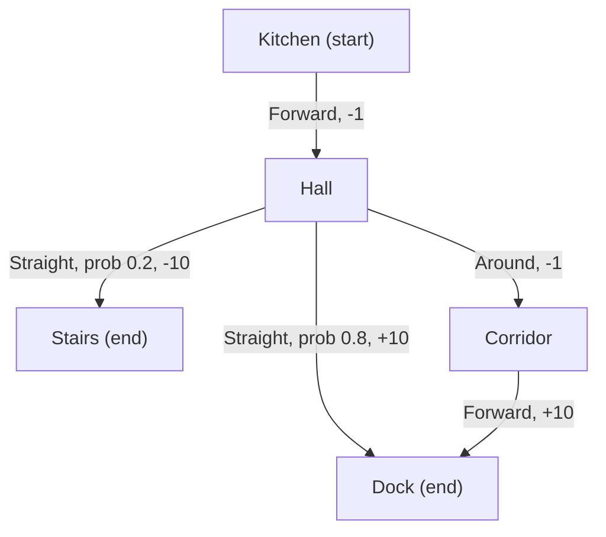

# What is a Markov Decision Process (MDP)?

> **Step 1: Machine Learning Foundations** · ⏱️ 17 min read · [Read original](https://outcomeschool.com/blog/markov-decision-process-mdp)

## TL;DR
An MDP is the standard formal way to describe a reinforcement learning problem: an agent makes step-by-step decisions, each changes the situation, and each yields a reward. It is defined by five parts: states, actions, transition probabilities, rewards and a discount factor.

## Key Concepts
- **Markov property** — the future depends only on the current state, not on how we got there (a chess board is enough).
- **States (S)** — all situations; **terminal states** end the run.
- **Actions (A)** — choices; not all available in every state.
- **Transition probabilities P(s' | s, a)** — chance of each next state; sum to 1 per state-action.
- **Rewards (R)** — numbers returned after steps.
- **Discount factor gamma** — 0 to 1; weight on future rewards.
- **Policy** — rule choosing an action per state; can be **stochastic**.
- **Return G** — discounted total reward.
- **Episodic vs continuing tasks.**

## How It Works
**Robot example.** Kitchen goes Forward to Hall. From Hall: *Straight* (80% Dock +10, 20% Stairs -10) or *Around* (via Corridor, safe, one extra step). Normal moves cost -1. Gamma = 0.9.

**Return:**

$$G = R_1 + \gamma R_2 + \gamma^2 R_3 + \dots$$

Policy B (Kitchen, Hall, Corridor, Dock) rewards -1, -1, +10: $-1 - 0.9 + 8.1 = 6.2$.

**Comparing choices at Hall (expected return):**

| Gamma | Straight | Around | Best |
|---|---|---|---|
| 0.9 | 0.8(10) + 0.2(-10) = 6 | -1 + 0.9(10) = 8 | Around (patient, safe) |
| 0.5 | 6 | -1 + 0.5(10) = 4 | Straight (impatient, risky) |

So the same MDP can have a different best policy for a different gamma.

**Episodic vs continuing.** Episodic tasks end (gamma can be 1). Continuing tasks never end; gamma < 1 keeps the sum finite (reward 1 forever with gamma 0.9 gives $1/(1-0.9) = 10$).

**LLM as an MDP:**

| MDP part | In an LLM |
|---|---|
| State | Prompt plus tokens so far |
| Action | Next token |
| Transition | Deterministic: token appended |
| Reward | Often 0 per token, one score at the end |
| Gamma | Often 1 |
| Policy | The LLM (stochastic over tokens) |

## Diagram

## Key Takeaways
- MDP = (S, A, P, R, gamma); the Markov property means the current state suffices.
- Reward specifies what we want, not how; the agent finds the path.
- Return discounts future rewards by gamma per step of delay.
- Gamma shapes behaviour: low is impatient and risky, high is patient and safe.
- Text generation by an LLM fits naturally as an episodic MDP.
