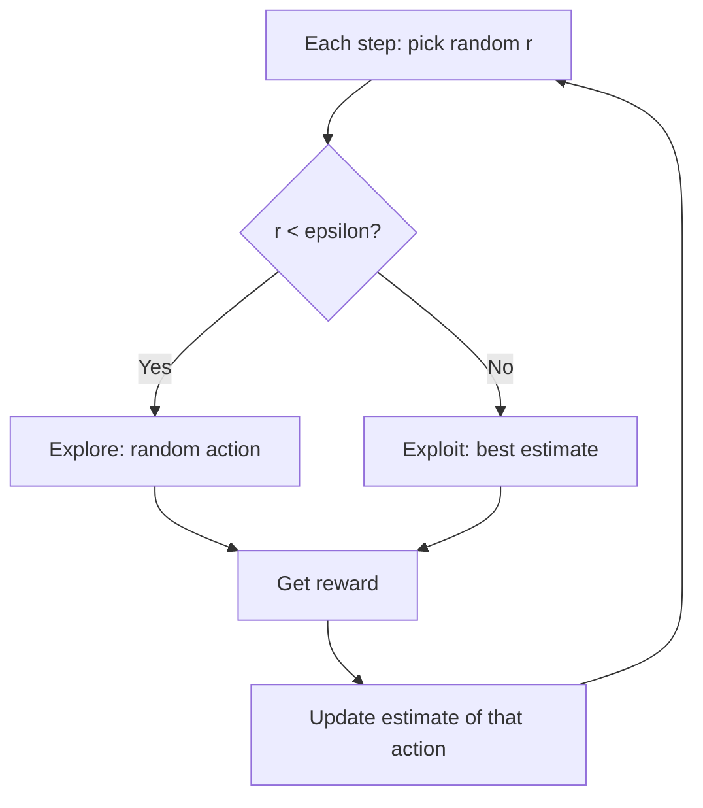

# What is Exploration vs Exploitation in Reinforcement Learning?

> **Step 1: Machine Learning Foundations** · ⏱️ 18 min read · [Read original](https://outcomeschool.com/blog/exploration-vs-exploitation)

## TL;DR
At every step an RL agent must either exploit the best-known action or explore another to learn something new. Too much of either collects less total reward, so strategies like epsilon-greedy, UCB and softmax balance them.

## Key Concepts
- **Exploitation** — pick the action with best reward so far (return to the favourite restaurant).
- **Exploration** — try a non-best action to learn about it.
- **Multi-armed bandit** — row of slot machines; simplest RL since the situation never changes.
- **Estimate** — running average reward per action.
- **Epsilon** — probability of exploring randomly.
- **Exploration bonus / temperature** — UCB's uncertainty term / softmax's randomness knob.

## How It Works
**Bandit setup:** machines A, B, C pay 20%, 50%, 80% (hidden); 1000 pulls; ideal about 800 coins.

**Strategies:**
1. *Greedy* — always highest estimate; locks onto A, about 186 coins in the code run.
2. *Epsilon-greedy* — with prob. $\epsilon$ pull random, otherwise best. Code run: 725 coins, pulling C 866 times. Weakness: explores at a constant rate forever.
3. *Decaying epsilon* — $\epsilon = \max(0.01, 0.99^{step})$; explore early, exploit later; the floor lets the agent notice changes.
4. *Optimistic initial values* — start estimates high (1.0) so greedy tries everything; only explores at the start.
5. *UCB* — score $= \bar{r} + \sqrt{2\ln t / n}$; targeted exploration. Example: C has the best average (0.60) but B scores highest (2.23) because it was pulled only twice.
6. *Softmax with temperature* — probability $\propto e^{\text{est}/T}$. Estimates 0.2, 0.5, 0.8: T=1.0 gives 0.24/0.32/0.44 (explores); T=0.1 gives 0.00/0.05/0.95 (exploits).

| Strategy | Strength | Weakness |
|---|---|---|
| Greedy | Simple | Stuck on first good option |
| Epsilon-greedy | Simple, works | Constant exploration |
| Decaying epsilon | Explore then exploit | Must tune decay |
| Optimistic init | No randomness | Only explores at start |
| UCB | Targets uncertain actions | Harder with many actions |
| Softmax | Better actions explored more | Tune temperature |

**In LLM RL:** exploration comes from sampling temperature (near 0 gives identical answers; around 1.0 gives variety) and multiple samples per prompt (e.g. 8 answers, 2 correct, group average 0.25; raise probability of above-average answers, lower the rest, as in GRPO). Too low a temperature learns nothing new; too high gives near-random text with no reward.

## Diagram

## Key Takeaways
- Pure exploitation gets stuck; pure exploration never cashes in.
- Epsilon-greedy is the simple workhorse; decay it over time.
- UCB explores where uncertainty is highest rather than randomly.
- Softmax temperature controls how evenly probabilities spread.
- In LLM RL, temperature and multiple samples per prompt provide exploration.
