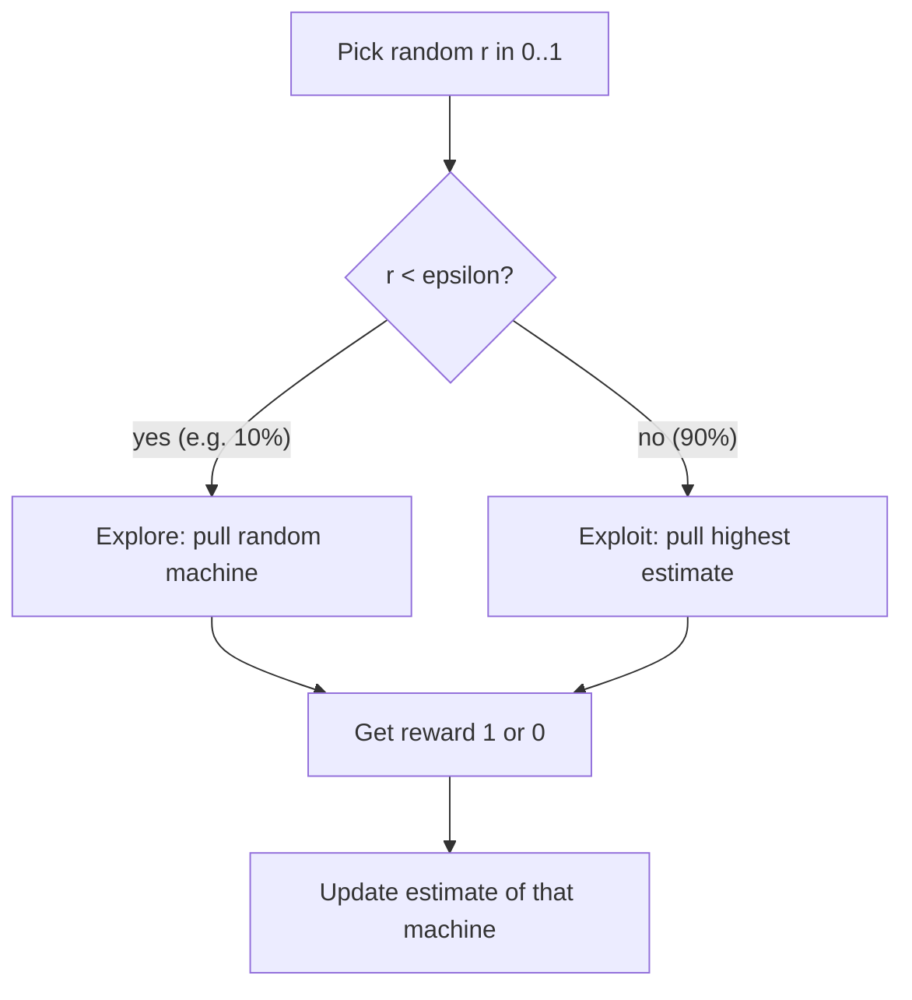
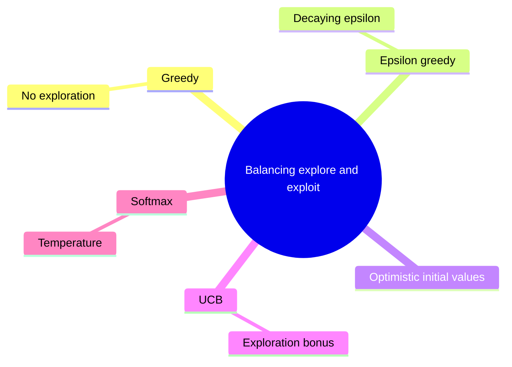
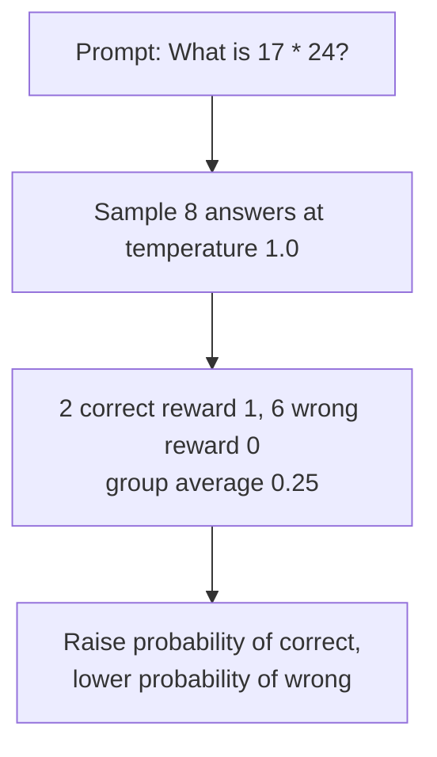

# What is Exploration vs Exploitation in Reinforcement Learning?

> **Step 1: Machine Learning Foundations** · ⏱️ 18 min read · [Read original](https://outcomeschool.com/blog/exploration-vs-exploitation)

## TL;DR
At each step an RL agent must either exploit (repeat the best-known action) or explore (try another to learn more). Pure exploitation locks onto the first decent option; pure exploration never cashes in. Strategies balance them: epsilon-greedy, decaying epsilon, optimistic initial values, UCB, softmax with temperature. The same dilemma appears in LLM RL via sampling temperature and multiple samples per prompt.

## Key Concepts
- **Exploitation** — pick the action with the best reward so far (return to the one good restaurant): good reward now, but never learns of a better one.
- **Exploration** — try a non-best action to learn more (new restaurant): costs today, pays back with knowledge.
- **Dilemma** — only exploit gets stuck; only explore never enjoys the best. Both collect less total reward.
- **Multi-armed bandit** — row of slot machines; simplest RL since the situation doesn't change between pulls. (When the situation changes after each action it becomes an MDP.)
- **Estimate** — running average reward per machine, e.g. B pulled 4 times with 1,0,1,1 gives 0.75.
- **Epsilon** — probability of exploring. **Temperature (T)** — softmax sharpness. **Logit** — raw score per token.

## How It Works

### Bandit setup
Machines A, B, C pay 1 coin with hidden chance 20%, 50%, 80%. 1000 pulls. Knowing the table, always C gives about 800 coins.

### Strategies
1. **Greedy** — always pull the highest estimate. Starts all 0, ties go to A; whether A pays or not, A stays top, so B and C are never tried: about 200 coins instead of about 800.
2. **Epsilon-greedy** — with probability epsilon (e.g. 0.1) pull a random machine, else the highest estimate. Update: `estimate += (reward - estimate) / count`. Simulation (1000 steps):
   - epsilon=0.0: total 186, pulls [1000, 0, 0]
   - epsilon=0.1: total 725, pulls [96, 38, 866] (almost 4x)
   Weakness: keeps wasting 10% on random picks forever.
3. **Decaying epsilon** — $\epsilon = \max(0.01, 1.0 \times 0.99^{step})$. Step 0: 1.00 (always explore); 100: 0.37 (~1 in 3); 300: 0.05 (~1 in 20); 500+: 0.01 (~1 in 100). Floor keeps a little exploration to notice changes.
4. **Optimistic initial values** — start estimates high (1.0). Greedy tries A, its estimate drops, B and C still look perfect so get tried; optimism drives exploration. Caveat: one-time push; unlucky early runs can settle on B; doesn't re-explore if chances change.
5. **UCB (Upper Confidence Bound)**:
$$\text{score} = \bar{r} + \sqrt{\frac{2\ln t}{n}}$$
$\bar r$ = average reward, t = total pulls, n = pulls of this machine; second term is the exploration bonus (big for rarely pulled). After t=20 (ln 20 ≈ 3.0):
| Machine | Avg | n | Bonus | Score |
|---|---|---|---|---|
| A | 0.20 | 10 | 0.77 | 0.97 |
| B | 0.50 | 2 | 1.73 | 2.23 |
| C | 0.60 | 8 | 0.87 | 1.47 |
UCB picks B (little data, could be higher). If B is truly worse, its bonus shrinks and C returns. Since ln(t) grows slowly, long-ignored machines regain bonus. Idea: if unsure, assume it can be good.
6. **Softmax with temperature** — probabilities so better actions are chosen more but all have a chance:
$$p_i = \frac{e^{q_i / T}}{\sum_j e^{q_j / T}}$$
Estimates A=0.2, B=0.5, C=0.8: T=1.0 gives 0.24, 0.32, 0.44 (explores a lot); T=0.1 gives 0.00 (about 0.002), 0.05, 0.95 (mostly exploits). High T flat, low T peaked. Unlike epsilon-greedy, bad and nearly-best machines aren't treated equally. T can also decay.

### Comparison
| Strategy | How it explores | Strength | Weakness |
|---|---|---|---|
| Greedy | Never | Simple | Stuck on first good option |
| Epsilon-greedy | Random with prob. epsilon | Simple, works well | Same rate forever |
| Decaying epsilon | Random, decreasing | Early explore, later exploit | Must choose decay speed |
| Optimistic init | High starting estimates | No randomness | Only at the start |
| UCB | Bonus for rarely tried | Targeted at uncertainty | Harder with very many actions |
| Softmax | Better-looking picked more | Smarter exploration | Tune temperature |

### Exploration in LLM RL
Agent = LLM, action = next token, reward at end (reward model or math check). Exploration comes from:
- **Sampling temperature** over logits via softmax: near 0 gives near-identical answers (exploitation, nothing new learned); around 1.0 gives varied answers, some better.
- **Multiple samples per prompt** (e.g. 8 or 16): raise probability of answers above group average, lower those below (GRPO). Example "17 * 24" with 8 samples: 2 correct (reward 1), 6 wrong (0), group average 0.25, so correct ones up, wrong ones down. With a single temperature-0 sample that was wrong, the model never sees a correct path.
- Balance: too low = nothing new; too high = near-random text, no reward. Models also grow more confident over training and less varied, so keeping exploration is an active concern.

## Diagram(s)

### Epsilon-greedy step

### Strategy family

### GRPO-style sampling

## FAQ
- Is the bandit RL? → Yes, simplest form.
- Why not stop exploring? → Chances may change; keep a floor (e.g. 0.01). Optimistic init can't do this.
- Epsilon-greedy vs UCB? → Random vs targeted bonus for uncertain actions.
- LLM temperature too low/high? → Low: no new learning; high: random text, no reward.

## Key Takeaways
- Pure greedy can lock onto a poor option (186 vs 725 coins in the demo).
- Epsilon-greedy is simple but explores at a constant rate.
- Decay epsilon: explore early, exploit late, keep a small floor.
- UCB adds a bonus for rarely tried actions; softmax uses temperature.
- Optimistic init explores only at the start.
- In LLM RL, temperature and multiple samples per prompt provide exploration.
