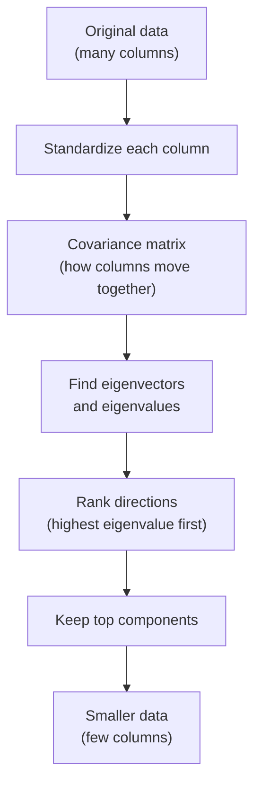
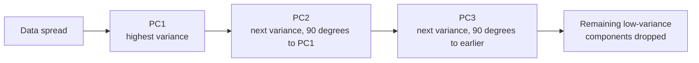

# How does PCA work?

> **Step 1: Machine Learning Foundations** · ⏱️ 19 min read · [Read original](https://outcomeschool.com/blog/principal-component-analysis-pca)

## TL;DR
PCA (Principal Component Analysis) shrinks data with many columns into fewer new columns while keeping as much useful information as possible. It standardizes the data, finds the directions of maximum spread (variance), ranks them, and rewrites the data using only the top few. It cuts redundancy, speeds up models and makes visualization possible.

## Key Concepts
- **Principal Component** — a new column PCA creates (a mix of old columns) pointing along a direction of high spread; "Principal" = most important, "Component" = new column.
- **Dimension** — one feature/column. 100 columns = 100 dimensions; humans can only visualize 2-3.
- **Dimensionality reduction** — reducing the number of columns; PCA is one technique (unsupervised learning).
- **Correlated columns** — columns that move together (e.g. height in cm and in inches); they repeat the same information.
- **Variance** — how spread out numbers are; spread means information. Low variance = close together, high = far apart.
- **Covariance matrix** — table of how each pair of columns moves together.
- **Eigenvector** — a special direction; becomes a Principal Component.
- **Eigenvalue** — how much variance (information) lies along an eigenvector.
- **Explained variance** — percentage of total information each component captures.
- **Scree plot** — bar chart of variance captured per component, highest to lowest.

## How It Works

### Why PCA is needed
Example: health study with height (cm), height (inches), weight (kg), weight (lb), age, daily steps. Some columns duplicate others. Problems:
1. High dimensionality: data hard to understand and slow to process.
2. Cannot draw data with 100 columns.
3. Many ML models get confused or slow with many (especially repeating) columns.

PCA notices overlapping columns and merges them into a few new columns with the real information and no repetition.

### Central idea
- PCA does not just delete columns; it creates new columns by mixing old ones.
- Height cm + height inches become one "how tall" column; the leftover carries almost no extra information.
- On a scatter plot where points stretch along a diagonal, that diagonal is where the information lives; PCA makes it the new main column.
- Rule: directions with most variance carry most information (keep); least variance carry least (drop).
- Example: ages 30,31,29,30,30 = low variance; 5,80,25,60,15 = high variance. A column with the same value for everyone (same country) has zero variance and tells nothing; income varies a lot and separates people.

### Principal Components
Created one by one in order of importance:
- PC1: direction of highest variance, most information.
- PC2: next highest variance, at a right angle to PC1, so it captures new information, not a repeat.
- PC3 and onward: next highest variance, each at a right angle to all earlier ones.

Keep the first few, throw away the rest.

### Steps
1. **Standardize** - rescale every column to a common scale (e.g. age 0-100 vs income 0-100000, else the larger numbers dominate). Example: age 25, 40, 30 becomes -1.07, 1.34, -0.27; income 50000, 90000, 60000 becomes -0.98, 1.37, -0.39.
2. **Measure how columns move together** - build the covariance matrix (does this go up when that goes up?).
3. **Find special directions** - eigenvectors (new directions) and eigenvalues (variance along each). Large eigenvalue = lots of information.
4. **Rank and keep** - sort by eigenvalue, highest first = PC1; keep the top few.
5. **Rewrite data** using only kept components: a smaller table with most of the information.

### Numeric walk-through
5 students: hours 1-5, marks 30, 40, 50, 60, 70. Each extra hour adds exactly 10 marks, so the columns are perfectly correlated and all points lie on one line. PC1 along the line captures all the spread; PC2 across it captures nothing and is dropped. 2 dimensions become 1 with no loss. Real data is never perfectly on a line, so a little is lost.

### How many components to keep
Too few loses information; too many fails to simplify. Use explained variance. Example: 72%, 18%, 6%, 3%, 1% - the first two give 72 + 18 = 90%, so if 90% suffices, keep 2 of 5. On a scree plot, keep components before the sharp drop-off flattens out, depending on the use case.

### Code (scikit-learn, Iris: 150 flowers, 4 columns)
```python
X = load_iris().data
X_scaled = StandardScaler().fit_transform(X)
pca = PCA(n_components=2)
X_reduced = pca.fit_transform(X_scaled)
print(pca.explained_variance_ratio_)  # [0.7296 0.2285]
```
`n_components=2` keeps the top 2; `fit_transform` finds directions and rewrites the data; the ratios (about 73% and 23%) show 2 components keep about 96% of the information.

### Advantages
- Fewer columns, smaller and easier data.
- Removes repetition among correlated columns.
- Faster training, less memory.
- Easy visualization with 2-3 components.
- Less noise, since dropped components often hold mostly noise.

### Where it is used
- Image compression (thousands of pixels into few components).
- Face recognition ("eigenfaces").
- Finance (main factors driving many stocks).
- Genetics (huge gene tables into a few components).
- Speeding up ML by cutting columns before training.
- Visualization of high-dimensional data in 2-3 components.

## Diagram(s)

### PCA pipeline


### Principal Components in order


## Trade-offs & Pitfalls
- **Harder to interpret** - components are mixtures of old columns, with no simple name like "age" or "income".
- **Only straight-line patterns** - curved structure can be missed.
- **Sensitive to scale** - skipping standardization lets large-number columns dominate.
- **Some information always lost** - dropping components is never a perfect copy.

## FAQ
- Does PCA just delete columns? → No. It creates new mixed columns, then keeps the top few (the Principal Components).
- Why standardize? → Columns on different scales (age vs income) let bigger numbers dominate; standardizing puts all on a common scale.
- Why right angles between components? → So each captures brand new information, not a repeat of earlier ones.
- Can PCA find curved patterns? → No, only straight-line directions of spread.

## Key Takeaways
- PCA reduces columns by creating new ones (Principal Components), not by deleting old ones.
- Spread (variance) means information; PCA keeps directions of highest variance.
- Components are ranked and mutually at right angles, so each adds fresh information.
- Steps: standardize, covariance matrix, eigenvectors/eigenvalues, rank, keep top, rewrite data.
- Choose component count with explained variance or a scree plot (e.g. keep 90%).
- Always standardize first, or large-scale columns dominate.
- Trade-offs: harder interpretation, linear only, some information lost.
- Common uses: compression, face recognition, finance, genetics, faster training, visualization.
