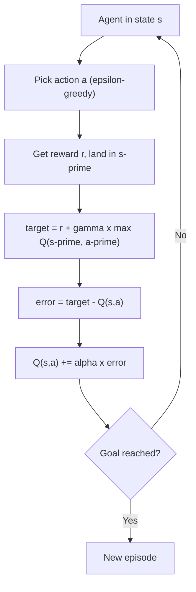

# What is a Value Function? Q-Learning Explained Step by Step

> **Step 1: Machine Learning Foundations** · ⏱️ 17 min read · [Read original](https://outcomeschool.com/blog/value-function-and-q-learning)

## TL;DR
A Value Function gives the expected return from a state (or state-action pair). Q-Learning learns Q(s, a) for every state and action by trial and error, filling a Q-table with a Bellman-based update rule.

## Key Concepts
- **Return** — $G = r_1 + \gamma r_2 + \gamma^2 r_3 + \dots$; discounting makes the agent prefer sooner rewards.
- **V(s)** — expected return starting in state s and following the policy ("how good is this state?").
- **Q(s, a)** — expected return taking action a in s, then following the policy ("how good is this action here?"); Q for "quality".
- **Relation** — $V(s) = \max_a Q(s,a)$.
- **Bellman idea** — value now = reward now + discounted value of the next state.
- **Q-table** — rows are states, columns are actions, cells are Q guesses (start at 0).
- **alpha** — learning rate; **epsilon-greedy** — explore with probability epsilon.

## How It Works
Why learn Q, not V? With Q the agent picks the best action directly; with V it would also need to know where each action leads.

**Bellman for Q:** $Q(s,a) = r + \gamma \max_{a'} Q(s',a')$

**Update rule:**

$$Q(s,a) \leftarrow Q(s,a) + \alpha\,\big(r + \gamma \max_{a'} Q(s',a') - Q(s,a)\big)$$

The bracket is target minus old guess (the error); alpha sets how far to move toward the target. Terminal next state has max Q = 0.

**Tiny corridor:** cells 0 to 3, goal in Cell 3 gives +10, other moves 0, alpha=0.5, gamma=0.9. Always moving Right:
- Episode 1: Q(Cell2, Right) = 0 + 0.5(10-0) = 5.
- Episode 2: Q(Cell1, Right) = 0.5(0.9 x 5) = 2.25 even though reward was 0; Q(Cell2, Right) becomes 7.5.
- Episode 3: Q(Cell0, Right) = 1.0125.

So reward flows backward one cell at a time. Converged values:

| State | Left | Right |
|---|---|---|
| Cell 0 | 7.29 | 8.1 |
| Cell 1 | 7.29 | 9 |
| Cell 2 | 8.1 | 10 |

Right wins everywhere; V = 8.1, 9, 10. A 200-episode Python run reproduces this.

**Limit:** a table cannot hold the huge number of states in games. Deep Q-Network (DQN) uses a neural network taking the state and outputting a Q per action, generalising to similar unseen states. Q-Learning and DQN are value-based; policy-based and actor-critic are the other families.

## Diagram

## Key Takeaways
- V scores states, Q scores state-action pairs; $V(s)=\max_a Q(s,a)$.
- Q-Learning bootstraps: one real reward plus the current guess of the next state's value.
- Q can rise on a zero reward because the next state is already valuable.
- Epsilon-greedy keeps the agent from getting stuck on the first path found.
- Q-tables don't scale; DQN replaces the table with a neural network.
