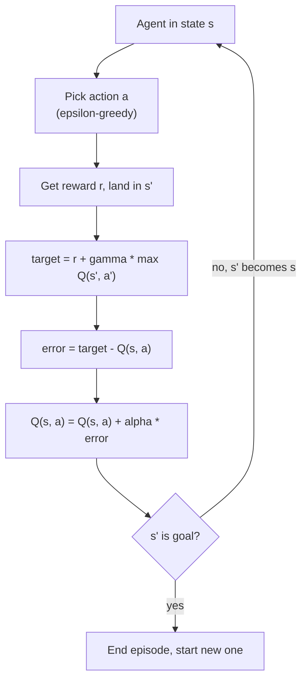
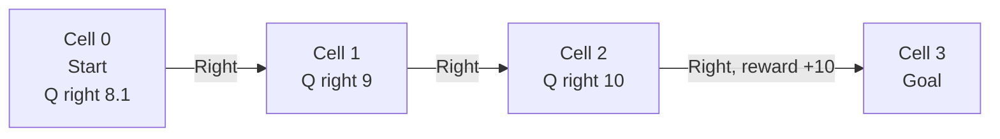
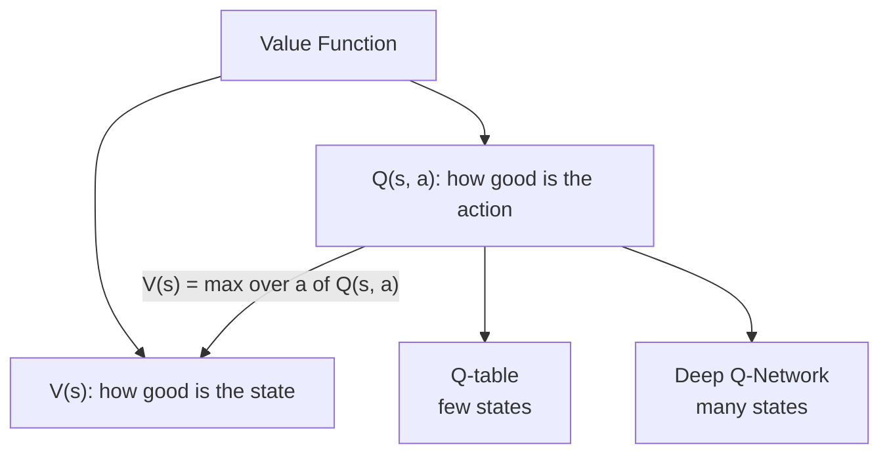

# What is a Value Function? Q-Learning Explained Step by Step

> **Step 1: Machine Learning Foundations** · ⏱️ 17 min read · [Read original](https://outcomeschool.com/blog/value-function-and-q-learning)

## TL;DR
A Value Function gives the expected return from a state (V) or a state-action pair (Q). Q-Learning learns Q(s, a) for every state and action in a Q-table by trial and error, using the Bellman idea: each update moves the old guess part of the way toward "reward now + discounted best value of the next state". Rewards at the goal flow backward through the table. Tables fail on huge state spaces, where Deep Q-Networks take over.

## Key Concepts
- **Return (G)** — total discounted reward from now: $G = r_1 + \gamma r_2 + \gamma^2 r_3 + \dots$. Reward 10 after 3 moves with gamma 0.9: 0 + 0 + 0.81x10 = 8.1; after 1 move: 10. Discount makes the agent prefer sooner rewards.
- **Value Function** — number for how good a state or action is (board game: 2 squares from finish beats 20).
- **V(s)** — return expected starting in s and following the policy ("How good is this state?"); depends on the policy.
- **Q(s, a)** — return expected from taking a in s now, then following the policy ("How good is this action here?"); Q = "quality".
- **Relation:** $V(s) = \max_a Q(s,a)$.
- **Q-table** — rows = states, columns = actions, cells = current Q guess; starts at 0.
- **Target** = $r + \gamma \max Q(s',a')$; **error** = target - Q(s,a); **alpha** = learning rate (0-1); **episode** = one start-to-end attempt.
- **Epsilon-greedy** — random action with probability epsilon, else highest Q.
- **DQN (Deep Q-Network)** — neural network replacing the Q-table.

## How It Works

### Why learn Q, not V
With Q the agent picks the action with the highest Q directly; with only V it would also need to know where each action leads. Knowing Q gives V.

### Bellman idea
Value of now = reward now + discounted value of where we land:
$$Q(s,a) = r + \gamma \max_{a'} Q(s',a')$$
s' = next state, a' = actions there. Assumes the same action gives the same reward/next state (if random, average over outcomes). Needs only one real step of reward plus current guess for the next state, not the whole game.

### Q-Learning update rule
$$Q(s,a) \leftarrow Q(s,a) + \alpha\,\big(r + \gamma \max_{a'} Q(s',a') - Q(s,a)\big)$$
Max term is 0 if s' is terminal. Moves the old guess a fraction alpha of the way to the target. One action = one cell update. Loop: in state s, pick a, get r and s', compute target, error, update, s' becomes s, repeat until goal, then new episode.

### Tiny corridor example
4 cells; start Cell 0, goal Cell 3 (+10, episode ends). Actions Left/Right; Left in Cell 0 stays; other moves 0 reward. alpha = 0.5, gamma = 0.9. Q-table 3 rows (Cells 0-2) x 2 columns, all 0. Agent moves Right for first episodes:
- **Episode 1:** steps 1-2 give target 0, no change. Step 3 (Cell 2 to goal): target 10, Q(2,Right) = 0 + 0.5x10 = 5.
- **Episode 2:** Cell 0 to 1: no change. Cell 1 to 2: reward 0 but best in Cell 2 is 5, target 4.5, Q(1,Right) = 2.25 (Bellman at work). Cell 2 to goal: Q = 5 + 0.5(10-5) = 7.5.
- **Episode 3:** Cell 0 to 1: target 0.9x2.25 = 2.025, Q(0,Right) = 1.0125.

| After | Cell 0 | Cell 1 | Cell 2 |
|---|---|---|---|
| Episode 1 | 0 | 0 | 5 |
| Episode 2 | 0 | 2.25 | 7.5 |
| Episode 3 | 1.0125 | 4.5 | 8.75 |

Reward flows backward one cell at a time. After many episodes (with some Left tries) it converges:
| State | Left | Right |
|---|---|---|
| Cell 0 | 7.29 | 8.1 |
| Cell 1 | 7.29 | 9 |
| Cell 2 | 8.1 | 10 |

Right wins everywhere. V(Cell 0)=8.1, V(Cell 1)=9, V(Cell 2)=10; nearer to goal means higher value; Q(0,Right)=8.1 matches the earlier return for reward 10 after 3 moves.

### Epsilon-greedy
Always picking max Q can lock onto the first good path; with epsilon (e.g. 0.2) pick randomly to explore.

### Python (essence)
```python
alpha, gamma, epsilon = 0.5, 0.9, 0.2
Q = [[0.0, 0.0] for _ in range(3)]   # 0 = Left, 1 = Right
for episode in range(200):
    s = 0
    while s != 3:
        a = random.choice([0,1]) if (random.random() < epsilon or Q[s][0]==Q[s][1]) else (0 if Q[s][0]>Q[s][1] else 1)
        s_next = max(0, s-1) if a == 0 else s+1
        r = 10 if s_next == 3 else 0
        best_next = 0 if s_next == 3 else max(Q[s_next])
        Q[s][a] += alpha * (r + gamma*best_next - Q[s][a])
        s = s_next
```
200 episodes; random tie-breaking when equal. Output: Cell 0 L 7.29 / R 8.10; Cell 1 7.29 / 9.00; Cell 2 8.10 / 10.00 (matches hand table).

### Limitation and DQN
A Q-table works for few states/actions (3x2). In a video game each screen is a state: too many to store, most never seen. **DQN** uses a neural network: state in, one Q value per action out, trained with the same Q-Learning target; generalizes to similar unseen states. Q-Learning and DQN are value-based; the other family learns the policy directly (Policy Gradient/REINFORCE), combined in Actor-Critic.

## Diagram(s)

### Q-Learning update loop


### Corridor and backward flow of value


### Value-based methods and their scaling


## FAQ
- Why Q not V? → Q lets the agent choose actions directly.
- Role of alpha? → Step size toward target (5 with target 10 and alpha 0.5 becomes 7.5).
- Why Q rises with reward 0? → Target includes discounted value of the next state; reward propagates backward.

## Key Takeaways
- V(s) rates states; Q(s, a) rates actions; V(s) = max over a of Q(s, a).
- Bellman: Q = reward + gamma x best next Q.
- Update: new Q = old Q + alpha x (target - old Q).
- Reward at the goal propagates backward one state per episode.
- Epsilon-greedy balances exploration and exploitation.
- Q-tables don't scale; DQN replaces the table with a neural network.
