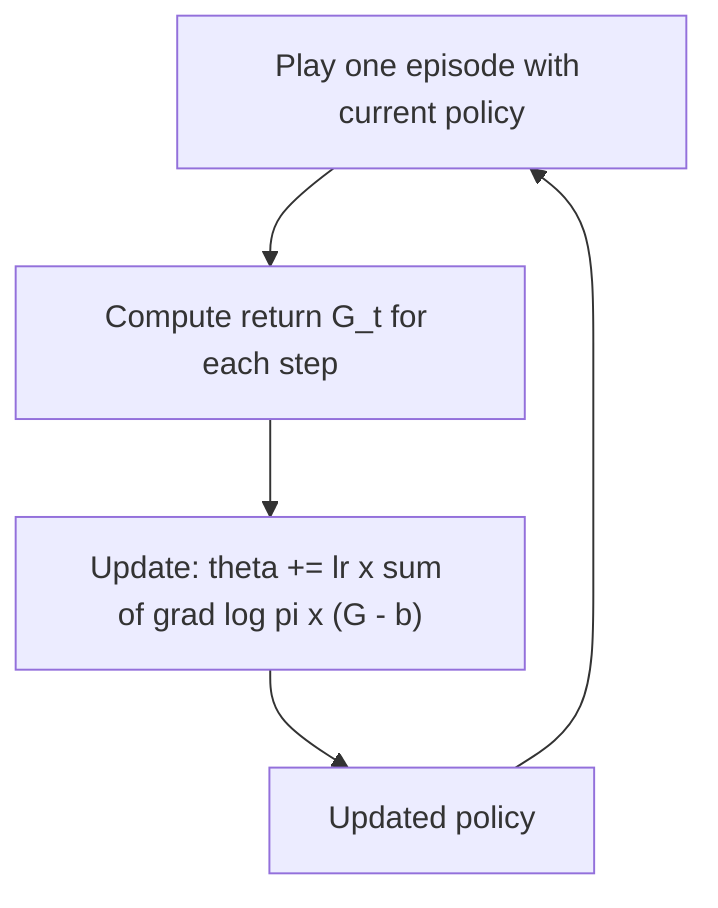

# What is Policy Gradient? The REINFORCE Algorithm Explained

> **Step 1: Machine Learning Foundations** · ⏱️ 18 min read · [Read original](https://outcomeschool.com/blog/policy-gradient-reinforce)

## TL;DR
Policy Gradient trains the policy directly: actions that led to high return become more likely, those that led to low return less likely. REINFORCE is the simplest version; it has high variance, which a baseline reduces, and it underlies PPO and GRPO for LLMs.

## Key Concepts
- **Value-based vs policy-based** — score every action then pick the highest, vs directly learn action probabilities and sample.
- **Policy network pi(a|s)** — state in, softmax probabilities out; weights are theta.
- **Gradient ascent** — we move up the gradient to increase expected return J(theta).
- **Monte Carlo method** — wait for the full episode and use real returns.
- **Baseline b** — subtract from the return to cut variance.
- **Advantage** — how much better an action was than the state's usual result.

## How It Works
**Estimate and update:**

$$\theta \leftarrow \theta + \eta\,\nabla_\theta \log \pi(a|s)\; G$$

Big positive G pushes hard toward the action; negative G pushes away.

**Why log?** $\nabla \log\pi = \nabla\pi / \pi$. Dividing by pi balances frequency: an action with probability 0.1 gets 10x push, one with 0.9 about 1.1x, so actions are judged by return, not how often they are picked. Logs also turn products of tiny probabilities into sums.

**REINFORCE (Williams, 1992):**
1. Play an episode with the current policy; record states, actions, rewards.
2. Compute returns backward: $G_t = r_t + \gamma G_{t+1}$ (rewards 1, 0, 10, gamma 0.9 give G = 9.1, 9.0, 10).
3. Update with the sum of $\nabla\log\pi(a_t|s_t)\,G_t$; repeat.

**Worked example:** two scores [0, 0] give probabilities 0.5/0.5. Pick Left, G=10, lr=0.1; gradient = [1,0] - [0.5,0.5] = [0.5,-0.5]; scores become [0.5,-0.5]; Left probability rises to 0.731. With G=-10 it falls to 0.269.

**High variance:** G depends on luck over a whole episode, so updates jump around; if all returns are positive, every action is pushed up.

**Baseline fix:** use $(G - b)$ with b e.g. average return. Returns 8, 10, 12 with b=10 give -2, 0, +2. It doesn't change the expected update direction, only variance. A learned state-value baseline gives Actor-Critic.

**LLM link:** policy = the LLM, state = prompt plus tokens so far, action = next token, return = answer score.
- PPO: learned critic baseline plus limits on how much the policy changes per update.
- GRPO: group average score as baseline, no critic needed.

## Diagram

## Key Takeaways
- Policy Gradient directly raises the probability of high-return actions.
- It uses gradient ascent on expected return, via $\nabla\log\pi \cdot G$.
- REINFORCE is Monte Carlo and high variance.
- Baseline subtraction stabilises learning without biasing it.
- PPO and GRPO are built on this idea.
