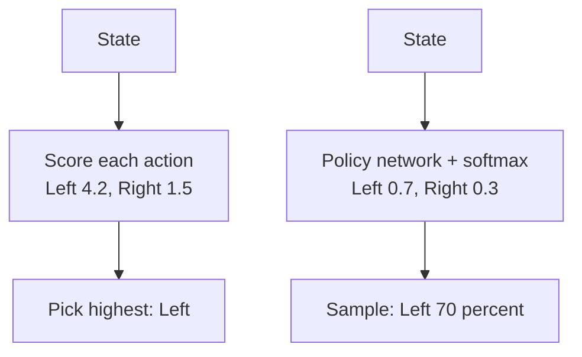
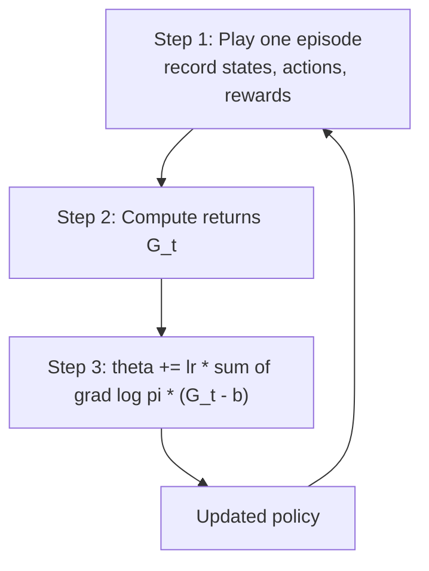

# What is Policy Gradient? The REINFORCE Algorithm Explained

> **Step 1: Machine Learning Foundations** · ⏱️ 18 min read · [Read original](https://outcomeschool.com/blog/policy-gradient-reinforce)

## TL;DR
Policy Gradient trains an agent by directly making actions that led to high return more likely and actions that led to low return less likely. REINFORCE is the simplest version: play an episode, compute returns, push the policy weights along $\nabla \log \pi \cdot G$. It is noisy (high variance), fixed by subtracting a baseline, and it underlies PPO/GRPO used for LLM training.

## Key Concepts
- **State / action / reward** — situation seen, move taken, number scoring the result.
- **Episode** — one full game start to end.
- **Return ($G$)** — total reward from a step till episode end.
- **Value-based methods** — learn a score per action per state (e.g. Q-learning), pick the highest; decide indirectly.
- **Policy-based methods** — learn directly "which action in this state"; decide directly.
- **Policy $\pi(a|s)$** — probability of action $a$ in state $s$; here a neural network with weights $\theta$.
- **Expected return $J(\theta)$** — average return over many episodes; the thing we maximize.
- **Gradient ascent** — go up the gradient to increase return (vs descent to reduce loss).
- **Discount factor $\gamma$** — number in (0,1) making far-future rewards count less.
- **Monte Carlo method** — waits for the full episode, uses real returns, no second model guessing values.
- **Variance** — how much the result jumps between tries.
- **Baseline $b$** — value subtracted from $G$ to reduce variance.
- **Advantage** — how much better an action was than the usual result from that state.

## How It Works

### Value-based vs policy-based
| | Value-based | Policy-based |
|---|---|---|
| Learns | score per action (Left 4.2, Right 1.5) | probability per action (Left 0.7, Right 0.3) |
| Chooses | highest score | samples from probabilities |

Policy-based is useful when there are too many actions to score one by one, or when the best behavior is to pick between actions with some probability.

### The policy network
State (e.g. game screen) goes into the network, which outputs raw scores (Left 0.85, Right 0.00). Softmax turns them into probabilities (0.7, 0.3) that sum to 1. The agent samples (Left 70%, Right 30%); the randomness keeps it trying different actions.

### Policy Gradient idea
Change $\theta$ to increase expected return: high return means action more likely next time in that state; low return means less likely. "Gradient" = direction to change weights to increase something. Going up the gradient is gradient ascent.

### The formula

$$
\nabla J(\theta) \approx \nabla \log \pi(a|s)\cdot G,\qquad \theta \leftarrow \theta + \alpha\,\nabla \log \pi(a|s)\,G
$$

- $\pi(a|s)$: probability given to the action actually taken; $\nabla\log\pi$: direction that makes that action more likely; $G$: return after it; $\alpha$: learning rate.
- Exact gradient would need every possible game, so it is estimated from games actually played.
- Large positive $G$ = strong push toward the action; small $G$ = small push; negative $G$ = push the opposite way.
- For a full episode, add the term for every step, each with its own return; the average over many episodes points in the true gradient direction.

### Why log probability?
- $\nabla\log\pi = \nabla\pi / \pi$.
- Sampling from its own policy, frequent actions get updated more just because they are picked often. Dividing by $\pi$ balances this: probability 0.1 gives factor 10; probability 0.9 gives about 1.1. Actions are judged by return, not frequency.
- Bonus: products of many small probabilities become tiny; log turns products into sums (easier numerically).

### REINFORCE (Williams, 1992)
1. **Play an episode** with the current policy; record states, actions, rewards.
2. **Compute returns** backward: $G_t = r_t + \gamma G_{t+1}$. Example: rewards 1, 0, 10, $\gamma=0.9$: $G_3=10$, $G_2=0+0.9\cdot10=9.0$, $G_1=1+0.9\cdot9.0=9.1$.
3. **Update**: $\theta \leftarrow \theta + \alpha \sum_t \nabla\log\pi(a_t|s_t)\,G_t$. Then repeat with the new policy.

One loop round uses exactly one episode. It is a Monte Carlo method.

### Worked example
One state, two actions, policy = two raw scores $\theta=[0,0]$ passed through softmax, so probabilities are [0.5, 0.5]. Agent picks Left, $G=10$, $\alpha=0.1$.
- For a softmax policy: $\nabla\log\pi(\text{Left}) = \text{one\_hot}(\text{Left}) - \text{probs} = [1,0]-[0.5,0.5]=[0.5,-0.5]$.
- Update: $0.1\cdot10\cdot[0.5,-0.5]=[0.5,-0.5]$, so new scores [0.5, -0.5].
- After softmax: Left goes 0.5 to 0.731 (Right 0.269).
- With $G=-10$: update is $[-0.5,0.5]$, Left drops to 0.269, Right 0.731.
- (Code subtracts max score inside softmax only for numerical safety; result unchanged.)

```python
grad_log_pi = np.eye(2)[action] - probs
theta = theta + lr * G * grad_log_pi
```

### High variance
- $G$ comes from a whole episode full of random choices and events, so the same action in the same state may get 50 once and 5 next time. Updates jump around; learning is slow and unstable and needs many episodes.
- If all returns are positive (e.g. 8 to 12), every taken action is pushed up, even bad ones; improvement happens only because good ones are pushed slightly more, very slowly.

### Baseline subtraction
Use $G-b$ instead of $G$ ($b$ e.g. average recent return):

$$
\theta \leftarrow \theta + \alpha\,\nabla\log\pi(a|s)\,(G-b)
$$

Returns 8, 10, 12 with baseline 10:
| Return | G - b | Effect |
|---|---|---|
| 8 | -2 | push down |
| 10 | 0 | no push |
| 12 | +2 | push up |

Does not change the average update direction, only reduces variance. A better baseline is the expected return of the current state from a second network: policy net + state-judging net = Actor-Critic, and $G$ minus that baseline estimates the advantage.

### Connection to LLM training
| RL | LLM |
|---|---|
| Policy | the LLM |
| State | prompt + tokens so far |
| Action | next token |
| Action probs | probs over vocabulary |
| Return | score of full answer (reward model or correctness check) |

High-scoring answer: all its tokens made a bit more likely; low-scoring: less likely.
- **PPO** — learned baseline (critic) and limits how much the policy changes per update.
- **GRPO** — samples a group of answers per prompt, uses the group's average score as baseline; no critic network.

## Diagrams

### Value-based vs policy-based decision


### REINFORCE loop


## Trade-offs & Pitfalls
- High variance from single-episode returns; slow, unstable, sample-hungry.
- Must wait for the full episode (Monte Carlo).
- All-positive returns push every action up; baseline fixes this.
- Baseline is safe: same average direction, lower variance.

## Key Takeaways
- Policy Gradient directly trains a policy network by gradient ascent on expected return.
- Update: $\nabla\log\pi(a|s)\cdot G$ — more push for bigger return, opposite push for negative.
- The log divides by $\pi$ so rare actions are not under-updated and it turns products into sums.
- REINFORCE = play episode, compute returns $G_t=r_t+\gamma G_{t+1}$, update; it is Monte Carlo.
- High variance is fixed by a baseline ($G-b$) without biasing the direction.
- A learned state baseline gives the advantage and leads to Actor-Critic/PPO.
- LLM as policy, token as action: PPO uses a critic baseline; GRPO uses the group-average baseline.
