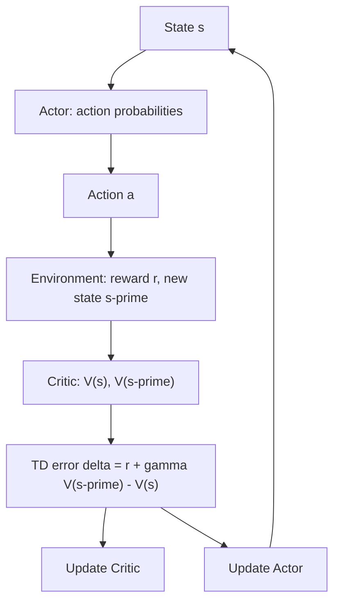

# What is Actor-Critic in Reinforcement Learning? The Advantage Function Explained

> **Step 1: Machine Learning Foundations** · ⏱️ 17 min read · [Read original](https://outcomeschool.com/blog/actor-critic)

## TL;DR
Actor-Critic splits an RL agent into an Actor (the policy that picks actions) and a Critic (a value function that judges each action right away). The judgment, the advantage, tells the Actor whether an action was better or worse than usual, fixing REINFORCE's late and noisy signal.

## Key Concepts
- **Actor** — policy network giving action probabilities.
- **Critic** — value network predicting V(s), the usual future reward from state s.
- **Advantage** $A(s,a) = Q(s,a) - V(s)$ — positive: make action more likely; negative: less likely; zero: unchanged.
- **TD error (delta)** — one-step estimate of the advantage using only the Critic.
- **A2C / A3C / PPO** — popular Actor-Critic algorithms.

## How It Works
**REINFORCE problems:** it waits until the episode ends (1,000 steps, zero learning meanwhile), and the return is noisy so one good action in a bad episode gets punished.

**Advantage example:** V(s)=10; Q(jump)=14, Q(wait)=7; so A(jump)=+4, A(wait)=-3. V(s) acts as the baseline, removing the luck of the state.

**TD error.** Since $Q(s,a) \approx r + \gamma V(s')$:

$$\delta = r + \gamma V(s') - V(s)$$

- Example 1: V(s)=9, r=2, V(s')=10, gamma=0.9 gives delta = +2 (better than expected).
- Example 2: V(s)=9, r=0, V(s')=5 gives delta = -4.5 (worse).
No Q network needed.

**Update loop (each step):**
1. Observe state s.
2. Actor gives probabilities; sample action a.
3. Environment returns r and s'.
4. Critic computes delta.
5. Critic update: $V(s) \leftarrow V(s) + \alpha_c \delta$ (9 to 9.2 in the code demo).
6. Actor update: raise action probability if delta > 0, lower if < 0 (jump 50% to 55%).
7. s' becomes s.

**Why better:** lower variance (judged against the state's usual value) and learns every step, so it suits long or endless tasks. Trade-off: TD error is slightly biased early because the Critic is imperfect, a good trade for lower variance.

**Where used:** A2C (synchronous, many environment copies), A3C (asynchronous workers), PPO (also limits how much the Actor changes per update). In RLHF the Actor is the LLM, the reward comes from a reward model, and the Critic is a value model giving a per-token advantage. GRPO removes the value model.

## Diagram

## Key Takeaways
- Actor decides; Critic evaluates; one TD error drives both updates.
- Advantage = how much better than usual, not how high the raw return was.
- $\delta = r + \gamma V(s') - V(s)$ estimates the advantage with only V.
- Lower variance and per-step learning beat REINFORCE.
- PPO is Actor-Critic; RLHF uses a value model as Critic.
