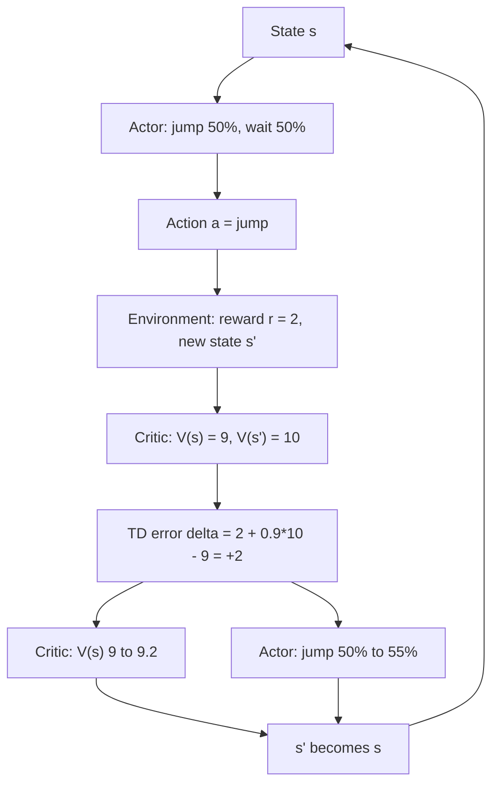
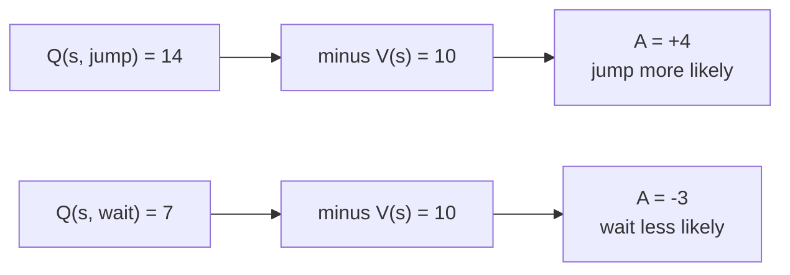

# What is Actor-Critic in Reinforcement Learning? The Advantage Function Explained

> **Step 1: Machine Learning Foundations** · ⏱️ 17 min read · [Read original](https://outcomeschool.com/blog/actor-critic)

## TL;DR
Actor-Critic uses two networks: an Actor (the policy) picks actions, and a Critic (a value function) judges each action right after it happens via the advantage, estimated by the TD error. One number, the TD error, updates both networks every step, giving lower variance than REINFORCE and learning without waiting for the episode to end.

## Key Concepts
- **State, action, reward, policy, episode** — standard RL terms (policy = rule used to pick actions).
- **Actor** — the policy; outputs action probabilities (e.g. jump 70%, wait 30%).
- **Critic** — value function; predicts $V(s)$, the total future reward usually obtained from state $s$.
- **$Q(s,a)$** — expected future reward if in $s$, take action $a$ first, then follow the policy.
- **Advantage $A(s,a)$** — $Q(s,a)-V(s)$: how much better/worse than usual an action is.
- **TD (Temporal Difference) error $\delta$** — difference between the Critic's prediction before a step and what it sees after.
- **Discount factor $\gamma$** — in (0,1), e.g. 0.9; future rewards count less.
- **A2C, A3C, PPO** — Actor-Critic algorithm families.

## How It Works

### Problem with REINFORCE
1. Waits until the end: a 1,000-step episode gives zero learning for 1,000 steps.
2. High variance: totals vary by luck; a good action in a bad episode is punished, a bad one in a lucky episode rewarded. Every action gets the same single end-of-episode score, so the agent cannot tell which of the 1,000 actions helped. Need a judge after each action.

### Actor and Critic
Both are usually neural nets and learn simultaneously. Analogy: batter (Actor) with a coach (Critic) saying "better/worse than your usual" after every shot instead of waiting for the match score.

### Advantage function
$$A(s,a)=Q(s,a)-V(s)$$
- Positive: better than usual, make more likely. Negative: worse, make less likely. Zero: unchanged.
- REINFORCE asks "was the total high?"; advantage asks "was this better than what we normally get here?" — removes the luck of the state itself (a great state makes everything look good; subtracting $V(s)$ takes that out).

### Advantage with numbers
$V(s)=10$, $Q(s,\text{jump})=14$, $Q(s,\text{wait})=7$:
- $A(\text{jump})=+4$ (make more likely), $A(\text{wait})=-3$ (make less likely).
- $V(s)$ is the baseline; actions are judged against it, not against zero.
- Problem: needs both $Q$ and $V$ (two networks). Solution: TD error.

### TD error
Estimate $Q(s,a)\approx r+\gamma V(s')$ (reward now + discounted value of the landing state $s'$). Plug in:
$$\delta = r+\gamma V(s')-V(s)$$
$\delta$ estimates the advantage and needs only the Critic.
- Example 1: $V(s)=9$, $r=2$, $V(s')=10$, $\gamma=0.9$: $\delta=2+9-9=+2$ (better than expected, positive advantage).
- Example 2: $V(s)=9$, wait, $r=0$, $V(s')=5$: $\delta=0+4.5-9=-4.5$ (worse, negative advantage).
- Judgment arrives after one step.

### Update loop (each step)
1. Observe state $s$.
2. Actor gives action probabilities; sample action $a$.
3. Environment returns $r$ and $s'$.
4. Critic computes $\delta=r+\gamma V(s')-V(s)$.
5. Critic update: $V(s)\leftarrow V(s)+\alpha_{critic}\,\delta$ (e.g. $\alpha=0.1$), moving toward $r+\gamma V(s')$.
6. Actor update using the same $\delta$: positive increases probability of $a$ in $s$, negative decreases; bigger $|\delta|$ means bigger change.
7. $s'$ becomes $s$; repeat.

One number ($\delta$) drives both updates.

### In code (Example 1)
Critic is a table, Actor is two logits [jump, wait] = [0,0] (50/50).
```python
delta = r + gamma * V["s_next"] - V["s"]      # 2.0
V["s"] += 0.1 * delta                         # 9 -> 9.2 (target is 11)
grad = -probs; grad[0] += 1                   # [0.5, -0.5]
logits += 0.1 * delta * grad                  # jump prob 50% -> 55%
```
Negative $\delta$ would push jump's probability down. Real systems do the same with $\delta$ scaling network weight updates.

### Why it works better
- **Lower variance** — judged by advantage vs. the state's usual value, not a noisy episode total.
- **Learns every step** — faster, and works for very long or never-ending tasks.
- Caveat: Critic is imperfect early on, so TD error is biased; a good trade for the large variance drop.

### Where it is used
- **A2C** — Advantage Actor-Critic; usually many environment copies at once, updates wait for all copies.
- **A3C** — Asynchronous; many workers update shared networks on their own without waiting.
- **PPO** — Actor-Critic that also limits how much the Actor changes per update for stability; one of the most used RL algorithms.
- **RLHF with PPO** — Actor = LLM (action = next token); reward from a reward model scoring the full answer; Critic = separate value model predicting answer quality from tokens so far, giving a per-token advantage. GRPO trains LLMs without a value model.

## Diagrams

### One Actor-Critic step


### Advantage as Q minus baseline


## Trade-offs & Pitfalls
- TD error is biased because the Critic is imperfect (esp. early); accepted for lower variance.
- Two networks to train together.
- REINFORCE alternative: unbiased full return but delayed and noisy.

## Key Takeaways
- Actor = policy; Critic = value function $V(s)$; both learn together.
- Advantage $=Q(s,a)-V(s)$: better or worse than usual from that state.
- TD error $\delta=r+\gamma V(s')-V(s)$ estimates advantage using only $V$, so no Q network is needed.
- One $\delta$ updates both: Critic moves $V$ toward target, Actor scales action probability by $\delta$.
- Beats REINFORCE: lower variance and per-step learning, at the cost of some bias.
- A2C (sync), A3C (async), PPO (clipped change) are Actor-Critic; RLHF-PPO uses an LLM Actor and a value-model Critic.
