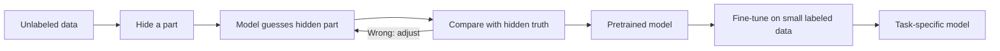

# How does Self-Supervised Learning work?

> **Step 1: Machine Learning Foundations** · ⏱️ 12 min read · [Read original](https://outcomeschool.com/blog/self-supervised-learning)

## TL;DR
In Self-Supervised Learning the data creates its own labels: hide part of unlabeled data and make the model predict it. This removes the human-labeling bottleneck and powers LLMs and many image models via pretraining followed by fine-tuning.

## Key Concepts
- **Label** — the correct answer for a data item.
- **Supervised learning problem** — human labels are slow, expensive and need experts (doctors, lawyers), while most data is unlabeled.
- **Self-supervised learning** — the data itself is the supervisor; the hidden part is the answer.
- **Pretraining** — play the guessing game on huge unlabeled data; yields a pretrained model.
- **Fine-tuning** — teach one specific task with a small labeled set.

## How It Works
**Recipe:**
1. Take unlabeled data.
2. Hide a part.
3. Model guesses the hidden part.
4. Compare with what we hid (the answer).
5. If wrong, adjust the model; repeat millions of times.

**Text example:** "The cat is sitting on the ____" with answer "mat". Over billions of sentences the model learns grammar, meaning and facts. LLMs are pretrained this way, predicting the next or a hidden token.

**Image examples:** cover part of a dog photo with a gray box and have the model reconstruct it; or create two altered versions (crop, colour, rotation) of one photo and teach the model they are the same (see contrastive learning).

**Two phases:**

| Point | Pretraining | Fine-tuning |
|---|---|---|
| Data | Huge unlabeled | Small labeled |
| Labels from | The data itself | A human |
| Goal | General knowledge | One specific task |
| Cost/time | Cheap labels, long | Few labels, short |

**Why it works:** abundant data (internet text, images, video), huge savings on labeling, and deep general understanding that transfers to many tasks.

**Uses:** language models, image models, speech models, recommendation (predict next item), medical AI (pretrain on unlabeled scans, fine-tune on few labeled ones).

## Diagram

## Key Takeaways
- The hidden part is the label, so no human labeling is needed in pretraining.
- Pretraining learns general knowledge; fine-tuning specialises with little labeled data.
- LLMs are pretrained with self-supervision (next or hidden token prediction).
- Core pattern everywhere: hide, guess, learn from the mistake.
