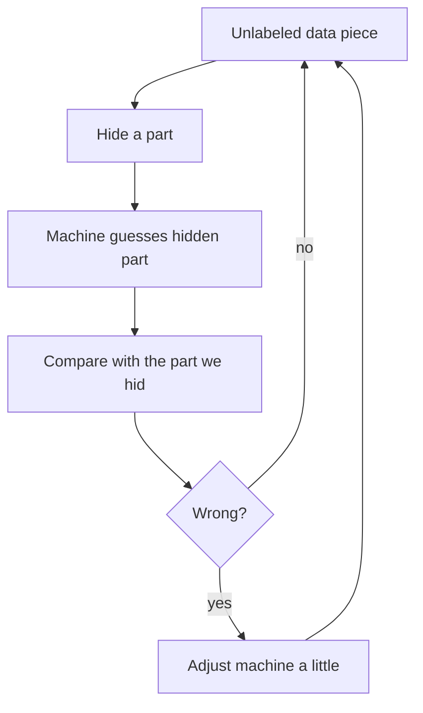
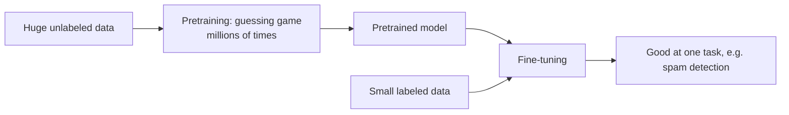

# How does Self-Supervised Learning work?

> **Step 1: Machine Learning Foundations** · ⏱️ 12 min read · [Read original](https://outcomeschool.com/blog/self-supervised-learning)

## TL;DR
Self-Supervised Learning (SSL) lets the data create its own labels: hide a part of unlabeled data, have the model predict it, and compare against the hidden part. It is done at massive scale in pretraining, then a small labeled set fine-tunes the model for a specific task. This is how LLMs and many image models start.

## Key Concepts
- **Supervised Learning** — learn from examples that each carry a correct answer (label) written by a human.
- **Label** — correct answer for a data piece (photo of dog -> "dog").
- **Self-Supervised Learning** — the data acts as the supervisor; no human labeling.
- **Pretraining** — phase 1: guessing game on huge unlabeled data.
- **Pretrained model** — model that already understands language/images basics.
- **Fine-tuning** — phase 2: teach one specific task with a small labeled set.

## How It Works

### Why supervised learning struggles
Labels come from humans: slow and expensive (1 million photos need 1 million human labels). Domain data is harder: doctors for medical images, lawyers for legal docs. Meanwhile billions of web pages, photos, videos have no labels.

### The SSL recipe
1. Take an unlabeled data piece.
2. Hide a part of it.
3. Machine guesses the hidden part.
4. Compare guess with the hidden part (the known answer).
5. If wrong, adjust the machine a little; repeat millions of times.

Supervision comes from the data, not a person.

### Example: text
"The cat is sitting on the mat." Hide "mat" -> "The cat is sitting on the ____." Machine guesses e.g. "chair"; correct is "mat" (we hid it), so adjust. Repeating over billions of internet sentences, it learns grammar, meaning, facts ("sitting on the" is followed by mat/chair/floor). LLMs are pretrained like this, predicting the next token or a hidden token, with zero hand labels.

### Example: images
- Cover part of a dog photo (e.g. the face) with a gray box; the model draws the hidden face from body, ears, tail; compare with the real face.
- Second puzzle: make two slightly different versions of one photo (crop, color shift, rotate) and ask the model to recognize they are the same photo. It learns shapes, edges, textures without being told the object (see Contrastive Learning).

### Two phases
| Point | Pretraining | Fine-tuning |
|---|---|---|
| Data | huge unlabeled | small labeled (e.g. few thousand spam emails) |
| Labels from | the data itself | a human |
| Goal | general knowledge | one specific task |
| Cost | cheap, no human labeling | small, few labels |
| Time | long | short |

The hard, expensive part (understanding) uses free unlabeled data; the final task needs little labeled data.

### Why it works so well
- **Data** — internet text/images/video can be used since no labels needed.
- **Cost** — no human labeling of billions of examples.
- **Understanding** — repeated guessing teaches deep patterns (grammar, facts, shapes, meaning) useful across many tasks.

### Where it is used
- Language models (predict hidden/next words)
- Image models (predict hidden patches or match two views)
- Speech models (predict hidden sound parts)
- Recommendation (predict next item in history)
- Medical AI (pretrain on unlabeled scans, fine-tune on a few doctor-labeled scans)

### FAQ
- LLMs use SSL? Yes, next/hidden-token prediction.
- Any labeled data needed? Not for pretraining; only a little for fine-tuning.
- Why "self-supervised"? Supervision comes from the data since we know what we hid.

## Diagrams

### The SSL loop

### Pretraining then fine-tuning

## Trade-offs & Pitfalls
- Plain supervised learning is bottlenecked by costly expert labels; SSL removes that for pretraining.
- Fine-tuning still needs some labeled data (small).

## Key Takeaways
- SSL = hide part of data, predict it; the hidden part is the label.
- No human labeling in pretraining, so it scales to internet-size data.
- Two phases: pretrain on unlabeled data, fine-tune on small labeled data.
- LLMs are SSL-pretrained via next/hidden-token prediction.
- Works for text, images, speech, recommendations, medical scans.
- Benefit: more data, lower cost, general understanding reusable across tasks.
