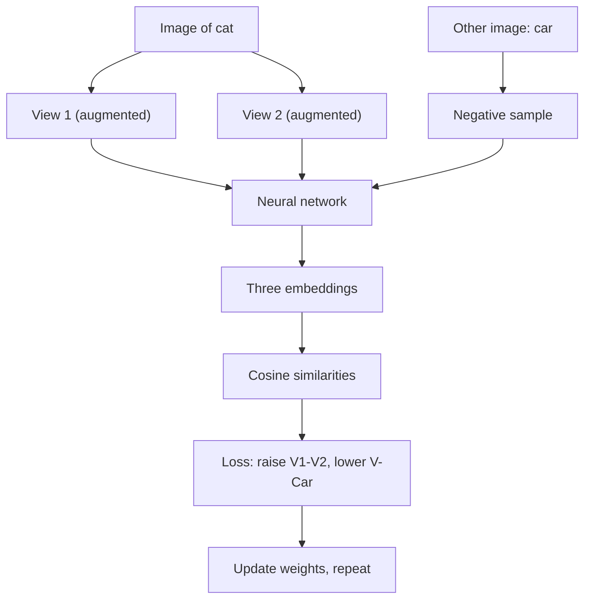
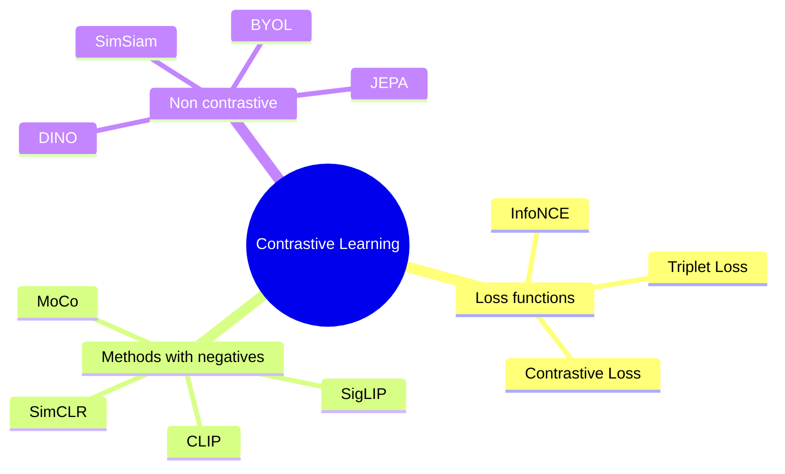

# What is Contrastive Learning?

> **Step 1: Machine Learning Foundations** · ⏱️ 15 min read · [Read original](https://outcomeschool.com/blog/contrastive-learning)

## TL;DR
Contrastive Learning is a self-supervised technique that learns embeddings by pulling similar items (positive pairs) close and pushing dissimilar ones (negative pairs) apart in embedding space. Pairs are built from the data itself via augmentation, so no human labels are needed. Learned embeddings are reused for search, classification, clustering, etc.

## Key Concepts
- **Embedding / representation** — vector a model maps an input to; **embedding space** is where they live.
- **Positive pair** — two similar samples, should be close (e.g. two augmentations of one image, two same-meaning sentences, image + caption).
- **Negative pair** — two different samples, should be far.
- **Data augmentation** — crop, rotate, flip, recolor; changes look, not meaning.
- **Cosine similarity** — direction closeness of vectors, -1 to 1 (near 1 = similar).
- **Anchor** — reference sample (in triplet / InfoNCE).
- **Temperature** — in InfoNCE, controls sharpness of decisions.
- **Zero-shot classification** — classifying without task-specific training.

## How It Works

### Why needed
Supervised learning needs costly labels, while the internet has billions of unlabeled images/videos/text. Contrastive Learning is self-supervised: the model creates labels from data, learns representations on unlabeled data, then reuses them for downstream tasks with very little labeled data. Intuition: magnets — similar attract, dissimilar repel.

### Making pairs
- Augment one image twice -> positive pair; any other image -> negative.
- Augmentations must change appearance but not meaning (cropped/rotated cat is still a cat), so the model ignores surface changes and focuses on content.
- Text: two same-meaning sentences. Image-text: image + caption. Search: query + answering passage (positive) vs non-answering (negative), as in ColBERT.

### Step-by-step (cat example)
1. Two augmented views of a cat (View 1, View 2) = positive pair.
2. Another image (car) = negative.
3. Pass all three through a neural network -> three embeddings.
4. Compute cosine similarities. Fresh start: sim(V1,V2)=0.3, sim(V1,Car)=0.6, sim(V2,Car)=0.5 — wrong (cats less similar than cat-car), so loss is high and weights update.
5. Train to raise sim(V1,V2), lower sim with car. Target: 0.9, 0.1, 0.1.
6. Repeat over many images until embeddings are good.

### Loss functions
| Loss | Samples | Idea |
|---|---|---|
| Contrastive Loss | pair | Similar: small loss when close. Different: small loss when farther than margin. Margin 1.0: distance 0.2 for different images = high loss; at 1.5 loss = 0 |
| Triplet Loss | anchor, positive, negative | Anchor-positive distance must be smaller than anchor-negative by a margin (face recognition: two photos of person A pulled together, person B pushed away) |
| InfoNCE | 1 anchor, 1 positive, many negatives | Classification: pick the positive among all; most popular (SimCLR, CLIP). Temperature: small = confident, large = softer |

### Methods
- **SimCLR** (Google, Simple Framework for Contrastive Learning of Visual Representations) — two augmented views (anchor, positive) through same network; negatives are augmented other images in the batch; InfoNCE loss. Showed simple augmentation is enough for strong image representations. Needs large batches (GPU memory).
- **MoCo** (Momentum Contrast) — negatives held in a dynamic queue (add new mini-batch, drop oldest), so many negatives without large batch; a slowly updated momentum encoder computes queue embeddings, keeping them fresh and training stable.
- **CLIP** (OpenAI) — positive = image + correct caption; negatives = other captions in batch; trained on millions of internet pairs. Zero-shot: compare image of a puppy with "a photo of a cat/dog/bird" and pick highest similarity. Used in Stable Diffusion and DALL-E.
- **SigLIP** (Google, 2023) — replaces CLIP's softmax loss with pairwise sigmoid loss; more memory-efficient, larger batches; common vision encoder in vision-language models.
- **Non-contrastive (BYOL, SimSiam, DINO, DINOv2)** — no negatives; only positives, using stop-gradient, momentum encoders, predictor heads, output centering to avoid collapse to one embedding. DINO/DINOv2 (Meta) are go-to for self-supervised visual representations. **JEPA** (LeCun's team) predicts a summary of a hidden part from the visible part, no pair comparison.

### Use cases
Image search, face recognition, recommendations (co-bought items close), text similarity (search/chatbots), multimodal models (CLIP-style), medical imaging (unlabeled scans), audio/speech. After embeddings, use ANN search to find nearest ones quickly.

### FAQ
- Supervised or unsupervised? Self-supervised.
- All SSL needs negatives? No, non-contrastive methods drop them.
- SimCLR vs MoCo? In-batch negatives (large batch) vs queue + momentum encoder.
- Contrastive vs Triplet loss? Pair vs anchor/positive/negative with margin.

## Diagrams

### Training flow with pairs

### Method taxonomy

## Trade-offs & Pitfalls
- Augmentation choice is critical: it must keep meaning.
- SimCLR needs large batches -> lots of GPU memory (MoCo's queue fixes it).
- Temperature must be tuned in InfoNCE.
- Methods without negatives risk collapse (all inputs to one embedding) and need architectural tricks.

## Key Takeaways
- Pull positives together, push negatives apart in embedding space; no human labels.
- Positives come from augmentations (or captions, paraphrases); negatives from other samples.
- Contrastive Loss uses pairs with a margin; Triplet uses anchor/positive/negative; InfoNCE uses many negatives and temperature.
- SimCLR: in-batch negatives. MoCo: queue + momentum encoder. CLIP: image-caption, enables zero-shot.
- BYOL/SimSiam/DINO avoid negatives with stop-gradient, momentum, predictor, centering.
- Embeddings are reused for search, classification, clustering, recommendation, multimodal generation.
