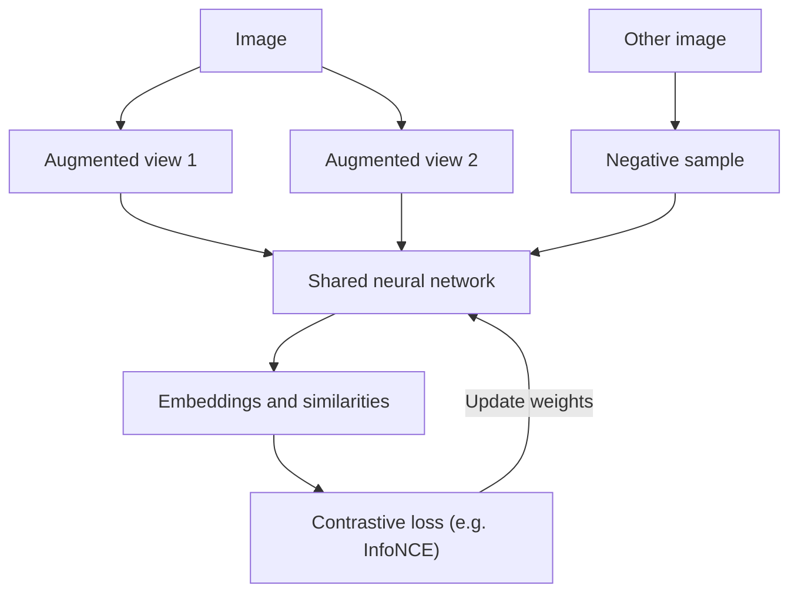

# What is Contrastive Learning?

> **Step 1: Machine Learning Foundations** · ⏱️ 15 min read · [Read original](https://outcomeschool.com/blog/contrastive-learning)

## TL;DR
Contrastive Learning is a self-supervised technique that teaches a model good embeddings by pulling similar items (positive pairs) together and pushing different items (negative pairs) apart. It needs no human labels and underpins models like SimCLR and CLIP.

## Key Concepts
- **Embedding space** — vectors the model maps inputs to; similar inputs should be close.
- **Positive pair** — two similar samples (two augmented views of one image; an image and its caption).
- **Negative pair** — two different samples (views of different images).
- **Cosine similarity** — direction closeness, from -1 to 1.
- **Temperature** — in InfoNCE, controls how sharp decisions are.
- **Zero-shot classification** — classifying with labels never trained on.

## How It Works
**Why:** labels are costly while unlabeled data is abundant. Pretrained embeddings can be reused for classification, search, clustering with little labeled data. Augmentations must change appearance, not meaning (a cropped cat is still a cat).

**Step by step (cat example):**
1. Make two augmented views of a cat image (positive pair).
2. Take another image, e.g. a car (negative).
3. Pass all through a network to get embeddings.
4. Compute similarities. Initially: View1-View2 = 0.3, View1-Car = 0.6, View2-Car = 0.5 (wrong, high loss).
5. Train to raise the positive similarity and lower the negative ones; target roughly 0.9, 0.1, 0.1.
6. Repeat over many images.

**Loss functions:**

| Loss | Works on | Idea |
|---|---|---|
| Contrastive Loss | A pair | Pull similar pairs together; push different pairs apart beyond a margin |
| Triplet Loss | Anchor, positive, negative | Anchor closer to positive than negative by a margin (face recognition) |
| InfoNCE | One anchor, one positive, many negatives | Pick the positive out of all samples, like classification; used by SimCLR and CLIP |

**Methods:**
- *SimCLR* — two augmented views, negatives are other images in the batch; needs a large batch.
- *MoCo* — queue of negatives plus a slowly updated momentum encoder, so no huge batch needed.
- *CLIP* — matches images with captions; enables zero-shot classification; used in Stable Diffusion and DALL-E. SigLIP replaces the softmax loss with a pairwise sigmoid loss.
- *Non-contrastive* (BYOL, SimSiam, DINO, JEPA) — drop negatives; use tricks like stop-gradient and momentum encoders to avoid collapse.

**Uses:** image search, face recognition, recommendations, text similarity, multimodal models, medical imaging, audio and speech.

## Diagram

## Key Takeaways
- Pull positives together, push negatives apart in embedding space.
- Pairs come from the data itself, so no human labels (self-supervised).
- InfoNCE is the dominant loss; temperature matters.
- SimCLR needs big batches, MoCo uses a queue, CLIP aligns text and images.
- Non-contrastive methods can learn without negatives.
