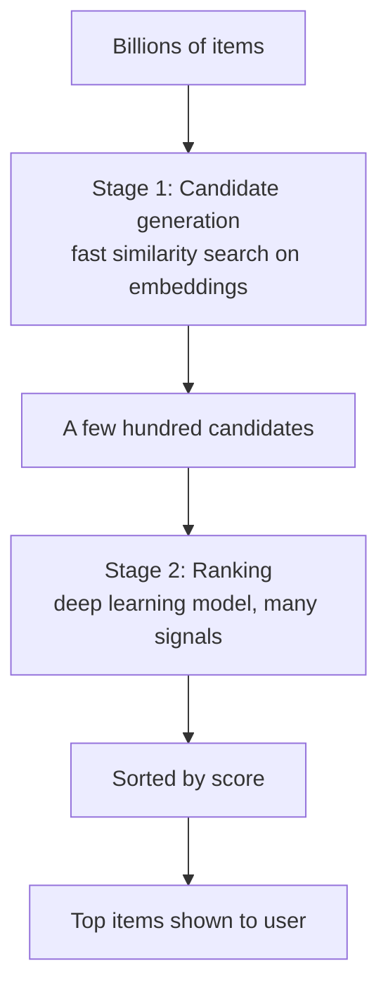
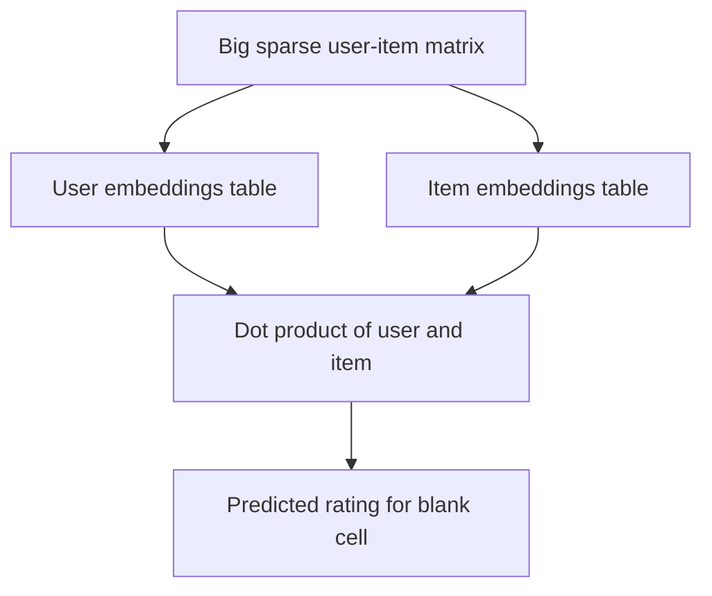

# How does a Recommendation System work?

> **Step 1: Machine Learning Foundations** · ⏱️ 21 min read · [Read original](https://outcomeschool.com/blog/recommendation-system)

## TL;DR
A Recommendation System predicts how much a user will like items they have not seen and shows the top-scoring ones. It builds on content-based and collaborative filtering, learns user and item embeddings via matrix factorization, handles cold start with hybrid methods, and at scale uses a fast candidate-generation stage followed by a precise ranking stage.

## Key Concepts
- **Too much choice** — thousands or millions of items make manual search impractical; recommenders show only the likely best few.
- **Goal** — (1) predict a score for unseen items, (2) sort by score and show the top.
- **Content-based filtering** — recommend items similar to those we liked, using item features (genre, actors, director, language, year).
- **Collaborative filtering** — use the behavior of many users; needs no item features.
- **User-item interaction matrix** — rows = users, columns = items, cells = interaction (e.g. rating).
- **Sparse matrix** — mostly empty.
- **Explicit feedback** — user states opinion (rating, like, review).
- **Implicit feedback** — inferred from behavior (watch time, clicks, cart adds).
- **Embedding** — vector of numbers capturing hidden traits of a user or item.
- **Dot product** — multiply matching numbers and sum; measures alignment.
- **Cold start** — new user or item with no history.
- **Hybrid system** — combines several techniques.

## How It Works

### Content-based filtering
- Compare feature values; close items are similar (see Cosine Similarity).
- Example (action, romance): A (loved) = 0.9, 0.1; B = 0.8, 0.2 (very similar, recommend); C = 0.1, 0.9 (far, skip).
- Plus: works even if no user has touched the item.
- Minus: keeps recommending the same type, a **filter bubble** (only action movies shown, never a great comedy).

### Collaborative filtering
- **User-based** ("people like you also liked this"): Riya and Sam liked the same nine movies; Sam also liked Movie10, so recommend Movie10 to Riya.
- **Item-based** ("people who liked this also liked that"): many phone buyers also bought a particular cover, so recommend it to new buyers. It ignores item features, only co-behavior.

| Approach | Uses | Core idea |
|---|---|---|
| Content-based | Item features | Similar to what we liked |
| User-based CF | Similar users' behavior | People like us liked this |
| Item-based CF | Behavior across items | Liked this, also liked that |

### User-item interaction matrix
Example (dash = unknown):

| | Movie1 | Movie2 | Movie3 | Movie4 |
|---|---|---|---|---|
| Riya | 5 | 4 | - | - |
| Sam | 5 | - | 4 | - |
| Aman | - | - | 5 | 4 |
| Neha | 1 | 2 | - | 5 |

Real matrices are enormous and sparse. The real job is to fill the blank cells (e.g. guess Aman's rating for Movie1).

### Explicit vs implicit feedback
| Type | What | Example | Quality |
|---|---|---|---|
| Explicit | User states opinion | Rating, like, review | Accurate but rare |
| Implicit | Inferred from behavior | Watch time, clicks, purchases | Plentiful but noisy |

Noise example: video left playing while the user walked away. Modern systems rely mostly on implicit feedback because there is far more of it.

### Matrix factorization and embeddings
- Breaks the big matrix into two small tables: user embeddings and item embeddings, whose dot products rebuild the ratings.
- Toy traits [action, romance]: Riya = [0.9, 0.1]; Movie1 = [0.95, 0.05]; Movie4 = [0.1, 0.9].
- Riya x Movie1 = 0.9x0.95 + 0.1x0.05 = 0.855 + 0.005 = 0.86 (high, recommend).
- Riya x Movie4 = 0.9x0.1 + 0.1x0.9 = 0.18 (low, skip).
- High dot product = user taste and item traits aligned.
- In reality traits are not hand-picked: start with random embeddings, compare guesses to known ratings, adjust slowly to reduce error (Gradient Descent). Learned traits may have no human names but work.
- Any blank cell = dot product of that user's and item's embeddings.

### Cold-start problem
- **New user:** CF has no behavior. Fixes: ask for favorite genres at signup, show popular items, use country/device/age group.
- **New item:** no behavior pattern. Fixes: content-based (genre, actor, director), show to a small group first then expand if response is good.
- CF is strong with data; content-based helps with none, so real systems are hybrid.

### Two-stage design (candidate generation then ranking)
1. **Candidate generation:** cut billions of items to a few hundred, favoring speed over perfection. Uses embeddings and fast similarity search to find items near the user embedding. Several generators run at once (collaborative, trending, recent activity) and pool results.
2. **Ranking:** a small list allows a powerful, expensive deep learning model. Signals: user and item embeddings, time of day and device, freshness/popularity, recent watch history, how long similar users watched. Predicts a final score (often chance of click and engagement), sorts, shows top few.

Fast and rough for scale, slow and precise for the shortlist. Same two-stage idea as a Reranker in search.

### Putting it together (YouTube flow)
Several candidate generators pull a few hundred videos (history, trending, similar users), the ranker scores them with embedding, time, device and other signals, sort, show top. Every user sees a different home screen.

## Diagram(s)

### Two-stage pipeline

### Matrix factorization

## Trade-offs & Pitfalls
- Content-based: filter bubble; needs item features.
- Collaborative: useless for brand-new users or items (cold start).
- Explicit feedback: clean but scarce; implicit: abundant but noisy.
- Ranking on all items is too slow, hence two stages.

## FAQ
- Content-based vs item-based CF? → Content-based compares actual features; item-based only notices the same people like both items.
- Hybrid system? → Uses more than one technique, usually content-based plus collaborative, to cover each other's gaps.
- Why mostly implicit feedback? → Far more plentiful than ratings, though noisy.
- Filter bubble? → Seeing only more of what we already know, from content-based filtering.

## Key Takeaways
- Goal: predict scores for unseen items, then rank and show the top.
- Content-based uses item features; collaborative uses crowd behavior.
- The user-item matrix is sparse; recommendation means filling its blanks.
- Matrix factorization learns user/item embeddings; their dot product predicts preference.
- Implicit feedback is plentiful but noisy; explicit is accurate but rare.
- Cold start is handled with onboarding questions, popularity, and content-based features, so use hybrids.
- Big platforms use candidate generation (fast) then ranking (precise).
