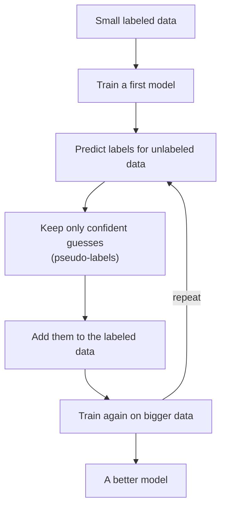
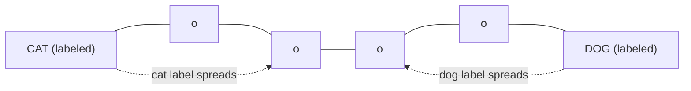

# How does Semi-Supervised Learning work?

> **Step 1: Machine Learning Foundations** · ⏱️ 7 min read · [Read original](https://outcomeschool.com/blog/semi-supervised-learning)

## TL;DR
Semi-supervised learning trains a better model by combining a small amount of labeled data with a large amount of cheap unlabeled data. It relies on the assumption that similar points share the same label, and uses methods like self-training and label propagation to spread labels to unlabeled points. It matters when labels are expensive but raw data is plentiful.

## Key Concepts
- **Labeled data** — data with a known answer (a photo tagged "cat"; the answer is the label).
- **Unlabeled data** — data with no answer attached (a photo with no tag).
- **Semi-supervised learning** — uses a few labels plus lots of unlabeled data to train a better model.
- **Key assumption** — points that are close or look similar probably share the same label.
- **Self-training (pseudo-labeling)** — the model labels unlabeled data itself and learns from its confident guesses.
- **Pseudo-label** — a label the model guesses for an unlabeled example.
- **Label propagation** — labels spread across a graph of similar points, like color spreading on a map.

## How It Works

### Labeled vs unlabeled, and why labels are costly
- Supervised learning needs labeled data (examples with answers).
- Unlabeled data is everywhere and cheap (photos, text, audio). Labeled data is expensive and slow because a human must look at each item and write the answer.
- Example: 1,000,000 unlabeled photos are easy to collect, but labeling all by hand is costly and slow; labeling a few hundred (say 500) is affordable.
- Question: can we use both together? That is semi-supervised learning.

### Where it sits

| Method | Data used |
|---|---|
| Supervised | Only labeled data |
| Unsupervised | Only unlabeled data |
| Semi-supervised | A few labels + lots of unlabeled data |

Goal: a model often close to one trained on many more labels, using only a few hundred labels plus cheap unlabeled data. (Self-supervised learning is a different way to learn from unlabeled data, where the data creates its own labels.)

### The key assumption
Similar or nearby points probably share the same label. If an unlabeled photo looks a lot like a labeled "cat" photo, it is probably a cat. This lets labels spread from the few labeled points to many nearby unlabeled ones.

### Self-training (pseudo-labeling)
1. Train a first model on only the small labeled data.
2. Use it to predict labels for the unlabeled data (pseudo-labels).
3. Keep only the most confident guesses and add them to the training data as if they were real labels.
4. Train again on the bigger combined data.

Repeat and the model keeps improving. It labels easy, confident cases first, then uses them to learn harder ones, hence "self"-training.

### Label propagation
- Imagine all points connected in a graph where similar points are linked.
- Start with labels on only a few points; each label spreads to its neighbors step by step.
- Example: a CAT point and a DOG point at the ends of a chain; points near the cat become cat, points near the dog become dog. Each point ends up with the label of the labeled points it is most strongly connected to.

### Where it is used
- **Medical images** — experts are needed to label scans; label a few, use many unlabeled.
- **Speech recognition** — huge audio, few written transcripts.
- **Web page classification** — billions of pages, few hand-labeled.
- **Fraud detection** — very few confirmed frauds, millions of unlabeled transactions.

## Diagram(s)

### Self-training loop

### Label propagation on a graph

## Trade-offs & Pitfalls
- Everything rests on one assumption: similar points share a label. The blog presents this as the reason it works.
- In self-training, only confident pseudo-labels are added, since they are treated as if they were real labels.
- Best used when labels are expensive but unlabeled data is cheap and plentiful.

## Key Takeaways
- Semi-supervised learning sits between supervised (labels only) and unsupervised (no labels): it uses both.
- Motivation: unlabeled data is cheap and abundant, labeled data is costly because humans must annotate it.
- Core assumption: close or similar points probably share the same label.
- Self-training: train on labels, predict pseudo-labels, keep confident ones, retrain, repeat.
- A pseudo-label is a model-guessed label for an unlabeled example.
- Label propagation spreads labels from a few labeled points through a similarity graph.
- Typical uses: medical scans, speech recognition, web page classification, fraud detection.
