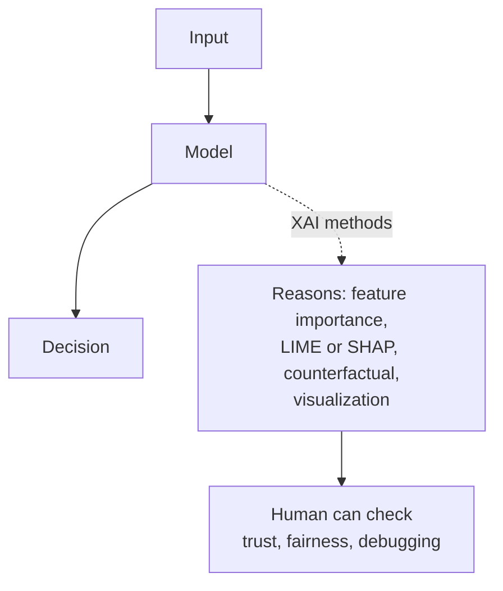

# What is Explainable AI?

> **Step 1: Machine Learning Foundations** · ⏱️ 7 min read · [Read original](https://outcomeschool.com/blog/explainable-ai-xai)

## TL;DR
Explainable AI (XAI) is a set of methods that reveal why a model made a decision, in reasons a human can follow. It opens up black-box models such as deep neural networks, which are accurate but hide their reasoning, so decisions like loans or medical scans can be trusted, checked, and justified.

## Key Concepts
- **Black box** — we see input and output but not the reasoning inside (e.g. deep neural networks).
- **Explainable AI (XAI)** — methods giving human-understandable reasons for a decision.
- **Global explanation** — how the model behaves overall.
- **Local explanation** — why the model made one specific decision.
- **Feature importance** — which inputs mattered most.
- **LIME / SHAP** — measure how much each input pushed the decision toward or away from the result; SHAP fairly splits credit among inputs.
- **Counterfactual** — smallest change that would flip the decision.

## How It Works

### Problem and fix
Black box: "Loan rejected." XAI: "Loan rejected, mainly because income was low and existing debt was high." A mysterious answer becomes one we can understand and check. This matters when stakes are high (loan approval, reading a medical scan).

### Why it matters
- **Trust** — more trust when we know why.
- **Fairness** — catch unfair bias (rejecting for wrong reasons).
- **Debugging** — find and fix the cause of wrong outputs.
- **Rules and law** — in finance and health a reason may be legally required; in many places a person has a right to know why they were rejected.

### Global vs local
| Type | Answers | Example |
|---|---|---|
| Global | How the model behaves in general | Income is the most important factor overall |
| Local | Why this one decision | This loan was rejected due to this person's high debt |

### Common methods
| Method | What it gives |
|---|---|
| Feature importance | Which inputs mattered most (income, debt) |
| LIME and SHAP | How much each input pushed the decision |
| Counterfactual | Smallest flip-the-decision change, e.g. "if income were 5,000 higher, approved"; easy to act on |
| Visualization | For images, highlight regions/pixels the model focused on (e.g. why "cat") |

Each gives a different kind of reason; choose by need.

### Accuracy vs explainability
- Simple models (small decision tree): easy to explain, sometimes less accurate.
- Complex models (deep networks): often more accurate, harder to explain.
- Either choose a simpler model to explain it, or keep the complex model and add XAI methods on top. Depends on how much the explanation matters.

### Where it is used
- Finance: why a loan or card was approved or rejected.
- Healthcare: why a scan was flagged so a doctor can check reasoning.
- Hiring: ensure screening is fair and unbiased.
- Any high-stakes decision.

## Diagram(s)

### Black box vs explainable

## Trade-offs & Pitfalls
- Simple, explainable models may lose accuracy; accurate complex models need extra XAI tooling.
- Different methods answer different questions, so match method to need (global vs local).

## FAQ
- What does SHAP do? → Measures each input's push toward or away from the result, fairly splitting credit.
- Counterfactual? → Smallest change that flips the decision; actionable.
- Is a decision tree explainable? → Yes if small, but may be less accurate.
- Can law require explanations? → Yes, in finance and health, e.g. why a loan was rejected.

## Key Takeaways
- A black box shows decisions but not reasons; XAI supplies reasons.
- Reasons build trust, expose bias, aid debugging, and meet legal needs.
- Global explains overall behavior; local explains one decision.
- Methods: feature importance, LIME/SHAP, counterfactuals, visualization.
- Simpler models are easier to explain but may be less accurate.
- Essential for high-stakes areas like finance, healthcare, and hiring.
